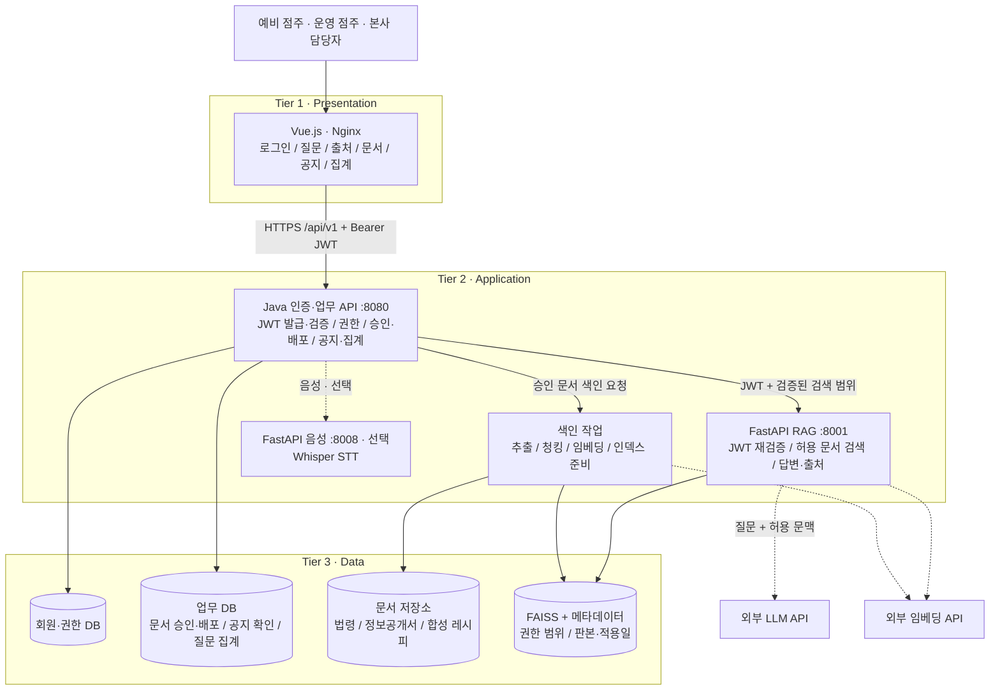

# frangizer — 가맹파트너 AI

> **점주는 문서에서 업무 기준을 찾고, 본사는 반복되는 문의를 보고 문서를 고치는 프랜차이즈 업무 지원 서비스**

운영 중인 가맹점주가 레시피·위생·고객 분쟁 기준을 물으면 **RAG**가 등록된 문서에서 근거를 찾아 답하고, 출처·판본·자료 성격을 함께 보여줍니다. 본사는 쌓인 질문을 주간·지역별로 확인해 문서를 보완하고, 새 판본을 배포해 점포에 공지와 확인 요청을 보냅니다.

> ⚠️ SKALA AI 서비스 개발 미니 프로젝트의 **시연용 서비스**입니다. 실제 브랜드의 공식 서비스가 아니며, 레시피·점포·계정·문의 데이터는 팀이 만든 **합성 자료**입니다.
>
> 📌 현재 상태: 기획과 API 계약을 확정한 단계입니다. 서버·화면 구현은 진행 예정입니다.

---

## 목차

- [해결하려는 문제](#해결하려는-문제)
- [주요 기능](#주요-기능)
- [AI의 역할과 서비스 경계](#ai의-역할과-서비스-경계)
- [아키텍처](#아키텍처)
- [기술 스택](#기술-스택)
- [데이터](#데이터)
- [API](#api)
- [폴더 구조](#폴더-구조)
- [실행 방법](#실행-방법)
- [평가 계획](#평가-계획)
- [시연 시나리오](#시연-시나리오)
- [팀 구성과 일정](#팀-구성과-일정)

---

## 해결하려는 문제

| 사용자 | 페인포인트 | 해결 방법 |
| --- | --- | --- |
| **운영 점주** | 조리나 고객 응대 중에 긴 문서를 뒤지거나 본사 답변을 기다리기 어렵다 | 텍스트·음성 질문으로 레시피·위생·소비자분쟁 기준을 검색하고, 근거와 함께 답한다 |
| **예비 점주** | 정보공개서와 법령을 따로 읽어야 해서 비용·절차의 근거를 찾기 어렵다 | 정보공개서와 가맹사업법을 검색해 문서 위치를 표시한다. 근거가 없으면 "확인 필요"로 구분한다 |
| **본사** | 반복 문의가 쌓여도 어떤 자료를 고쳐야 할지 모른다 | 질문 유형, 반복 질문, 미해결 항목을 주간·지역별로 집계한다 |
| **본사 → 점포** | 신메뉴나 규정이 바뀐 뒤에도 점포가 구버전을 보거나 공지를 놓친다 | 판본과 적용일을 관리하고, 검색 데이터 갱신 → 공지 → 점포 확인 기록까지 연결한다 |

위 문제는 프로젝트에서 검증하려는 **가설**이며, 특정 브랜드의 운영 문제를 확인한 결과가 아닙니다.

## 주요 기능

| 기능 | 설명 | 처리 방식 | 우선순위 |
| --- | --- | --- | --- |
| 매장 운영 Q&A | 합성 레시피, 위생 관련 법령, 소비자분쟁해결기준 검색 | RAG | 필수 |
| 가맹 정보 Q&A | 정보공개서와 가맹사업법에서 준비사항·조건의 근거 안내 | RAG | 필수 |
| 출처·확인 필요 표시 | 원문 위치, 판본, 합성 여부, 추가 확인 사유 | RAG 응답 계약 | 필수 |
| 문서 변경 반영 | 업로드 → 검수 → 승인 → 색인 → 배포, 적용일별 판본 검색 | 문서 관리 + 색인 | 필수 시연 |
| 변경 공지·확인 | 화면 내 공지, 점포별 확인 버튼, 본사의 확인 현황 | 업무 API | 필수 시연 |
| 본사 문의 대시보드 | 질문 기록·분류, 주간·지역별 통계, 확인 필요 목록 | DB 집계 (RAG 아님) | 필수 |
| STT 음성 질문 | 음성을 텍스트로 바꾸고, 메뉴명·수량을 확인한 뒤 질의 | Whisper | 확장 |
| 운영 분석 에이전트 | 집계 결과로 문서 개선 초안 제안 | Agent | 후속 검토 |

### 답변 상태

| 상태 | 의미 | 화면에 보여주는 것 |
| --- | --- | --- |
| `answered` | 필요한 근거를 확보함 | 핵심 답변, 처리 순서, 출처 |
| `needs_review` | 정보가 부족하거나 근거가 상충함 | 확인된 부분, 부족한 정보, 추가 질문 |
| `handoff` | 분쟁·안전 판단 등 담당자 검토가 필요함 | 검토 사유, 담당자에게 전달할 문의 요약 |

## AI의 역할과 서비스 경계

AI는 승인된 문서의 근거를 찾아 이해하기 쉽게 정리하는 **업무 보조자**입니다.

- **서비스가 하는 일:** 허용된 문서 검색, 근거·판본·자료 성격 표시, 근거 부족 안내, 담당자 문의 요약, 변경 공지와 확인 기록
- **서비스가 하지 않는 일:** 위법 여부 판정, 계약 체결, 결제·환불 실행, 식품 안전 보증, 점포 제재, 외부 메시지 자동 발송
- 자료에 없는 금액·레시피·정책을 만들어내지 않습니다. 근거가 없다는 이유만으로 본사의 요구를 위법하다고 판정하지도 않습니다.
- `handoff`는 "담당자 확인이 필요하다"는 안내일 뿐, 상담이 접수되었거나 해결되었다는 뜻이 아닙니다.

## 아키텍처

교재(AI서비스개발 Mini-project v3.1)의 상용 서비스 구조(19쪽), 요청 흐름(20쪽), JWT 검증(27쪽), RAG 응답 계약(31쪽)을 3계층으로 구성했습니다.



**질의 흐름:** 로그인 → `POST /api/v1/rag-query` → Java가 JWT·역할·점포를 확인하고 질문 사건을 기록 → 허용된 판본 범위를 담아 내부 RAG 호출 → RAG가 JWT를 다시 검증하고 허용 범위·적용일 안에서만 검색 → 답변·출처·상태 반환 → Java가 결과를 기록해 화면에 응답

**설계 원칙**
- 브라우저는 `/api/v1/*`만 호출합니다. RAG·음성·DB 포트는 외부에 열지 않습니다.
- 역할·브랜드·점포는 서버가 JWT와 DB로 판정합니다. 요청 본문으로 받지 않습니다.
- 검색에는 `published` 상태이고, 색인이 `ready`이며, 사용자 권한 범위 안에 있고, 질의 적용일에 유효한 판본만 사용합니다.
- 새 인덱스를 준비하는 동안에도 기존 판본으로 계속 서비스합니다. 인덱스를 덮어쓰지 않습니다.

## 기술 스택

| 계층 | 기술 |
| --- | --- |
| Frontend | Vue.js 3, Vite, Nginx |
| Backend | Java (Spring Boot, Gradle), JWT |
| RAG | Python, FastAPI, FAISS, 외부 LLM·임베딩 API |
| Voice (선택) | FastAPI, Whisper |
| Data | 관계형 DB (MariaDB), 문서 저장소, FAISS 인덱스 (볼륨) |
| Infra | Docker Compose |

## 데이터

| 자료 | 성격 (`material_type`) | 용도 |
| --- | --- | --- |
| 식품위생법 | 법령 (`official`) | 영업·교육·위생 질문의 근거 |
| 가맹사업거래의 공정화에 관한 법률 | 법령 (`official`) | 가맹 준비, 본사·가맹점 거래 관련 근거 |
| 소비자분쟁해결기준 | 고시 (`official`) | 고객 불만·교환·환급 기준 |
| 빽다방 공개 정보공개서 (2025-11-21 등록, 59쪽) | 원본 (`public_disclosure`) | 가맹점 부담 비용, 입지, 개점 절차, 교육 조건 |
| 합성 카페 표준 레시피 v1.0 (6개 메뉴) | 합성 (`synthetic`) | 계량·제조 순서·옵션 Q&A |
| 합성 카페 표준 레시피 v1.1 | 합성 (`synthetic`) | 바닐라 시럽 20→15 mL 변경, 신메뉴 허니자몽블랙티 추가. 적용일 2026-10-26, 배포 시연용 |

- 정보공개서는 이름·수치·쪽수를 바꾸지 않고 원본 그대로 사용합니다. 수집본 기준이며 현재 실제 계약 조건을 보장하지 않습니다.
- 합성 레시피는 실제 브랜드의 제조법이 아닙니다. 모든 답변 출처에 합성 자료임을 표시합니다.
- 질문 속 고객명·연락처·주문번호는 마스킹해서 저장합니다. 음성 원본은 저장하지 않습니다.
- 평가 정답, 문의 표본, 대시보드 시안은 RAG 색인 대상에서 제외합니다.

## API

| 문서 | 내용 |
| --- | --- |
| [docs/api/API_명세서.md](docs/api/API_명세서.md) | 사람이 읽는 명세서. 공통 규칙, 엔드포인트 25개, 오류 코드, **담당별 구현 가이드(백엔드·프론트·RAG)** |
| [docs/api/public.openapi.yaml](docs/api/public.openapi.yaml) | 공개 API `/api/v1` (OpenAPI 3.1, Swagger) |
| [docs/api/internal-rag.openapi.yaml](docs/api/internal-rag.openapi.yaml) | Java ↔ FastAPI 내부 RAG API |
| [docs/api/examples/](docs/api/examples/) | 계약 테스트용 요청·응답 예시 |

주요 엔드포인트 (`/api/v1` 기준)

```text
POST  /login                                       로그인·JWT 발급
POST  /rag-query                                   근거 답변
POST  /documents                                   문서·새 판본 등록 (hq)
POST  /documents/{doc_id}/versions/{ver_id}/approve   승인·색인 시작 (hq)
POST  /documents/{doc_id}/versions/{ver_id}/publish   배포·공지 생성 (hq)
GET   /notices · PUT /notices/{id}/ack             공지 조회·확인 (owner)
GET   /analytics/questions                         주간·지역별 문의 집계 (hq)
```

## 폴더 구조

세부 규칙은 [폴더규칙.md](폴더규칙.md)를 따릅니다.

```text
frangizer/
├── docs/        API 계약, 기획 문서
├── frontend/    Vue.js
├── backend/     Java 인증·업무 API
├── rag/         FastAPI RAG + 색인
├── voice/       FastAPI STT (선택)
├── nginx/       리버스 프록시
├── data/        RAG 적재 원본 자료
├── eval/        평가셋·결과 (색인 제외)
└── scripts/     시드·적재·검증 스크립트
```

## 실행 방법

> 구현이 진행되면 이 절을 갱신합니다. 목표 실행 방식은 다음과 같습니다.

```bash
cp .env.example .env
```

```bash
docker compose up -d --build
```

| 서비스 | 주소 |
| --- | --- |
| 웹 | http://localhost |
| Java API (개발) | http://localhost:8080/api/v1 |
| 상태 확인 | http://localhost/api/v1/health |

필요한 환경변수: `JWT_SECRET`, `JWT_ISSUER`, `JWT_AUDIENCE`, `INTERNAL_TOKEN`, `LLM_API_KEY`, `LLM_MODEL`, `EMBEDDING_MODEL`, DB 접속 정보. 실제 값은 `.env`에만 넣고 커밋하지 않습니다.

## 평가 계획

평가셋은 33문항입니다. 정상 RAG 질문과 업무 기능 질문을 따로 구분합니다.

| 유형 | 문항 수 | 확인할 내용 |
| --- | --- | --- |
| 정상 · 합성 레시피 | 12 | 계량, 단위, 제조 순서, 옵션 |
| 정상 · 가맹 준비 · 위생 | 8 | 정보공개서 항목, 법령 검색과 출처 |
| 문서 변경 · 신규 등록 | 4 | 변경 전후, 미래 판본, 미배포 메뉴 |
| 근거 부족 · 판단 경계 | 3 | 없는 레시피, 환불 정책, 사건 종결 판단 |
| 접근 권한 | 2 | 제한 자료의 본문·출처 노출 방지 |
| 본사 업무 기능 | 4 | 주간·지역 집계, 공지 확인, 문서 배포 (RAG 정답률과 분리) |

**데모 목표**
- 정상 20문항: 사실 정확도 18/20 이상, 근거 연결 20/20
- 근거 부족 3문항: 모두 확인 필요 또는 인계로 처리
- 변경·권한 시나리오: 전부 통과

이 수치는 목표이며 현재 성적이 아닙니다.

## 시연 시나리오

1. **운영 점주:** "아이스 바닐라라테 시럽 몇 펌프예요?"를 묻고 레시피 쪽수와 합성 여부를 확인한다.
2. **본사:** 지난 완료 주와 지역을 골라 반복 문의와 확인 필요 목록을 본다.
3. **본사:** 레시피 v1.1을 등록하고 검수·승인·색인·배포한다. 시럽 변경, 신메뉴, 적용일을 확인한다.
4. **운영 점주:** 적용일 전후로 같은 질문을 비교하고 변경 공지를 확인한다.
5. **본사:** 공지 미확인 점포와 다음 문서 개선 후보를 확인한다.
6. **예비 점주:** 정보공개서에서 임대보증금 포함 여부를 확인하고, 없는 메뉴나 환불 정책을 물으면 확인 필요 안내를 받는다.

## 팀 구성과 일정

| 담당 | 역할 | 주요 산출물 |
| --- | --- | --- |
| A | 데이터 파이프라인 | 정제 데이터, 메타데이터, FAISS 인덱스, 재색인 코드 |
| B | RAG · LLM | 검색·답변 코드, 프롬프트, 질문별 평가 결과 |
| C | 인증 · API | API 명세·Swagger, 업무 DB, 인증·업무 코드 |
| D | Vue.js 프론트엔드 | 역할별 화면, API 연동, 시연 화면 |
| E | 통합 · 배포 · 평가 | Docker Compose, README, 평가 결과표, 시연 영상 |

| 일정 | 목표 |
| --- | --- |
| Day 1 | 데이터 판본·권한·응답 형식 확정, 로그인 → 질문 → 근거 답변 연결 |
| Day 2 | Vue 통합, 질문 기록·분류, 주간·지역 집계, 레시피 변경·공지 |
| Day 3 | 평가·수정, 배포, 발표 준비 |

## 참고 자료

- [식품위생법 — 국가법령정보센터](https://www.law.go.kr/법령/식품위생법)
- [가맹사업거래의 공정화에 관한 법률 — 국가법령정보센터](https://www.law.go.kr/법령/가맹사업거래의공정화에관한법률)
- [소비자분쟁해결기준 — 국가법령정보센터](https://www.law.go.kr/행정규칙/소비자분쟁해결기준)
- [정보공개서 열람 — 공정거래위원회 가맹사업거래](https://franchise.ftc.go.kr/mnu/00013/program/userRqst/list.do)
