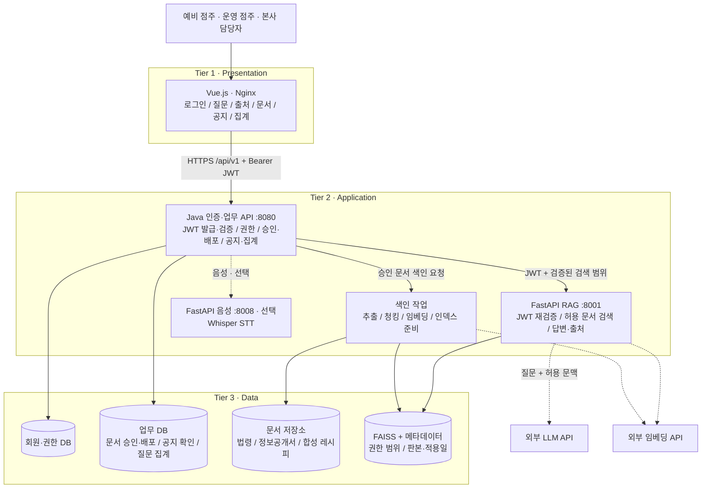

# frangizer — 가맹파트너 AI

> **점주는 문서에서 업무 기준을 찾고, 본사는 반복되는 문의를 보고 문서를 고치는 프랜차이즈 업무 지원 서비스**

운영 중인 가맹점주가 레시피·위생·고객 분쟁 기준을 물으면 **RAG**가 등록된 문서에서 근거를 찾아 답하고, 출처·판본·자료 성격을 함께 보여줍니다. 본사는 쌓인 질문을 주간·지역별로 확인해 문서를 보완하고, 새 판본을 배포해 점포에 공지와 확인 요청을 보냅니다.

**근거를 찾아 답하고, 불확실하면 멈추며, 제한적으로 보완하는 상담 시스템**을 목표로 합니다. 레시피의 단순 계량·순서는 구조화 데이터로 빠르게 조회하고, 문서 해석이 필요한 상담은 LangGraph 기반 단일 에이전트가 검색·생성·검수를 수행합니다.

[서비스 기획서·페인포인트별 동작 스냅샷](docs/planning/가맹파트너_AI_서비스기획서.md) · [스냅샷 이미지 10장](docs/planning/frangizer-planning-snapshots/)

[RAG 아키텍처·노드별 동작 설명](docs/rag/아키텍처_및_동작_설명.md) — 실제 실행 흐름, 기술 선택, AI·코드 역할 분담, 보완 한계와 관련 파일

> ⚠️ SKALA AI 서비스 개발 미니 프로젝트의 **시연용 서비스**입니다. 실제 브랜드의 공식 서비스가 아니며, 레시피·점포·계정·문의 데이터는 팀이 만든 **합성 자료**입니다.
>
> 📌 현재 상태: 백엔드·RAG·화면이 구현되어 `docker compose`로 전체를 실행할 수 있습니다. 평가와 품질 개선을 진행 중입니다.

---

## 목차

- [해결하려는 문제](#해결하려는-문제)
- [주요 기능](#주요-기능)
- [AI의 역할과 서비스 경계](#ai의-역할과-서비스-경계)
- [아키텍처](#아키텍처)
- [기술 스택](#기술-스택)
- [데이터](#데이터)
- [API](#api)
- [폴더 구조](#폴더-구조)
- [실행 방법](#실행-방법)
- [평가 계획](#평가-계획)
- [평가 결과](#평가-결과)
- [시연 시나리오](#시연-시나리오)
- [팀 구성과 일정](#팀-구성과-일정)

---

## 해결하려는 문제

| 사용자 | 페인포인트 | 해결 방법 |
| --- | --- | --- |
| **운영 점주** | 조리나 고객 응대 중에 긴 문서를 뒤지거나 본사 답변을 기다리기 어렵다 | 텍스트·음성 질문으로 레시피·위생·소비자분쟁 기준을 검색하고, 근거와 함께 답한다 |
| **예비 점주** | 정보공개서와 법령을 따로 읽어야 해서 비용·절차의 근거를 찾기 어렵다 | 정보공개서와 가맹사업법을 검색해 문서 위치를 표시한다. 근거가 없으면 "확인 필요"로 구분한다 |
| **본사** | 반복 문의가 쌓여도 어떤 자료를 고쳐야 할지 모른다 | 질문 유형, 반복 질문, 미해결 항목을 주간·지역별로 집계한다 |
| **본사 → 점포** | 신메뉴나 규정이 바뀐 뒤에도 점포가 구버전을 보거나 공지를 놓친다 | 판본과 적용일을 관리하고, 검색 데이터 갱신 → 공지 → 점포 확인 기록까지 연결한다 |

위 문제는 프로젝트에서 검증하려는 **가설**이며, 특정 브랜드의 운영 문제를 확인한 결과가 아닙니다.

## 주요 기능

| 기능 | 설명 | 처리 방식 | 우선순위 |
| --- | --- | --- | --- |
| 매장 운영 Q&A | 합성 레시피의 계량·순서 조회, 위생·소비자분쟁 관련 문서 상담 | 구조화 JSON 빠른 조회 + 상담 RAG | 필수 |
| 가맹 정보 Q&A | 정보공개서와 가맹사업법에서 준비사항·조건의 근거 안내 | RAG | 필수 |
| 출처·확인 필요 표시 | 원문 위치, 판본, 합성 여부, 추가 확인 사유 | RAG 응답 계약 | 필수 |
| 문서 변경 반영 | 업로드 → 검수 → 승인 → 색인 → 배포, 적용일별 판본 검색 | 문서 관리 + 색인 | 필수 시연 |
| 변경 공지·확인 | 화면 내 공지, 점포별 확인 버튼, 본사의 확인 현황 | 업무 API | 필수 시연 |
| 본사 문의 대시보드 | 질문 기록·분류, 주간·지역별 통계, 확인 필요 목록 | DB 집계 (RAG 아님) | 필수 |
| STT 음성 질문 | 음성을 텍스트로 바꾸고, 메뉴명·수량을 확인한 뒤 질의 | Whisper | 확장 |
| 운영 분석 에이전트 | 집계 결과로 문서 개선 초안 제안 | Agent | 후속 검토 |

문서 내용은 **상담 채팅**, 반복·추가 확인 필요 문의는 **본사 문의 대시보드**, 점포별 공지 확인 여부는 **변경 공지의 확인 현황**에서 봅니다. 현재 채팅에는 질문 이력 집계 도구가 연결되어 있지 않습니다. 구현된 상담 에이전트와 후속 운영 분석 에이전트는 별개입니다.

### 답변 상태

| 상태 | 의미 | 화면에 보여주는 것 |
| --- | --- | --- |
| `answered` | 필요한 근거를 확보함 | 핵심 답변, 처리 순서, 출처 |
| `needs_review` | 정보가 부족하거나 근거가 상충함 | 확인된 부분, 부족한 정보, 추가 질문 |
| `handoff` | 분쟁·안전 판단 등 담당자 검토가 필요함 | 검토 사유, 담당자에게 전달할 문의 요약 |

## AI의 역할과 서비스 경계

AI는 승인된 문서의 근거를 찾아 이해하기 쉽게 정리하는 **업무 보조자**입니다.

- **서비스가 하는 일:** 허용된 문서 검색, 근거·판본·자료 성격 표시, 근거 부족 안내, 담당자 문의 요약, 변경 공지와 확인 기록
- **서비스가 하지 않는 일:** 위법 여부 판정, 계약 체결, 결제·환불 실행, 식품 안전 보증, 점포 제재, 외부 메시지 자동 발송
- 자료에 없는 금액·레시피·정책을 만들어내지 않습니다. 근거가 없다는 이유만으로 본사의 요구를 위법하다고 판정하지도 않습니다.
- `handoff`는 "담당자 확인이 필요하다"는 안내일 뿐, 상담이 접수되었거나 해결되었다는 뜻이 아닙니다.

## 아키텍처

교재(AI서비스개발 Mini-project v3.1)의 상용 서비스 구조(19쪽), 요청 흐름(20쪽), JWT 검증(27쪽), RAG 응답 계약(31쪽)을 3계층으로 구성했습니다.



**질의 흐름:** 로그인 → `POST /api/v1/rag-query` → Java가 JWT·역할·점포를 확인하고 질문 사건을 기록 → 허용된 판본 범위를 담아 내부 RAG 호출 → RAG가 JWT를 다시 검증 → 레시피 빠른 조회 우선, 처리할 수 없으면 상담 검색·생성·검수 → 답변·출처·상태 반환 → Java가 결과를 기록해 화면에 응답. 두 경로 모두 허용 범위·판본·적용일과 원문 출처를 확인합니다.

**설계 원칙**
- 브라우저는 `/api/v1/*`만 호출합니다. RAG·음성·DB 포트는 외부에 열지 않습니다.
- 역할·브랜드·점포는 서버가 JWT와 DB로 판정합니다. 요청 본문으로 받지 않습니다.
- 검색에는 `published` 상태이고, 색인이 `ready`이며, 사용자 권한 범위 안에 있고, 질의 적용일에 유효한 판본만 사용합니다.
- 새 인덱스를 준비하는 동안에도 기존 판본으로 계속 서비스합니다. 인덱스를 덮어쓰지 않습니다.

## 기술 스택

| 계층 | 기술 |
| --- | --- |
| Frontend | Vue.js 3, Vite, Nginx |
| Backend | Java (Spring Boot, Gradle), JWT |
| RAG | Python, FastAPI, LangChain·LangGraph, FAISS + 한국어 BM25·RRF, 선택적 LLM 재순위화, 외부 LLM·임베딩 API |
| Voice (선택) | FastAPI, Whisper |
| Data | 관계형 DB (MariaDB), 문서 저장소, FAISS 인덱스 (볼륨) |
| Infra | Docker Compose |

## 데이터

원본 파일은 `data/source/`(자동 적재 대상)와 `data/staged/`(미배포, 자동 적재 금지)에 있고, 판본·쪽수·색인 제외 쪽·적용일은 [`data/manifest.json`](data/manifest.json)에 기록합니다. 판본은 법령·고시의 경우 PDF 머리글의 시행일, 합성 자료의 경우 문서 판본입니다.

| 분야 | 자료 | 성격 (`material_type`) | 판본 | 쪽수 | 용도 |
| --- | --- | --- | --- | --- | --- |
| 위생 | 식품위생법 | 법령 (`official`) | 2026-10-08 | 76 | 영업·교육·위생 질문의 근거 |
| 위생 | 식품위생법 시행령 | 법령 (`official`) | 2026-08-18 | 28 | 위생 세부 기준 |
| 위생 | 식품위생법 시행규칙 | 법령 (`official`) | 2026-09-01 | 73 | 위생교육·영업 세부 절차 |
| 가맹 | 가맹사업거래의 공정화에 관한 법률 | 법령 (`official`) | 2026-10-02 | 36 | 가맹 준비, 본사·가맹점 거래 관련 근거 |
| 가맹 | 가맹사업법 시행령 | 법령 (`official`) | 2026-08-04 | 23 | 가맹 거래 세부 기준 |
| 가맹 | 가맹사업법 시행령 [별표 2] 불공정거래행위의 유형 또는 기준 | 법령 (`official`) | 2028-01-01 | 6 | 불공정거래 유형. 수록된 별표는 2024-06-04 개정본이라 적용일을 2024-06-04로 둠 |
| 가맹 | 가맹분야 불공정거래행위 심사지침 | 고시 (`official`) | 2024-03-25 | 44 | 추가 요구·불공정 여부 판단 기준 |
| 가맹 | 빽다방 정보공개서 (대외 공개용) | 원본 (`public_disclosure`) | 2025-11-21 | 59 | 가맹점 부담 비용, 입지, 개점 절차, 교육 조건 |
| 가맹 | 가맹카페 A 가맹계약서 (합성) | 합성 (`synthetic`) | v1.0 | 10 | 선택 시연 자료. 기본 시드 제외, `--include-optional`로 등록 |
| 소비자 | 소비자기본법 | 법령 (`official`) | 2026-09-11 | 27 | 소비자 권리·분쟁 일반 원칙 |
| 소비자 | 소비자분쟁해결기준 | 고시 (`official`) | 2025-12-18 | 2 | 고객 불만·교환·환급 기준 |
| 소비자 | 소비자분쟁해결기준 별표 | 고시 (`official`) | 2025-12-18 | 145 | 품목·업종별 해결 기준 |
| 소비자 | 전자상거래법 (청약철회 관련 발췌) | 법령 (`official`) | 2026-07-21 | 6 | 배달·온라인 주문의 청약철회 |
| 레시피 | 카페 표준 레시피 북 (합성) | 합성 (`synthetic`) | v1.0 | 8 | 6개 메뉴의 계량·제조 순서·옵션 Q&A |
| 레시피 | 카페 표준 레시피 북 (합성) — `staged` | 합성 (`synthetic`) | v1.1 | 10 | 바닐라 시럽 20→15 mL 변경, 신메뉴 허니자몽블랙티 추가. 적용일 2026-10-26, 배포 시연용 |

- 정보공개서는 이름·수치·쪽수를 바꾸지 않고 원본 그대로 사용합니다. 수집본 기준이며 현재 실제 계약 조건을 보장하지 않습니다.
- 합성 레시피는 실제 브랜드의 제조법이 아닙니다. 모든 답변 출처에 합성 자료임을 표시합니다.
- 질문 속 고객명·연락처·주문번호는 마스킹해서 저장합니다. 음성 원본은 저장하지 않습니다.
- 평가 정답, 문의 표본, 대시보드 시안은 RAG 색인 대상에서 제외합니다.

## API

| 문서 | 내용 |
| --- | --- |
| [docs/api/API_명세서.md](docs/api/API_명세서.md) | 사람이 읽는 명세서. 공통 규칙, 엔드포인트 25개, 오류 코드, **담당별 구현 가이드(백엔드·프론트·RAG)** |
| [docs/api/public.openapi.yaml](docs/api/public.openapi.yaml) | 공개 API `/api/v1` (OpenAPI 3.1, Swagger) |
| [docs/api/internal-rag.openapi.yaml](docs/api/internal-rag.openapi.yaml) | Java ↔ FastAPI 내부 RAG API |
| [docs/api/examples/](docs/api/examples/) | 계약 테스트용 요청·응답 예시 |

주요 엔드포인트 (`/api/v1` 기준)

```text
POST  /login                                       로그인·JWT 발급
POST  /rag-query                                   근거 답변
POST  /documents                                   문서·새 판본 등록 (hq)
POST  /documents/{doc_id}/versions/{ver_id}/approve   승인·색인 시작 (hq)
POST  /documents/{doc_id}/versions/{ver_id}/publish   배포·공지 생성 (hq)
GET   /notices · PUT /notices/{id}/ack             공지 조회·확인 (owner)
GET   /analytics/questions                         주간·지역별 문의 집계 (hq)
```

## 폴더 구조

세부 규칙은 [폴더규칙.md](폴더규칙.md)를 따릅니다.

```text
frangizer/
├── docs/        API 계약, 기획 문서
├── frontend/    Vue.js
├── backend/     Java 인증·업무 API
├── rag/         FastAPI RAG + 색인
├── voice/       FastAPI STT (Whisper)
├── nginx/       리버스 프록시
├── data/        RAG 적재 원본 자료
├── eval/        평가셋·결과 (색인 제외)
└── scripts/     시드·적재·검증 스크립트
```

## 실행 방법

> `backend/`, `rag/`, `frontend/`를 Docker Compose 한 번으로 실행합니다. 구현이 진행되면 이 절을 갱신합니다.

**준비물:** Docker Desktop(Compose v2), `.env`에 넣을 값(JWT 서명키, 내부 토큰, LLM API 키, DB 비밀번호, 시연 계정 비밀번호)

### 1. 환경변수 준비

```bash
cp .env.example .env
```

`.env`의 값은 직접 채우며 **커밋하지 않습니다.** 변수는 서비스마다 필요한 것이 다릅니다.

| 변수 | 사용처 | 설명 |
| --- | --- | --- |
| `JWT_SECRET` | backend, rag | JWT 서명키. **32바이트 이상**, 두 서비스가 같은 값 사용 |
| `JWT_ISSUER`, `JWT_AUDIENCE` | backend, rag | 기본 `frangizer`, `frangizer-api` |
| `INTERNAL_TOKEN` | backend, rag, voice | 서비스 간 호출용 비밀 (`X-Internal-Token`) |
| `DB_USERNAME`, `DB_PASSWORD` | db, backend | MariaDB 앱 사용자(기본 `frangizer`)와 비밀번호. Compose가 같은 값으로 사용자를 만듭니다 |
| `DEMO_PASSWORD` | backend | 시연 계정 비밀번호. **비어 있으면 로그인할 수 없습니다** |
| `LLM_API_KEY`, `LLM_MODEL`, `EMBEDDING_MODEL` | rag | 외부 모델 설정. 비어 있어도 서비스는 뜨지만 질문은 `503`, 색인은 `EMBEDDING_NOT_CONFIGURED`로 실패합니다. 임베딩 모델은 `text-embedding-3-small` 또는 `-large`이며, 바꾸면 전체를 다시 색인합니다 |
| `EMBEDDING_API_KEY`, `EMBEDDING_DIMENSIONS`, `EMBEDDING_BASE_URL` | rag | 선택. 비우면 `LLM_API_KEY`와 모델 기본 차원을 씁니다 |
| `DB_URL`, `RAG_URL`, `CORS_ALLOWED_ORIGINS` | backend | 로컬 `bootRun`용 값. Compose에서는 서비스 이름(`db`, `rag`)으로 자동 대체됩니다 |
| `DOCUMENT_STORE_DIR`, `FAISS_DIR` | backend, rag | 볼륨 안 저장 경로. 기본값 사용 |
| `DB_NAME`, `WEB_PORT`, `WHISPER_MODEL` | db, web, voice | 선택. 기본 `frangizer`, `80`, `small` |

시연 계정은 `demo-hq-01`(본사), `demo-owner-a001`~`demo-owner-a012`(운영 점주), `demo-prospect-01`(예비 점주)이며, 비밀번호는 모두 `DEMO_PASSWORD` 값입니다.

### 2. 기동

기본 구성은 **db + backend + rag + voice + web**입니다.

```bash
docker compose up -d --build
```

기동 순서는 `db → backend·rag → web`입니다. 서비스마다 헬스체크가 있어 앞 서비스가 준비된 뒤에 다음 서비스가 시작됩니다. 처음 빌드는 Gradle·npm·Python 의존성을 받느라 몇 분 걸립니다. `.env`에 필수 값(`DB_PASSWORD`, `JWT_SECRET`, `INTERNAL_TOKEN`, `DEMO_PASSWORD`)이 비어 있으면 컨테이너를 띄우기 전에 안내 메시지를 내고 멈춥니다.

음성 서비스(STT)도 함께 뜹니다. 처음 시작할 때 Whisper 모델(약 460MB)을 `whisper_cache` 볼륨에 내려받아 몇 분 걸리고, 그동안 음성 질문은 `503`입니다. 이후에는 바로 준비됩니다.

상태 확인:

```bash
docker compose ps
```

기본 구성 5개 서비스가 기동됐는지 확인합니다. 컨테이너 상태만으로 모델 호출·문서 검색까지 정상이라고 판단하지 않고, 아래 문서 등록과 동작 확인을 이어서 수행합니다. 실패하면 로그를 봅니다.

```bash
docker compose logs --tail 50 backend
```

### 3. 문서 등록 (처음 한 번)

처음 띄운 직후에는 등록된 문서가 없어서 질문에 답할 수 없습니다. `data/source/`의 원본 13건을 등록 → 승인(색인) → 배포합니다. 1~2분 걸리며, 색인할 때 임베딩 API가 호출됩니다.

```bash
SEED_HQ_PASSWORD=<DEMO_PASSWORD 값> python3 scripts/seed_documents.py --apply --publish --base-url http://localhost/api/v1
```

- `--base-url`은 Nginx 주소(`http://localhost/api/v1`)를 씁니다. 스크립트 기본값(`localhost:8080`)은 배포 구성에서 외부에 열려 있지 않습니다. `WEB_PORT`를 바꿨다면 그 포트로 지정합니다.
- `--publish`가 없으면 등록·색인만 하고 배포하지 않아 질문에 쓰이지 않습니다. 배포하면 문서마다 점포 공지가 하나씩 생깁니다.
- 옵션 없이 실행하면 서버에 보내지 않고 대상 목록만 보여 줍니다. 다시 실행해도 끝난 문서는 건너뜁니다.
- 레시피 v1.1(`data/staged/`)은 문서 변경 시연에서 본사 화면으로 직접 등록하므로 제외됩니다. 합성 가맹계약서는 `--include-optional`을 붙여야 포함됩니다.
- `docker compose down -v`로 볼륨을 지우면 문서도 지워지므로 다시 실행합니다.

화면에서 하나씩 등록할 수도 있습니다. 본사 계정으로 로그인해 문서 관리에서 등록 → 승인 → 색인 완료 확인 → 배포 순서로 진행합니다.

### 4. 동작 확인

브라우저에서 http://localhost 에 접속해 시연 계정(예: `demo-owner-a001`)과 `DEMO_PASSWORD`로 로그인한 뒤 "아이스 바닐라라테 시럽 몇 mL 넣어요?"를 물어봅니다. **v1.0은 20 mL, v1.1은 15 mL**이므로, 기준 시점에 적용되는 배포 판본의 값과 레시피 PDF 5쪽 출처가 맞는지 확인합니다. 한 질문의 성공을 전체 평가셋 통과로 간주하지 않습니다.

스크립트로 확인할 때는 다음을 실행합니다. 비밀번호는 `.env`의 `DEMO_PASSWORD`를 자동으로 읽습니다.

```bash
./scripts/smoke.sh http://localhost
```

웹·API 상태, 토큰 없는 접근 거부(401), 로그인, `/me`, `/rag-query`를 순서대로 점검합니다. `/rag-query`는 모델 설정과 3단계 문서 등록이 끝나야 `200`입니다. 그 전에는 `SKIP_RAG=1 ./scripts/smoke.sh http://localhost`로 질문 항목을 건너뜁니다. 계정을 바꾸려면 `./scripts/smoke.sh <주소> <아이디> <비밀번호>`로 넘깁니다.

| 서비스 | 주소 | 외부 공개 |
| --- | --- | --- |
| 웹 | http://localhost | O |
| API (Nginx 경유) | http://localhost/api/v1 | O |
| 상태 확인 | http://localhost/api/v1/health | O |
| backend · rag · voice · db | 컨테이너 내부 네트워크 전용 | X |

### 5. 개발용 실행

서비스를 직접 호출하며 개발할 때는 개발용 Compose를 겹쳐서 사용합니다. 내부 포트가 `127.0.0.1`에만 열립니다. **시연·배포에는 사용하지 않습니다.**

```bash
docker compose -f docker-compose.yml -f docker-compose.dev.yml up -d --build
```

| 서비스 | 개발용 주소 |
| --- | --- |
| backend (Java API) | http://localhost:8080/api/v1 |
| Swagger UI | http://localhost:8080/swagger.html |
| rag | http://localhost:8001 |
| voice | http://localhost:8008 |
| db | 127.0.0.1:3306 |

### 6. 종료와 초기화

```bash
docker compose down        # 컨테이너 종료 (DB·인덱스 유지)
docker compose down -v     # 컨테이너와 볼륨(DB, FAISS 인덱스, 업로드 문서) 삭제
```

### 참고

- 문서는 backend 업로드·승인을 거쳐서만 RAG에 들어갑니다. `data/source/`, `data/staged/`(미배포 판본), `eval/`, `docs/`는 컨테이너에 연결하지 않으며 자동 적재하지 않습니다. 구조화 레시피(`data/structured/`)만 읽기 전용으로 연결됩니다.
- 업로드 문서, FAISS 인덱스, 질의 결과(SQLite)는 `frangizer_data` 볼륨(`/var/lib/frangizer`)에 저장되며, backend가 저장한 문서를 rag가 같은 볼륨에서 읽어 색인합니다. 저장소에는 커밋하지 않습니다.
- 웹 이미지는 실제 API에 연결되도록 `VITE_USE_MOCK=false`로 빌드됩니다. PC·모바일 화면은 `frontend/` 하나로 실행합니다. 합성 데이터만 확인하려면 `frontend/.env.local`에 `VITE_USE_MOCK=true`를 설정하고 개발 서버를 실행합니다.
- backend 이미지는 저장소 루트를 빌드 컨텍스트로 써서 `docs/api` 계약(Swagger)을 함께 담습니다. Swagger UI는 외부에 공개하지 않으므로 개발용 실행(5단계)에서 확인합니다.
- MariaDB 사용자·비밀번호 초기 설정은 빈 볼륨에서 처음 기동할 때 적용됩니다. 기존 볼륨에서는 `.env`만 바꿔도 DB 계정이 바뀌지 않으므로 실제 계정과 설정을 맞춰야 합니다. `down -v`는 데이터까지 삭제하는 초기화이며, 단순 환경변수 갱신의 기본 절차가 아닙니다.
- 80번 포트가 이미 쓰이고 있으면 `.env`의 `WEB_PORT`를 바꿉니다(예: `WEB_PORT=8088` → http://localhost:8088).

## 평가 계획

평가셋은 33문항입니다. 정상 RAG 질문과 업무 기능 질문을 따로 구분합니다.

| 유형 | 문항 수 | 확인할 내용 |
| --- | --- | --- |
| 정상 · 합성 레시피 | 12 | 계량, 단위, 제조 순서, 옵션 |
| 정상 · 가맹 준비 · 위생 | 8 | 정보공개서 항목, 법령 검색과 출처 |
| 문서 변경 · 신규 등록 | 4 | 변경 전후, 미래 판본, 미배포 메뉴 |
| 근거 부족 · 판단 경계 | 3 | 없는 레시피, 환불 정책, 사건 종결 판단 |
| 접근 권한 | 2 | 제한 자료의 본문·출처 노출 방지 |
| 본사 업무 기능 | 4 | 주간·지역 집계, 공지 확인, 문서 배포 (RAG 정답률과 분리) |

**데모 목표**
- 정상 20문항: 사실 정확도 18/20 이상, 근거 연결 20/20
- 근거 부족 3문항: 모두 확인 필요 또는 인계로 처리
- 변경·권한 시나리오: 전부 통과

이 수치는 목표이며 현재 성적이 아닙니다.

## 평가 결과

통합 환경(`docker compose` 전체 기동 + 원본 13건 등록·색인·배포)에서 확인한 결과입니다. 상세 기록은 [QA 결과(10/23)](eval/results/2026-10-23/QA_결과.md), [운영 점검(10/26)](eval/results/2026-10-26/운영_점검.md), [배포 체크리스트(10/26)](eval/results/2026-10-26/배포_체크리스트.md)에 있습니다.

**배포 체크리스트**: 전체 기동 ✅ · 서비스 이름 호출 ✅ · 키는 `.env`로만 ✅ · README ✅

**QA (화면·답변 품질)**

| ID | 내용 | 10/23 | 10/26 |
| --- | --- | --- | --- |
| QA-01 | 답변 음성 자동 재생 | 발견 | 반영됨(#14), 화면 재확인 중 |
| QA-02 | 근거 없는 질문에 상식 덧붙임 | 발견 | 해결 |
| QA-03 | 표 인용 시 "표 검수 필요" 문구만 반환 | 발견 | 해결 |
| QA-04 | 범위 밖 질문에 서버 오류 | 발견 | 해결 |

**기능 시나리오**

| 시나리오 | 결과 |
| --- | --- |
| 레시피 질문 (바닐라 시럽 20 mL, 레시피 5쪽) | 통과 |
| 문서 변경 v1.0 → v1.1 배포 후 적용 시점 기준 15 mL | 통과 |
| 예비 점주에게 레시피 미노출 | 통과 |
| 본사 문의 대시보드 집계 | 기존 통합 점검 통과. 현재 화면 기본은 오늘 포함 최근 7일이며, 기간 생략 시 API 기본인 지난 완료 주와 구분 |

**RAG 후속 보완(10/26, [PR #43](https://github.com/kimhynsoo/frangizer/pull/43)):** 포함·복합 질문을 표 하나의 일치만으로 완료하지 않고, 본문에 쓰지 않은 수치 메타데이터가 정상 설명을 차단하지 않도록 보완했습니다. 실제 출력한 수치의 출처·항목·단위 검증은 유지합니다. 관련 회귀 검사 **116개 통과**이며, 전체 평가셋 성적이나 아래 운영 측정값을 갱신한 결과는 아닙니다. 이 변경은 재색인·재임베딩이 필요 없습니다.

**운영 점검 (대표 질문 10건)**

| 항목 | 결과 | 목표 |
| --- | --- | --- |
| 응답 시간 | 평균 9.6초, 최대 19.8초, 5초 이내 2건(구조화 레시피) | 3~5초 |
| 입력 토큰 (LLM 호출 질문) | 평균 7.5만, 최대 10.9만 | — |
| 요청당 원가 (`gpt-5.4-mini`) | LLM 상담 약 $0.061, 구조화 레시피 $0. 시연 기업(12개 점포·하루 10건) 월 약 $153 | — |
| 로깅 | 경로·상태·지연만 기록, 질문 원문 미기록, DB는 마스킹본 저장 | 원문·개인정보 미기록 |
| 예외 처리 | rag·voice 정지 시 503 안내, 복구 후 정상, 잘못된 오디오 415 | 503·재시도·안내 |

응답 시간과 토큰 사용량은 개선 대상입니다(운영 점검 OPS-01~03).

## 시연 시나리오

1. **운영 점주:** "아이스 바닐라라테 시럽 몇 펌프예요?"를 묻고 레시피 쪽수와 합성 여부를 확인한다.
2. **본사 · 문의 대시보드:** 조회 기간과 지역을 골라 반복 문의와 추가 확인 필요 목록을 본다. 화면 기본값은 오늘 포함 최근 7일이다.
3. **본사:** 레시피 v1.1을 등록하고 검수·승인·색인·배포한다. 시럽 변경, 신메뉴, 적용일을 확인한다.
4. **운영 점주:** 적용일 전후로 같은 질문을 비교하고 변경 공지를 확인한다.
5. **본사 · 변경 공지:** 해당 변경 공지의 점포별 확인·미확인 현황을 본다. 문의 대시보드와 함께 다음 문서 개선 후보를 정한다. 공지 확인과 실제 제조 적용은 구분한다.
6. **예비 점주:** 정보공개서에서 임대보증금 포함 여부를 확인하고, 없는 메뉴나 환불 정책을 물으면 확인 필요 안내를 받는다.

페인포인트별 질문과 화면은 [기획서 5.2~5.3절](docs/planning/가맹파트너_AI_서비스기획서.md)에 정리했습니다. 첨부된 변경 공지 스냅샷은 v1.0 초기 등록 사례이며, v1.1 판본·답변 변경 화면과 동일 공지의 연속 확인 결과는 아닙니다.

## 팀 구성과 일정

| 담당 | 이름 | 역할 | 주요 산출물 |
| --- | --- | --- | --- |
| A | 김세령 | 데이터 파이프라인 | 정제 데이터, 메타데이터, FAISS 인덱스, 재색인 코드 |
| B | 박인우 | RAG · LLM | 검색·답변 코드, 프롬프트, 질문별 평가 결과 |
| C | 김현수 | 인증 · API | API 명세·Swagger, 업무 DB, 인증·업무 코드 |
| D | 박세웅 | Vue.js 프론트엔드 | 역할별 화면, API 연동, 시연 화면 |
| E | 성재원 | 통합 · 배포 · 평가 | Docker Compose, README, 평가 결과표 |

| 일정 | 목표 |
| --- | --- |
| Day 1 | 데이터 판본·권한·응답 형식 확정, 로그인 → 질문 → 근거 답변 연결 |
| Day 2 | Vue 통합, 질문 기록·분류, 주간·지역 집계, 레시피 변경·공지 |
| Day 3 | 평가·수정, 배포, 발표 준비 |

## 참고 자료

- [식품위생법 — 국가법령정보센터](https://www.law.go.kr/법령/식품위생법)
- [가맹사업거래의 공정화에 관한 법률 — 국가법령정보센터](https://www.law.go.kr/법령/가맹사업거래의공정화에관한법률)
- [소비자분쟁해결기준 — 국가법령정보센터](https://www.law.go.kr/행정규칙/소비자분쟁해결기준)
- [정보공개서 열람 — 공정거래위원회 가맹사업거래](https://franchise.ftc.go.kr/mnu/00013/program/userRqst/list.do)
