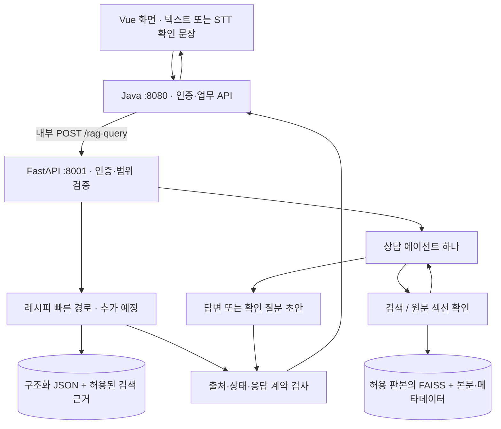
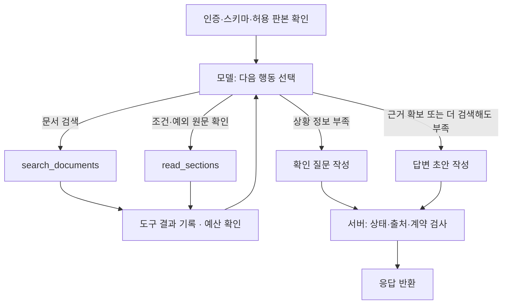

# 레시피 조회와 상담 Agentic RAG 시스템 설계

작성일: 2026-10-23 (Asia/Seoul)  
상태: 상담 그래프·색인 API·FAISS 검색·구조화 레시피 응답을 연결했습니다. 실제 Java/H2 HTTP 연동과 판본 전환을 검증했으며, 실제 모델·MariaDB·웹 품질 검증은 남았습니다. 최신 구현 상태와 팀 연결 사항은 [RAG 백엔드 연동 검증](RAG_백엔드_연동_검증.md), 실행 명령은 `rag/README.md`를 따릅니다. 아래의 단계별 계획은 최초 설계 맥락을 포함합니다.

## 1. 구성 방향

**MVP는 레시피·상담 모두 기존 `/rag-query`를 유지합니다. 레시피는 구조화 JSON 기반의 정확한 계량·단계 반환을 내부 빠른 경로로 추가하고, 창업·운영 상담은 단일 Agentic RAG로 구성합니다.**

2026-10-23 C 회신을 검토한 뒤 사용자가 위 MVP 방향을 선택했습니다. 레시피 RDB·별도 API·단계 전용 화면은 E2E 이후 확장으로 옮깁니다. 기존의 정확한 값·순서 반환 원칙은 유지하며 저장 방식과 구현 시점만 조정합니다. 구조화 JSON·검색 인덱스와 명확한 계량·순서 질문의 생성 없는 경로를 연결했습니다. 실제 임베딩·상담 모델의 품질과 지연 평가는 이후 단계입니다.

### 사용자와 정한 제품 기준

| 구분 | 레시피 빠른 처리 | 창업·운영 상담 |
|---|---|---|
| 첫 화면 | 계량·단계를 크게 표시 | 상황에 맞는 핵심 답변 |
| 상세 내용 | 재료표·제조 순서 | 확인·처리 순서, 적용 조건·예외 |
| 근거 | 메뉴·온도·레시피 판본 | 문서명·판본·페이지 또는 섹션 |
| 정보 부족 | 메뉴·온도 등을 짧게 확인 | 답이 달라지는 조건을 추가 질문 |
| 원칙 | 구조화 자료의 값·순서를 그대로 반환 | 확보한 근거 안에서 설명 |

이 표를 화면·응답·테스트의 기준으로 유지합니다. 레시피 빠른 경로에서는 생성 모델이 수치·순서를 다시 작성하지 않고, 검수된 구조화 JSON의 값을 사용합니다. 빠른 경로가 지원하지 않는 일반 문서 질의도 원문 계량·단위를 유지하고 근거 없는 옵션·대체를 생성하지 않습니다.

상담 엔진은 창업·운영을 수용할 수 있도록 만들되, **첫 구현·터미널 검증은 운영 점주의 고객 불만·위생 질문**으로 제한합니다. 질문 후보는 [상담 첫 검증 범위](상담_첫_검증_범위.md)를 따릅니다. 기존 자료 안에서 질문을 만들며 내부 응대 매뉴얼을 새로 합성하지 않습니다.

| 경로 | 목적 | 처리 방식 |
|---|---|---|
| 레시피 빠른 조회 | 제조 중 특정 재료의 양·순서 확인 | 기존 `/rag-query` 내부에서 메뉴·HOT/ICE·재료·적용 판본을 식별하고 구조화 JSON의 값 반환 |
| 상담 | 사용자 상황에 필요한 문서 항목을 찾아 조건·절차 안내 | 에이전트 하나가 검색 대상을 선택하고, 결과에 따라 추가 검색·원문 확인·되묻기·답변 중 선택 |

상담 안에 일반 RAG와 Agentic RAG를 별도 서비스로 만들지 않습니다. 같은 에이전트가 간단한 질문은 한 번 검색해 끝내고, 복합 질문은 필요한 부분만 추가로 찾습니다. 모든 질문에 여러 번 검색을 강제하지 않습니다.

MVP에 새 레시피 API나 단계 전용 화면을 요구하지 않습니다. 레시피 빠른 경로 여부는 내부에서 결정하고 현행 `RagAnswer`의 `answer`·`steps`·`sources`로 반환합니다. 자유 SQL 생성은 도입하지 않습니다. 별도 레시피 API·RDB·음성 단계 안내 화면은 E2E 이후 별도 계약으로 검토합니다.

## 2. 현재 코드·명세와의 관계

교수님 뼈대: [`rag_external-web_pdf_closed_llm.py`](../../../share/rag-code-template_ext/rag_external-web_pdf_closed_llm.py).

| 교수님 코드 | 재사용할 부분 | 새 프로젝트에서 바꿀 부분 |
|---|---|---|
| FastAPI `/rag-query` | HTTP 요청·응답 처리 | 현재 내부 API 계약, 인증·권한 검증 적용 |
| `PdfReader` | PDF 본문 추출 시작점 | 페이지·조항·표·조건 보존 및 추출 품질 검수 |
| `RecursiveCharacterTextSplitter` | 긴 본문 분할 보조 | 자료별 의미 단위 분할, `section_key`로 상위 조건 복원 |
| `OpenAIEmbeddings`, FAISS | 임베딩·유사도 검색 | 판본별 불변 인덱스, 허용 범위 안에서 검색 |
| `ChatOpenAI` | 모델 호출 어댑터 | 도구 선택·구조화 초안 생성, 호출 예산·시간 제한 |
| 검색 결과 → 프롬프트 → 답변 | 근거를 모델에 전달하는 원리 | 결과에 따라 다음 행동을 선택하는 반복 흐름 추가 |

현재 교수님 코드는 기본 검색·생성 흐름입니다. 새 설계의 agentic 요소는 **모델이 검색어와 다음 도구 사용을 선택하고, 검색 결과에 따라 행동을 바꾸는 부분**입니다. LangGraph 사용 자체가 agentic 동작을 보장하지는 않습니다.

전역 `WEB/PDF` 저장소를 사용자에게 선택시키는 방식, 업로드할 때 공용 인덱스를 교체하는 방식, 질문·본문을 그대로 출력하는 로그는 옮기지 않습니다. 외부 웹 수집 `/upload-topic`도 초기 상담 도구에 포함하지 않습니다.

기준 계약은 [`API_명세서.md`](../api/API_명세서.md), [`internal-rag.openapi.yaml`](../api/internal-rag.openapi.yaml)입니다. MVP의 레시피 처리는 기존 API·계약 테스트를 유지합니다. 재색인·`synthetic` 설명 등 C가 예고한 변경은 실제 계약 PR 확인 후 반영하며, 회신만으로 구현 계약을 바꾸지 않습니다.

## 3. 전체 요청 구조

브라우저는 Java의 `/api/v1/*`만 호출합니다. Java가 사용자 JWT를 검증하고 DB에서 역할·브랜드·점포·허용 판본을 계산합니다. FastAPI에는 서비스 토큰 `X-Internal-Token`과 원래 사용자 Bearer JWT를 모두 전달합니다. FastAPI도 JWT의 서명·만료·발급자·대상과 전달된 사용자 정보의 일치를 검증합니다.

음성은 선택 입력입니다. STT 결과를 사용자가 확인한 뒤 동일한 질의 경로에 넣습니다. 상담 답변의 TTS 자동 재생은 초기 범위에 넣지 않습니다.

## 4. 상담 에이전트의 처리 순서

### LangChain과 LangGraph의 역할

| 구성 | 맡길 일 | 이 프로젝트에서의 경계 |
|---|---|---|
| LangChain 모델·메시지 구성요소 | 모델 호출, 도구 호출 스키마, 구조화된 응답 초안 | 별도의 상위 에이전트 실행기를 중복으로 두지 않음 |
| LangChain 도구 | `search_documents`, `read_sections`를 모델이 호출할 수 있게 연결 | 실제 파일 로더와 임베딩 설정은 검색 어댑터 뒤에 둠 |
| LangGraph `StateGraph` | 상태를 보관하며 다음 행동·도구 실행·최종 응답으로 분기 | 상담 에이전트 하나. 호출 예산과 요청 제한 시간 적용 |
| FastAPI + Pydantic | API·인증·스키마·공통 오류·응답 검증 | 기존 내부 API 계약 유지 |
| 일반 Python 검색 인터페이스 | 검색 결과·원문 섹션 제공 | 모의 구현과 실제 데이터 구현을 교체 가능하게 구성 |

모델이 검색어와 추가 도구 사용을 선택하고, 서버가 권한·예산·출처 규칙을 강제합니다. 도구 실행·검증·응답 조립마다 별도 모델을 호출하지 않습니다. LangGraph가 상담의 실행 흐름을 맡으므로 LangChain의 상위 에이전트를 다시 중첩하는 구조는 초기에는 사용하지 않습니다.

모델은 구조화된 행동 또는 도구 호출을 출력합니다. 서버는 등록된 도구와 허용된 인자만 실행합니다. 최종 문장을 먼저 쓴 뒤 그럴듯한 출처를 붙이는 흐름을 허용하지 않습니다.

그래프는 `decide → execute_tools → decide` 반복과 `finalize → validate → END` 종료 경로로 구성합니다. `decide`는 도구 호출 또는 최종 초안 생성을 선택하며, `finalize`는 같은 모델의 구조화 출력 호출로 구현할 수 있습니다. 되묻기도 최종 초안의 한 종류로 반환합니다. 노드 개수와 모델 호출 횟수는 같지 않으며, 실제 모델 호출은 모두 공통 예산에서 계산합니다.

### 초기 도구는 두 개

| 도구 | 모델이 지정하는 인자 | 서버가 보장하는 것 |
|---|---|---|
| `search_documents` | 검색 문장, 선택적 자료 범주 필터 | 고정된 허용 판본·적용 시점 안에서 검색하고 본문·위치·조각 ID 반환 |
| `read_sections` | 이번 요청에서 검색된 조각 ID | 해당 조각과 같은 허용 판본·인덱스의 섹션을 읽어 조건·예외·표 주석 복원 |

`read_sections`는 임의 파일 경로나 URL을 받지 않습니다. 긴 섹션은 서버의 크기 제한에 맞춰 반환하고 잘림 여부를 표시합니다. 필요한 예외가 잘렸다면 완전한 근거로 취급하지 않습니다.

사용자에게 되묻기는 외부 전송 도구가 아닙니다. `needs_review`와 `follow_up_questions`를 반환하고 HTTP 요청을 끝냅니다. 다음 사용자 답변은 Java가 제공하는 대화 이력과 함께 새 요청으로 처리합니다.

초기 도구에는 자유 SQL, 임의 웹 검색, 업로드·색인 실행, 문서 승인·배포, 외부 메시지 발송을 넣지 않습니다. 레시피 DB를 상담 에이전트가 직접 읽는 도구도 초기에는 만들지 않습니다.

### 상담 예시 — 실제 답변이 아닌 동작 시나리오

질문: “고객이 음료에 이물이 있다고 환불을 요구합니다. 어떤 기준과 정보를 확인해야 하나요?”

1. 이전 대화에 적용 대상을 구분할 정보가 있는지 확인합니다.
2. 필요하면 관련 분쟁 기준과 적용 대상 항목을 검색합니다.
3. 대상에 따라 답이 달라지는데 매장 제조 음료인지 포장 판매 제품인지 확인되지 않았다면 짧게 되묻습니다. 이 질문을 모든 상담에 고정적으로 적용하지 않습니다.
4. 조건이 확인되면 이번 요청에서 허용된 근거를 검색하고, 표 주석·예외가 필요할 때 같은 판본의 섹션을 읽습니다.
5. 근거가 있는 설명과 확인 순서를 `answer`·`steps`에 정리합니다. 매장 내부 환불 승인자나 처리 시간을 만들어내지 않습니다.

자료가 하나도 없다면 에이전트 구조만으로 위 시나리오를 성립시킬 수 없습니다. 해당 항목을 포함한 승인 원문과 출처 복원이 먼저 필요합니다.

## 5. 상태·권한·실행 제한

### 신뢰할 입력과 변경 가능한 상태 분리

| 구분 | 주요 값 | 관리 원칙 |
|---|---|---|
| 요청의 고정 문맥 | `principal`, `allowed_versions`, `as_of`, `basis`, `scope_revision`, 요청 ID, 제한 시간 | 인증·검증 후 서버가 고정. 모델이 바꿀 수 없음 |
| 에이전트 상태 | 대화 메시지, 검색어, 획득한 근거, 선택한 조각, 호출 횟수, 종료 사유, 응답 초안 | 요청 내부에서만 갱신 |
| 저장되는 업무 기록 | 질문·답변·피드백·대화 이력 | Java가 소유. FastAPI에서 별도 대화 DB를 추가하지 않음 |

대화 이력은 현행 계약의 최근 최대 6턴을 사용합니다. 과거 답변에 들어 있던 출처는 이번 요청에서 다시 허용·유효한지 확인해야 하며, 과거 모델 답변 자체를 새 근거로 취급하지 않습니다. MVP에 별도 LangGraph 체크포인트 저장소는 요구하지 않습니다.

### 초기 예산 제안 — 성능 측정 후 조정

- 전체 모델 호출 최대 4회. 최종 초안 생성도 포함합니다.
- 도구 호출 최대 3회, 그중 문서 검색 최대 2회. 한 모델 응답이 여러 도구를 요청하면 각각 계산합니다.
- 마지막 모델 호출은 도구를 해제하고 최종 답변·확인 질문 생성에 사용합니다. 모델의 추가 호출 요구와 무관하게 서버가 중단을 강제합니다.
- 실제 요청 제한은 `deadline_ms`를 따릅니다. 계약 범위는 1~30초이며 Java의 20초 예시가 성능 보장을 뜻하지 않습니다. 각 모델·도구 호출에 남은 시간을 전달하고 응답 조립 시간도 확보합니다.
- LangGraph의 `recursion_limit`은 그래프 실행 단계 제한입니다. 모델·도구 호출 예산은 별도 카운터로 검사합니다.
- 횟수 제한에 도달했는데 근거가 부족하면 확인 사유를 명시합니다. 실제 시간 초과는 `504`, 모델·검색 인프라 오류는 계약의 `502/503` 등으로 처리합니다. 시스템 장애를 정상 상담 상태로 숨기지 않습니다.

이는 시작값이며 품질·지연 측정 전 확정된 운영 수치가 아닙니다. 별도 분류·검증 모델을 추가하면 호출 수와 시간을 함께 재산정해야 합니다.

## 6. 검색과 데이터 파이프라인 연결

1. A가 원문을 보존하고 페이지·조항·섹션·표 조건을 유지하며 추출·분할합니다.
2. 승인된 색인 요청으로 새 `index_revision`을 만들고 인덱스·본문·메타데이터를 준비합니다.
3. 색인 `ready`와 실제 `published`는 구분합니다. Java가 배포와 사용자별 허용 판본을 관리합니다.
4. B는 요청의 `(document_id, version_id, index_revision)`에 해당하는 검색 자료만 선택합니다.
5. 청크의 적용 기간과 권한을 확인한 후보 안에서 검색합니다. 전체 검색의 상위 몇 개를 나중에 걸러내는 방식만으로 끝내지 않습니다.
6. 섹션 복원도 같은 판본·권한·적용 기간을 유지합니다. 새 검색어가 검색 권한을 넓히지는 않습니다.

초기에는 판본별 FAISS 인덱스를 불변 자료로 로드하고 허용 판본의 후보를 합치는 방식을 제안합니다. 비교할 임베딩 모델·차원·거리 방식은 같아야 합니다. 청크별 유효 기간이 다르면 허용 청크 부분집합을 적용해야 합니다. 데이터량이 늘어 지연이 커질 때 범위별 캐시나 다른 검색 저장소를 검토합니다.

본문·메타데이터는 조각 ID와 `section_key`로 원문 섹션을 복원할 수 있어야 합니다. 임의 출처의 직렬화 파일을 위험한 역직렬화 옵션으로 여는 코드를 그대로 복사하지 않습니다.

원문은 `data/source/`와 승인된 업로드에서만 가져옵니다. `docs/`, `eval/`, `data/staged/`는 검색 근거가 아닙니다. 상세 데이터 인계 항목은 [데이터 파이프라인 담당자 인계서](데이터_파이프라인_담당자_인계서.md)를 따릅니다.

## 7. 답변 형식과 검증

공개 `POST /api/v1/rag-query`, 내부 `POST /rag-query`의 현행 형식을 유지합니다. 새로운 `agent_mode`, `plan`, 사고 과정 필드를 공개 응답에 추가하지 않습니다.

| 응답 값 | 화면에서의 역할 |
|---|---|
| `answer` | 먼저 읽을 짧은 결론과 적용 조건 |
| `steps` | 필요한 행동·확인 순서. 순서가 없으면 빈 배열 |
| `sources` | 실제 사용한 근거의 제목·판본·위치·발췌·원문 링크 |
| `follow_up_questions` | 답변을 구체화하는 데 필요한 짧은 질문 |
| `status`, `needs_review`, `handoff`, `handoff_reason` | 답변 가능·추가 확인·담당자 검토 구분 |
| `as_of`, `basis` | 적용 시점과 과거·현재·미래 기준 |

제품 표의 “적용 조건·예외”는 현행 계약에서 `answer`에 짧고 명시적으로 적습니다. 실행 순서는 `steps`, 정보 부족은 `follow_up_questions`, 근거는 `sources`로 표현합니다. 현재 계약에 없는 `conditions`·`exceptions` 필드를 공개 응답에 임의 추가하지 않습니다. 추후 화면에서 별도 영역으로 나눌 필요가 있으면 API 변경 절차를 먼저 거칩니다.

상담 답변은 결론을 먼저 제시하고 필요한 순서·조건·예외·출처를 이어갑니다. 관련성이 없는 긴 법령 요약으로 첫 화면을 채우지 않습니다. 특정 문장이 근거로 뒷받침되지 않으면 사용자 조건으로 확인된 사실인지, 자료에 없는 부분인지 구분합니다.

모델은 초안과 사용한 조각 ID를 반환하고, 서버가 보유한 메타데이터로 `sources`를 조립합니다. 모델이 원문 URL·페이지·판본을 자유롭게 만들어 넣지 않도록 합니다.

- `answered`: 실제 사용한 유효 출처가 최소 하나 있어야 합니다. 단, 출처 한 개의 존재만으로 답변 전체가 검증되었다고 판단하지 않습니다.
- `needs_review`: 사용자 정보 부족·근거 누락·상충 등을 명시하고 `follow_up_questions` 또는 `handoff_reason`을 제공합니다.
- `handoff`: 담당자 검토가 필요한 사유를 기록합니다. 접수나 외부 연락을 실행했다는 뜻이 아닙니다.
- 근거가 없으면 `sources=[]`이며 `answered`가 될 수 없습니다. 확인된 부분과 확인하지 못한 부분을 구분합니다.
- 합성 자료는 계약에 따라 답변 첫 문장과 출처에서 시연 자료임을 표시합니다.
- 내부 `retrieval.used_chunk_ids`와 실제 응답 출처를 일치시키고 모든 모델·임베딩 사용량을 합산합니다.

코드 검사는 출처 ID·권한·판본·응답 형식을 보장합니다. 문장마다 근거가 충분한지, 예외를 빠뜨렸는지는 별도 평가가 필요합니다. 에이전트가 스스로 “충분하다”고 판단했다는 사실을 정확성 검증으로 취급하지 않습니다.

문서 본문과 사용자 문장에 담긴 명령은 서버의 권한·도구 정책을 바꾸지 못합니다. 외부 모델에 보내기 전 개인정보를 제거하고, 로그에는 요청 ID·도구명·횟수·사용 조각·시간·오류 등 재현에 필요한 정보만 남깁니다. 원문 질문·비밀값·비공개 사고 과정은 기록하지 않습니다.

같은 `(question_id, attempt_id)`의 재시도는 한 실행으로 취급하고 기존 처리 상태·결과를 재사용해야 합니다. 동시 실행과 결과 보존은 API 계층에서 처리하며 에이전트 대화 기억으로 대체하지 않습니다.

## 8. 구현 위치와 기술

기존 폴더 규칙 안에서 필요한 파일을 생성합니다. 아래는 책임 배치이며, 현재 구현·실행 방법과 정확한 파일 목록은 [`rag/README.md`](../../rag/README.md)를 따릅니다. `generation/agent.py`에 요청 상태를, `generation/model.py`에 도구·모델 어댑터를 함께 구현했습니다. 실제 검색·색인 파일은 데이터 합의 이후 생성합니다.

| 위치 | 책임 |
|---|---|
| `rag/app/api/query.py` | 요청 검증·중복 실행 방지·전체 시간 제한·에이전트 실행 |
| `rag/app/auth.py`, `schemas.py` | 이중 인증·고정 문맥 검증·OpenAPI와 같은 모델 |
| `rag/app/retrieval/search.py` | 허용 범위 FAISS 검색 |
| `rag/app/retrieval/sections.py` | 원문 섹션 복원 |
| `rag/app/generation/agent.py` | LangGraph `StateGraph`와 조건 분기 |
| `rag/app/generation/state.py`, `tools.py` | 요청 상태·고정 문맥·두 검색 도구 어댑터 |
| `rag/app/generation/answer.py` | 구조화 초안·출처 조립·상태 검사 |
| `rag/prompts/counsel.md` | 상담 범위·되묻기·근거 사용 규칙 |
| `rag/app/indexing/` | A 소유의 추출·분할·임베딩·색인 작업 |
| `rag/tests/`, `eval/` | 모듈·계약 검사 / 실제 근거·시연 질문 평가 |

FastAPI·Pydantic·FAISS·텍스트 분할·기존 모델 어댑터를 활용하고 LangGraph를 실행 흐름에 추가하는 안입니다. 모델은 도구 호출·구조화 응답을 지원하는 것으로 검증하고 환경변수로 선택합니다. 모델명·라이브러리 버전은 구현 시 설치 조합을 검증한 뒤 고정합니다. 초기에는 리랭커·멀티에이전트·외부 웹 검색을 추가하지 않습니다.

### 데이터 담당자 답변 전에 구현할 검색 경계

내부 검색 인터페이스는 다음 의미로 정의합니다. 이는 새 HTTP API나 데이터 담당자의 파일 포맷 확정이 아닙니다.

- `search(query, trusted_context) → EvidenceBatch`: 검색된 본문·계약상 메타데이터·조각 ID·잘림 등 검색 결과 상태.
- `read_sections(chunk_ids, trusted_context) → EvidenceBatch`: 이번 요청에서 검색된 조각의 원문 섹션. 확장 중 포함된 조각도 같은 권한·판본·적용일로 검증하고 근거 목록에 기록.

`trusted_context`는 서버가 주입하며 모델의 도구 인자에 노출하지 않습니다. 모의 구현은 테스트 전용 fixture를 사용하고, 실제 구현은 A가 제공하는 산출물을 읽습니다. `EvidenceBatch`는 내부 자료형으로 두고 공개 계약을 바꾸지 않습니다. 파일명·직렬화 방식·임베딩 설정은 A의 응답 이후 어댑터에서 맞춥니다.

모의 검색 자료는 `rag/tests/` 안에 두고 실제 문서로 표시하거나 운영 색인에 넣지 않습니다. 모의 모델로 그래프 분기를 재현하는 검사와 실제 모델이 도구를 선택하는 검사는 구분합니다. 실제 산출물 연결 전 서비스의 준비 상태를 실제 RAG ready로 보고하지 않습니다.

## 9. 구현과 검증 순서

1. **상담 질문 후보와 사용할 원문을 정리합니다.** 운영 점주의 고객 불만·위생 질문 10개를 출발점으로 삼고, 기대 근거·정답은 원문 검수 후 확정합니다.
2. **데이터와 독립적인 API·인증·검색 인터페이스를 구현합니다.** 현재 API 계약을 유지합니다.
3. **모의 검색과 모델 대역으로 LangGraph 분기·응답 규칙을 검사합니다.** 실제 모델의 도구 선택 검증은 별도로 진행합니다.
4. **A의 첫 산출물을 연결하고 터미널로 실제 검색·답변을 확인합니다.** 원문 위치·조건·적용 판본을 복원할 수 있어야 합니다. 한 번 검색·생성하는 기준 흐름과 같은 질문으로 비교합니다.
5. **Java 게이트웨이를 연결합니다.** 이후 단계로 JWT·범위·대화 이력·재시도·질문 기록을 함께 검사합니다.
6. **Vue에서 제품 표에 맞는 결론·순서·조건·예외·출처·확인 질문을 표시합니다.** 화면 연결도 이후 단계입니다.
7. **레시피 구조화 JSON의 빠른 경로를 같은 API 안에 연결합니다.** 메뉴·온도·적용 판본·옵션을 확정할 수 있을 때 저장된 계량·단계를 반환하며, 현행 출처 형식과 문서 권한을 유지합니다. RDB·별도 API는 E2E 이후로 둡니다.

최소 평가에는 단일 문서 질문, 두 항목 결합 질문, 되묻기 후 후속 답변, 근거 없음, 상충 문서, 권한 밖 문서, 신·구 판본, 잘린 예외, 문서 안의 도구 지시, 재시도, 모델 장애·시간 초과를 포함합니다.

기준 흐름과 에이전트에 같은 문서·질문을 사용해 답변 근거 충족률·출처 정확성·불필요한 검색·지연·호출 비용을 비교합니다. 단순 질문에서 반복 검색이 늘고 복합 질문의 누락이 줄지 않으면 도구·프롬프트·범위를 고칩니다. 에이전트라는 이름만으로 개선을 주장하지 않습니다.

미확정 사항은 실제 데이터 산출물·검수된 기대 근거, 패키지 통합 버전, 실측 호출 예산입니다. A의 색인 모듈·구조화 JSON과 C의 실제 백엔드 코드·계약 변경 PR을 받아 연결해야 합니다.

### 레시피 빠른 경로의 추가 조건

- 레시피 메뉴·원문 조각이 식별되고 구조화 JSON과 같은 문서·판본임이 확인될 때만 사용합니다. JSON에 있다는 이유로 미배포·미래 자료를 노출하지 않습니다.
- `sources`에는 실제 허용된 검색 조각을 사용합니다. JSON의 출처 표기를 임의의 `chunk_id`로 만들어 대신하지 않습니다. 빠른 경로의 `retrieval.llm_called=false`이며, 질문 임베딩을 호출했다면 해당 사용량과 지연은 별도로 기록합니다.
- 단순 계량·명시된 옵션·정확한 단계 조회는 모델 생성 없이 정해진 문구로 반환합니다. 처리 속도는 아직 측정 전이며 2~5초 등의 값은 보장하지 않습니다.
- 직전 최대 6턴은 메뉴·온도·대화 맥락 파악에 사용합니다. 대화가 있다는 이유로 현재 제조 단계가 확정되지는 않습니다. ‘딸기 넣었어’가 어느 메뉴·온도·단계를 뜻하는지 모호하면 되묻습니다. 이전 모델 답변을 새 출처로 취급하지 않습니다.
- 새 판본·새 메뉴·공통 옵션의 출처 연결, 단계 번호·원문 순서 보존을 검증합니다. 단계 전용 UI나 숨겨진 진행 상태를 새 API 필드로 추가하지 않습니다.

### 현재 구현된 범위

- `POST /rag-query`, 인증된 `GET /health`, 현행 요청·응답 모델과 오류 형식.
- 서비스 토큰 + HS256 JWT 검증, 본문 principal 대조, 고정된 판본·적용일 범위 검사.
- LangGraph 판단·도구 실행·최종 초안 흐름, LangChain 도구 호출·구조화 출력 어댑터.
- 서버가 출처를 조립하고, 없는 출처·완전하지 않은 근거의 정상 답변을 거절하는 검사.
- 단일 프로세스의 동시 중복 요청 병합과 SQLite의 완료 결과·안전한 오류 재사용. 다중 프로세스 실행 중 중복 방지는 미구현.
- 테스트 전용 모델·검색 fixture와 실제 HTTP 요청 검증. 실제 문서 검색·모델의 상담 품질 평가 결과와 구분.

실제 검색 어댑터를 연결하지 않은 기본 서버·테스트 모드는 `health=not_ready`입니다. 첫 테스트 서버는 기존 8001과 겹치지 않도록 로컬 8011을 사용합니다. 모의 자료는 본문에 테스트·합성임을 표시하며 데이터 담당자의 원문이나 실제 내부 정책을 대체하지 않습니다.

## 10. 설계 참고

- [LangGraph: Workflows and agents](https://docs.langchain.com/oss/python/langgraph/workflows-agents) — 고정 워크플로와 동적 도구 선택의 구분, 모델·도구 반복 패턴.
- [LangGraph: Graph API](https://docs.langchain.com/oss/python/langgraph/graph-api) — 상태·노드·조건 분기와 실행 단계 제한.
- [LangChain: Tools](https://docs.langchain.com/oss/python/langchain/tools) — 모델이 호출할 도구의 입출력 정의.

위 문서는 실행 도구의 동작 근거입니다. 이 프로젝트의 권한·응답·데이터 기준은 저장소의 API 계약과 폴더 규칙이 우선합니다.
