# 가맹파트너 AI 서비스 기획서

> **점주는 문서로 업무 기준을 찾고, 본사는 반복 문의를 보고 문서를 개선하는 프랜차이즈 업무 지원 서비스**

- 서비스명: 가맹파트너 AI(서비스 코드명 frangizer)
- 개발 인원: 5명
- 프로젝트 형태: Vue.js 기반 시연 서비스
- 필수 기술: RAG 기반 검색·답변
- 주 사용자: 운영 중인 가맹점주. 예비 가맹점주는 가맹 준비 안내의 보조 사용자
- 기본 기능: 점주 RAG Q&A, 본사 문서 등록·갱신, 질문 DB 기록·분류, 주간·지역별 문의 대시보드, 변경 공지·확인
- 확장 기능: STT 음성 질문(구현 완료, 호출어 대기 포함). 상담은 LangGraph 기반 단일 에이전트를 사용하며, 본사 자율 분석·멀티모달은 후속 검토
- 시연 자료: **빽다방 공개 정보공개서 원본 + 법령·고시 + 별도로 작성한 합성 카페 레시피**. 합성 제조법을 실제 브랜드의 규정으로 안내하지 않음
- 문서 상태: 2026-10-26 제출 정리본. 기능과 API를 구현해 `docker compose`로 전체 서비스를 실행할 수 있다. 1차 QA(2026-10-23)를 진행했고 평가·품질 개선 중이다. 수익·효과·문의 빈도는 여전히 검증할 가설이다.

## 1. 서비스 개요

프랜차이즈 본사가 도입하고 예비 가맹점주와 운영 중인 점주가 사용하는 업무 지원 서비스다. 가맹 준비, 매장 운영, 위생, 고객 분쟁과 관련된 문서를 검색해 질문에 답하고, 답변의 출처와 추가로 확인할 사항을 함께 제공한다.

본사는 반복되거나 해결되지 않은 질문을 확인해 안내 자료를 보완하고, 승인한 신규 레시피와 운영 문서를 갱신해 점포에 알린다.

**주 흐름은 운영 점주의 레시피·규정 검색과 본사의 문서 개선이다.** 가맹 준비 질문에는 공개 정보공개서(`data/source/빽다방_정보공개서_v2025-11-21.pdf`)를 이름·수치·출처를 바꾸지 않고 사용한다. 별도의 가상 기업 참고서는 만들지 않는다. 수집본의 판본을 표시하며 현재 실제 계약 조건을 보장하지 않는다.

매장 제조 질문에는 팀이 만든 **합성 카페 표준 레시피**를 쓴다. v1.0은 6개 메뉴, v1.1은 시럽량 변경·신메뉴 추가 시연용이다. 레시피는 PDF와 함께 **구조화 JSON**(`data/structured/demo_cafe_recipes.json`)으로도 만들어, 계량·순서를 LLM이 다시 쓰지 않고 그대로 답한다. 합성 자료는 실제 브랜드의 내부 레시피·운영 규정이 아니며 모든 페이지와 답변 출처에서 구분한다. 서비스는 팀이 만든 시연물이며 실제 브랜드의 공식 서비스가 아니다.

본사 기능은 세 가지다. **문서 등록·색인**으로 검색 자료를 관리하고, **질문 기록·DB 집계**로 주간·지역 현황을 확인하며, 필요할 때 **AI 분류**를 보조로 쓴다. 업로드와 통계 조회 자체는 RAG 질의가 아니다. 현재 채팅에는 질문 이력 집계 도구가 연결되어 있지 않으며, 반복·미해결 문의는 본사 문의 대시보드, 점포별 공지 확인 여부는 변경 공지의 확인 현황에서 조회한다.

### 1.1 첫 시간 조별 기획 확정 — 네 가지 확인

| 확인 항목                             | 우리 조의 설명·준비 내용                                                                                                                                                                                                                                                    | 현재 확인 상태                                                                                                                                                                                              |
| ------------------------------------- | --------------------------------------------------------------------------------------------------------------------------------------------------------------------------------------------------------------------------------------------------------------------------- | ----------------------------------------------------------------------------------------------------------------------------------------------------------------------------------------------------------- |
| **① 업무 맥락**                       | 예비 점주는 가맹 상담·개점 준비 중 비용·준비사항의 근거를 찾다가 문서가 흩어져 막힌다. 운영 점주는 조리·고객 응대 중 레시피·위생·분쟁 관련 기준을 찾다가 긴 문서 검색과 문의 대기로 막힌다. 이를 Vue 질문 화면 → 인증 API → RAG 검색 → 근거 답변·확인 필요 안내로 연결한다. | **구현·시연 가능.** 로그인 → 질문 → 근거 답변 흐름이 실제로 동작한다. 실제 불편의 빈도·시간은 사용자 검증 대상.                                                                                             |
| **② 핵심 질문과 답이 있는 자료 식별** | 정상 질문 20개를 운영 점주 12개·가맹 준비 및 위생 8개로 구성하고 파일·쪽수·기대답변을 연결했다. 경계 3·변경 4·권한 2·본사 업무 4는 따로 구분한다.                                                                                                                           | **1차 실행.** 33개 사례를 바탕으로 25문항 QA표(`eval/results/2026-10-23/QA_결과.md`)를 만들어 일부를 실행했다. 실제 인터뷰 발화는 아님.                                                                     |
| **③ 실제 PDF·웹 검색 자료 준비**      | 법령·고시 10건, 정보공개서 원본 1건, 합성 레시피 v1.0과 합성 가맹계약서, 업로드 시연용 레시피 v1.1을 준비했다. 정보공개서는 원본을 사용하고 가상 기업 문서로 바꾸지 않는다.                                                                                                 | **실물 준비·색인 완료.** 배포 대상은 `data/source/`, 미배포 v1.1은 `data/staged/`. 판본·쪽수·sha256·색인 제외 쪽·적용일은 `data/manifest.json`에 기록. 기본 원본 13건을 시드 스크립트로 등록·색인·배포한다. |
| **④ 필수·확장 및 계층별 담당자**      | 필수는 External RAG의 문서 정제·임베딩·검색, 외부 LLM 답변, JWT 연동, Vue 질문·출처 화면과 평가·배포다. Voice AI와 단일 상담 에이전트는 구현했고, Internal 모델 서빙·본사 자율 분석은 후속이다. 김세령은 데이터, 박인우는 RAG·LLM, 김현수는 인증·API, 박세웅은 Vue, 성재원은 통합·배포·평가를 담당한다. | **구현으로 확인.** 4·6·10장에 연결됨. 담당자는 README의 팀 구성과 일치한다. |

**구현 결과:** 페이지·조문·판본을 보존한 복수 문서 적재, 현재 조문과 미래 시행 조문의 분리(42개 조문), 표 데이터 정리, 계정별 권한, 질문 사건 저장, 주간·지역별 집계 API를 구현했다. 자료 준비·구현과 실제 검색 품질 검증은 구분하며, 품질 검증은 11장 평가로 진행 중이다.

본사 집계·공지 확인은 업무 기능 시나리오이며 정상 RAG 정답률의 분모에 넣지 않는다. 질문 정답지와 평가 결과는 `eval/`에 두고 RAG 적재 대상에서 제외한다.

### 1.2 서비스 경계와 책임 — 기획 확정용 요약

**이 서비스는 승인된 문서의 근거를 찾아 업무 판단을 돕는 보조 서비스다.** 가맹 계약, 환불·보상, 식품 안전 판정과 현장 업무 실행은 담당자의 확인·결정 지점으로 남긴다.

| 구분                                    | 경계와 책임                                                                                                                                                                  |
| --------------------------------------- | ---------------------------------------------------------------------------------------------------------------------------------------------------------------------------- |
| **서비스가 제공할 것**                  | 허용된 문서 검색, 근거·판본·자료 성격 표시, 이해하기 쉬운 설명, 근거 부족 안내, 담당자 문의 요약, 승인 문서의 변경 공지·확인 기록                                            |
| **서비스가 실행하지 않는 것**           | 본사 요구의 위법 여부 확정, 계약 체결, 결제·환불 실행, 식품 안전 보증, 점포 제재, 외부 상담 접수·메시지 자동 발송                                                            |
| **서비스 제공·개발 팀의 책임**          | 검색·출처 연결의 오류 관리, 인증·권한 검증, 개인정보 최소화, 자료의 시연·합성 표시, 장애 안내와 수정. 오답을 방치하거나 모든 책임을 사용자에게 돌리는 방식으로 운영하지 않음 |
| **본사 문서 책임자의 책임**             | 등록 자료의 권리·내용·적용 범위 확인, 판본·적용일 검수, 문서 변경·배포 승인                                                                                                  |
| **점주·예비 점주와 업무 담당자의 책임** | 실제 상황과 근거 확인, 필요한 추가 문의, 권한 범위에서 계약·환불·현장 작업 등 최종 업무 결정                                                                                 |
| **확인 필요·인계의 의미**               | `needs_review`는 정보 부족·상충 등의 확인 필요 상태, `handoff`는 담당자 검토 안내 상태다. 실제 상담이 접수되거나 문제가 해결됐다는 의미로 표시하지 않음                      |

**서비스의 핵심:** 근거를 찾아 답하고, 불확실하면 멈추며, 제한적으로 보완하는 상담 시스템이다.

자료에 근거가 없다고 해서 해당 요구가 곧 부당·위법한 것은 아니다. 문서를 갱신했다고 모든 점포에 전달된 것은 아니며, 공지 확인 기록도 현장 이행을 보장하지 않는다. 이 책임 구분은 서비스 운영 설계이며 법률상 책임을 확정·면제하는 조항이 아니다. 업무별 상세 경계와 담당 책임은 **4.4절**에 정리한다.

## 2. 문제와 사용자 가치

### 2.1 대상 사용자

| 구분                | 대상                  | 필요한 가치                                                              |
| ------------------- | --------------------- | ------------------------------------------------------------------------ |
| 도입·비용 지불 고객 | 프랜차이즈 본사       | 반복 문의 대응 부담 감소, 안내 기준의 일관성, 문서 변경 전달과 확인 관리 |
| 사용자 1            | 예비 가맹점주         | 가맹 비용·절차·조건의 문서 근거를 쉽게 확인                              |
| 사용자 2            | 운영 중인 가맹점주    | 레시피·위생·고객 대응 관련 정보를 업무 중 빠르게 확인                    |
| 사용자 3            | 본사 교육·운영 담당자 | 자주 묻는 내용과 문서의 빈틈을 파악하고 안내·교육 개선                   |

### 2.2 페인포인트 → 해결방안 → 기대효과

| 페인포인트                                                                                     | 해결방안                                                                                                                                                        | 직접 기대효과                                              |
| ---------------------------------------------------------------------------------------------- | --------------------------------------------------------------------------------------------------------------------------------------------------------------- | ---------------------------------------------------------- |
| **가맹 준비:** 정보공개서와 법령을 따로 읽어야 하며, 비용·절차·추가 요구의 근거를 찾기 어렵다. | 가맹 관련 질문에 정보공개서와 관련 법령을 검색해 답하고 문서 위치를 표시한다. 근거가 없는 부분은 확인 필요로 구분한다.                                          | 정보 탐색 부담과 본사·예비 점주 사이의 기준 전달 혼선 감소 |
| **매장 운영:** 조리·응대 중 긴 문서를 찾거나 본사 답변을 기다리기 어렵다.                      | 텍스트·음성 질문으로 레시피, 위생 관련 조항, 소비자 분쟁 관련 기준을 검색한다. 손을 쓰기 어려운 조리 중에는 호출어로 음성 질문을 시작하고 답변을 소리로 듣는다. | 탐색·대기 시간 감소와 근거를 확인한 업무 대응 지원         |
| **본사 지원:** 반복 문의가 쌓여도 어떤 설명과 자료를 개선해야 할지 파악하기 어렵다.            | 질문 유형·반복 질문·미해결 항목을 집계해 본사 화면에 제공한다.                                                                                                  | FAQ·매뉴얼·교육의 개선 우선순위 파악                       |
| **변경 전파:** 신메뉴와 규정 변경 이후 점포가 구버전 자료를 참고하거나 공지를 놓칠 수 있다.    | 승인 문서의 버전·적용일을 관리하고 검색 데이터를 갱신한다. 변경 공지와 점포의 확인 여부를 연결한다.                                                             | 구버전 사용과 반복 안내로 인한 혼선 감소                   |

위 문제는 특정 브랜드의 부당행위나 운영 문제를 확인한 결과가 아니라, 프로젝트에서 검증하려는 사용자 문제 가설이다.

### 2.3 차별점

- **가맹 준비와 운영을 함께 지원:** 예비 점주와 운영 점주가 같은 서비스에서 역할에 맞는 자료를 확인한다.
- **근거 종류를 구분:** 법령·고시, 정보공개서, 합성 레시피를 명확하게 표시해 서로 다른 자료를 같은 의무나 사실로 섞지 않는다.
- **답변 이후까지 연결:** 미해결 질문을 본사의 문서 개선으로 연결하고, 바뀐 문서는 재검색·공지·확인 흐름으로 전달한다.

차별점은 서비스 설계상의 가설이며, 경쟁 서비스에 없는 기능이라고 단정하지 않는다.

## 3. 데이터 선정과 활용 범위

### 3.1 선정 데이터

원본 파일은 `data/source/`(시드 등록 대상)와 `data/staged/`(미배포, 자동 적재 금지)에 둔다. 판본은 법령·고시의 경우 PDF 머리글의 시행일, 합성 자료의 경우 문서 판본이다.

| 분야   | 데이터                                                     | 성격 (`material_type`)     | 판본       | 쪽수 | 활용 목적                                                                                                |
| ------ | ---------------------------------------------------------- | -------------------------- | ---------- | ---- | -------------------------------------------------------------------------------------------------------- |
| 위생   | 식품위생법                                                 | 법령 (`official`)          | 2026-10-08 | 76   | 영업·교육·위생 질문의 근거                                                                               |
| 위생   | 식품위생법 시행령                                          | 법령 (`official`)          | 2026-08-18 | 28   | 위생 세부 기준                                                                                           |
| 위생   | 식품위생법 시행규칙                                        | 법령 (`official`)          | 2026-09-01 | 73   | 위생교육·영업 세부 절차                                                                                  |
| 가맹   | 가맹사업거래의 공정화에 관한 법률                          | 법령 (`official`)          | 2026-10-02 | 36   | 가맹 준비, 본사·가맹점 거래 관련 근거                                                                    |
| 가맹   | 가맹사업법 시행령                                          | 법령 (`official`)          | 2026-08-04 | 23   | 가맹 거래 세부 기준                                                                                      |
| 가맹   | 가맹사업법 시행령 [별표 2] 불공정거래행위의 유형 또는 기준 | 법령 (`official`)          | 2028-01-01 | 6    | 불공정거래 유형. 수록 별표는 2024-06-04 개정본이라 적용일을 2024-06-04로 둠                              |
| 가맹   | 가맹분야 불공정거래행위 심사지침                           | 고시 (`official`)          | 2024-03-25 | 44   | 추가 요구·불공정 여부 판단 기준                                                                          |
| 가맹   | 빽다방 정보공개서 (대외 공개용)                            | 원본 (`public_disclosure`) | 2025-11-21 | 59   | 가맹점 부담 비용, 입지, 개점 절차, 교육 조건                                                             |
| 가맹   | 가맹카페 A 가맹계약서 (합성)                               | 합성 (`synthetic`)         | v1.0       | 10   | 계약 조건 시연. 기본 시드에서 제외하고 `--include-optional`로만 등록                                     |
| 소비자 | 소비자기본법                                               | 법령 (`official`)          | 2026-09-11 | 27   | 소비자 권리·분쟁 일반 원칙                                                                               |
| 소비자 | 소비자분쟁해결기준                                         | 고시 (`official`)          | 2025-12-18 | 2    | 고객 불만·교환·환급 기준                                                                                 |
| 소비자 | 소비자분쟁해결기준 별표                                    | 고시 (`official`)          | 2025-12-18 | 145  | 품목·업종별 해결 기준                                                                                    |
| 소비자 | 전자상거래법 (청약철회 관련 발췌)                          | 법령 (`official`)          | 2026-07-21 | 6    | 배달·온라인 주문의 청약철회                                                                              |
| 레시피 | 합성 카페 표준 레시피                                      | 합성 (`synthetic`)         | v1.0       | 8    | 6개 메뉴의 계량·제조 순서·옵션 Q&A. 표지 제외                                                            |
| 레시피 | 합성 카페 표준 레시피 — `staged`                           | 합성 (`synthetic`)         | v1.1       | 10   | 바닐라 시럽 20→15 mL 변경, 신메뉴 허니자몽블랙티 추가. 적용 시작 2026-10-26. 승인·배포 전 자동 적재 금지 |

준비한 자료는 15건이다. 기본 시드 등록 대상은 13건이며, 선택 자료인 합성 가맹계약서는 별도 옵션으로, staged 레시피 v1.1은 변경 시연에서 직접 등록·승인·색인·배포한다. 준비한 파일 수와 특정 실행 환경의 색인·배포 완료 수를 구분한다. 법령 파일명에 시행일이 있어도 본문에 미래 시행 조문이 함께 실려 있을 수 있어, 출력본의 `[시행일: …]` 꼬리표로 시행 예정 조문을 분리해 적용 기간을 따로 붙였다(42개 조문). 조문별 법적 시점 검토는 하지 않았으므로 법령 답변에는 `[시행일 미검수]`를 표시한다.

### 3.2 현재 데이터로 답할 수 있는 범위

- 법령·고시에서 확인되는 일반적인 기준과 확인사항
- 확보한 공개 정보공개서에 기재된 가맹 준비 정보. 수집본의 기록임을 표시
- 팀이 작성하고 검수한 합성 메뉴의 제조 방법
- 승인된 시연 문서의 변경 내용과 적용일

**현재 빠져 있는 자료:** 실제 가맹계약서(합성 계약서로 시연만 가능), 본사 내부 운영·교육 매뉴얼, 브랜드별 고객응대 정책, 배달 플랫폼별 약관.

따라서 정보공개서만으로 전체 개점 의무를 확정하거나, 실제 브랜드의 내부 환불 절차를 안내할 수는 없다. 필요한 자료가 없으면 누락된 문서와 추가 질문을 제시한다. 실제 운영 규정의 변경 전파는 권한 있는 본사 자료를 확보한 뒤 확장하고, 이번 데모에서는 합성 레시피 변경으로 흐름을 입증한다.

### 3.3 데이터 이용·개인정보 점검

- 공개 열람 가능 여부와 원문 재배포·서비스 이용 조건은 따로 확인한다. 정보공개서는 수집 방식과 이용 범위를 확인하고, 원문 전체의 공개 재배포는 별도로 판단한다.
- 법령은 시행일, 고시는 시행일·고시번호, 정보공개서는 등록·변경 정보와 수치의 기준연도를 기록한다. 업로드한 날짜를 법적 적용일로 사용하지 않는다.
- 질문의 고객명·연락처·주문번호는 마스킹해 저장한다. 고객명은 "고객 홍길동 님", "고객명: 박민수"처럼 이름이라는 신호가 분명한 꼴만 가려, 일반 문장("고객이 음료에 …")의 뜻이 바뀌지 않게 한다. 음성 원본은 저장하지 않는다.
- 외부 LLM에 전달하는 문맥과 로그에도 권한·개인정보 규칙을 적용한다. 요청 로그에는 질문 원문 대신 질문 ID·토큰 수·추정 비용만 남긴다. 실제 비공개 레시피 도입 시에는 외부 API 전송 허용 여부를 먼저 확인한다.

### 3.4 전처리·검색 설계

문서 등록 → 승인 → 텍스트·표 추출 → 조문·쪽·표 단위 분할 → 출처·판본 메타데이터 → 임베딩 → 새 FAISS 색인 판본(`index_revision`) 작성·검증 → 배포 후 검색 순서로 처리한다.

- **법령:** 조 단위로 나누고(부칙 별도), 긴 조는 항 경계에서 나누며 조 제목을 반복한다. 장·절 제목은 맥락으로 붙인다. 시행 예정 조문은 적용 기간을 분리한다.
- **정보공개서·별표:** 쪽 단위로 나누되 표는 표마다 별도 조각으로 만든다. PDF 텍스트 추출로는 표의 칸 구조가 사라지므로, 칸 테두리·그려진 가로선·줄 높이로 행·열을 복원한 **검증된 표 데이터**(`data/structured/table_transcriptions.json`, 표 99개)를 쓴다. 모든 칸 값은 원문 텍스트와 대조하고 합계를 검산하며, 원본 파일 해시가 다르면 적용하지 않는다. 소비자분쟁해결기준 별표의 분쟁유형·해결기준 3칸 표(126쪽)는 같은 높이의 행끼리 짝짓는다.
- **레시피:** 메뉴명·재료·계량·제조 순서를 구조화 JSON으로 만들고(원문 대조 254건), 레시피 질문은 이 값을 그대로 답한다.
- **검색:** 상위 제목을 붙인 본문으로 임베딩하고, 한국어 형태소 BM25(키워드)와 임베딩 검색(의미) 결과를 RRF로 합친 뒤 LLM이 다시 순위를 매긴다.
- **공통 메타데이터:** 문서 ID, 제목, 자료 유형, 원문 출처, 페이지·조항, 버전, 시행·적용일, 색인 판본, 접근 권한, 합성 자료 여부, 품질 표시(표 검수 여부 등).

### 3.5 원본 자료와 합성 데이터의 구분

| 구분           | 서비스에서의 표현                                                 | 관리 원칙                                                                    |
| -------------- | ----------------------------------------------------------------- | ---------------------------------------------------------------------------- |
| 사용자·점포    | 시연 점주·시연 본사 계정, 가상 점포·권역(1개 브랜드·4권역·12점포) | 계정·집계 데이터는 합성. 실제 브랜드 점포의 활동으로 표시하지 않음           |
| 가맹 준비 문서 | 빽다방 공개 정보공개서 원본                                       | 원본 이름·수치·판본·페이지를 그대로 사용. 합성 레시피와 자료 성격 구분       |
| 법령·고시      | 실제 문서명과 시행 판본                                           | 법령을 가상의 본사 규정으로 바꾸지 않고 독립된 공식 근거로 검색              |
| 메뉴·레시피    | 바닐라라테 등 카페 메뉴를 가정한 합성 레시피                      | 팀이 만든 재료·계량·순서임을 표시하고 실제 브랜드의 제조법으로 설명하지 않음 |
| 사용자 답변    | 자료 유형·판본을 표시한 시연 답변                                 | 원본 기록과 팀의 합성 설정을 섞어 실제 브랜드의 현재 규정으로 안내하지 않음  |

정보공개서 원본은 `material_type=public_disclosure`, 합성 레시피는 `material_type=synthetic`, 법령·고시는 `material_type=official`로 관리한다. `is_demo`는 자료 내용이 합성인지 구분하는 필드이며 레시피는 true, 원본 문서는 false다. 서비스 자체가 시연물인 것과 원문 내용의 합성 여부를 구분한다. 원문 제목·URL·판본·페이지는 `original_source`에 보존한다. 편집 원본·평가 정답·문의 표본·대시보드 시안은 RAG 자료에 넣지 않는다.

## 4. AI의 역할과 기능 범위

### 4.1 AI의 역할

AI는 필요한 문서를 찾고 이해하기 쉬운 답변으로 정리하는 **업무 보조자**다. 법률적 결론, 환불 승인, 식품 안전 여부의 최종 결정은 담당자에게 남긴다.

| 상태           | 의미                                            | 사용자에게 제공할 내용                                                                 |
| -------------- | ----------------------------------------------- | -------------------------------------------------------------------------------------- |
| `answered`     | 필요한 근거를 확보함                            | 핵심 답변, 확인·처리 순서, 출처                                                        |
| `needs_review` | 추가 정보가 필요하거나 근거가 부족·상충함       | 확인된 부분, 부족한 정보, 추가 질문. 질문이 모호하면 고를 수 있는 선택지(예: HOT/ICED) |
| `handoff`      | 구체적인 분쟁·안전 판단 등 담당자 검토가 필요함 | 검토 사유와 본사·관련 담당자에게 전달할 문의 요약                                      |

근거가 없다는 이유로 본사 요구가 위법하다고 판정하지 않는다. 자료에 없는 금액·레시피·정책도 만들어내지 않는다.

### 4.2 핵심 기능

| 기능                 | 주요 동작                                                                        | 우선순위                        | 상태   |
| -------------------- | -------------------------------------------------------------------------------- | ------------------------------- | ------ |
| 가맹 정보 Q&A        | 정보공개서·가맹사업법 검색, 준비사항·조건의 근거와 확인사항 안내                 | 필수                            | 구현   |
| 매장 운영 Q&A        | 합성 레시피·위생 관련 문서·소비자분쟁해결기준 검색                               | 필수                            | 구현   |
| 출처·확인 필요 표시  | 원문 위치, 판본, 합성 여부, 추가 확인 사유 제공                                  | 필수                            | 구현   |
| 이어지는 대화·되묻기 | 같은 대화에서 후속 질문, 모호한 질문은 선택지로 되묻고 답을 이어 감              | 필수                            | 구현   |
| 답변 피드백          | 답변마다 도움 여부 기록                                                          | 필수                            | 구현   |
| 문서 변경 반영       | 합성 레시피 등록·승인(색인)·배포, 버전·적용일별 검색                             | 필수 시연                       | 구현   |
| 변경 알림·확인       | 화면 내 공지와 확인 버튼, 본사 확인 현황                                         | 필수 시연                       | 구현   |
| 본사 문의 분석       | 질문 DB 기록·분류·주간 및 지역별 통계·추가 확인 필요 목록, 담당자 처리 상태 수정 | 필수. RAG가 아닌 업무·집계 기능 | 구현   |
| 자주 묻는 질문(FAQ)  | 분야별 FAQ 목록과 검색                                                           | 보조                            | 구현   |
| STT 음성 질문        | 음성을 텍스트로 변환하고 메뉴명·수량을 수정한 뒤 질의, 답변 읽어 주기            | 확장                            | 구현   |
| 핸즈프리 음성 대기   | 호출어를 부르면 음성 질문 시작, 답변을 읽고 다시 대기                            | 확장                            | 구현   |
| 본사 자율 분석·이미지 분석 | 집계 결과 기반 문서 개선 제안과 사진 기반 판단. 구현된 문서 상담 에이전트와 구분 | 후속 검토 | 미구현 |

문서에 근거한 텍스트 답변과 변경 반영을 먼저 완성했다. STT는 추가 입력 수단이며, 이를 도입해도 답변의 근거는 동일한 RAG를 사용한다.

**기능 구분:** 점주 질문은 RAG, 본사 업로드는 문서 관리·색인, 문의 수집은 DB 기록, 주간·지역별 수치는 DB 집계다. 질문의 대분류(`category`)는 답변 단계에서 함께 정하고, 세부 주제(`topic_id`)는 본사 담당자가 문의 목록에서 지정·수정한다. 본사가 내부 문서 내용을 물어보는 경우에는 같은 권한 내 RAG를 쓸 수 있으며, 본사 화면의 기본 동작은 문서 관리와 문의 분석이다.

### 4.3 문서 갱신·전파 흐름

문서 등록(초안) → 본사 확인 후 승인·검수 메모 → 새 색인 판본 준비·검증 → 배포(적용일 지정) → 변경 공지 → 점포 확인 기록

새 색인이 준비되기 전에는 기존 서비스 판본을 유지한다. 색인이 끝나도 배포 전에는 검색 근거가 되지 않는다. 미래 적용 문서는 현재 기준과 구분하고, 변경 이력을 보존한다. 사용자가 과거·미래 기준을 요청하면(`as_of`) 해당 시점에 맞는 판본을 찾아 표시한다.

RAG 갱신은 답변 근거의 변경, 공지는 변경사항 전달, 확인 기록은 공지를 확인했다는 의미다. 실제 현장 이행까지 완료됐다는 뜻으로 사용하지 않는다.

### 4.4 서비스 경계와 책임

**서비스가 맡는 범위는 등록·승인된 문서의 근거 검색, 이해를 돕는 설명, 변경 안내와 확인 기록이다.** 의사결정이나 현장 업무를 대신 수행하는 기능은 포함하지 않는다.

| 업무                  | 서비스가 제공하는 범위                                                  | 사람의 확인·최종 결정                                                                      |
| --------------------- | ----------------------------------------------------------------------- | ------------------------------------------------------------------------------------------ |
| 가맹 준비             | 원본 정보공개서·법령에서 준비사항과 조건의 근거를 찾고 누락 자료를 안내 | 예비 점주와 본사 담당자가 실제 계약·비용·개점 조건을 확인하고 계약 여부 결정               |
| 추가 요구의 근거 확인 | 확인된 조항, 찾지 못한 근거, 추가로 필요한 계약·사실관계 제시           | 본사 담당자 및 필요한 경우 관련 전문가가 구체적인 요구의 적정성·법률 쟁점 검토             |
| 레시피·위생 안내      | 승인된 레시피와 확보한 위생 관련 문서의 내용 제공                       | 점주·현장 책임자가 재료 상태·설비·상황을 확인하고 실제 작업 결정                           |
| 고객 불만·환불        | 적용 가능 기준과 확인할 상황, 문의 초안 안내                            | 권한 있는 점주·본사 담당자가 사실관계와 정책을 확인하고 환불·보상 결정                     |
| 문서 변경             | 승인 상태에 따라 색인·배포·공지·확인 기록 관리                          | 본사 문서 책임자가 내용과 적용일을 승인하고 점주가 현장 적용 여부 확인                     |
| 본사 문의 분석        | 주제별 빈도·미해결 현황 제공                                            | 본사가 추가 조사 후 교육·문서 개선 결정. 질문 수만으로 점포 평가·제재를 자동 수행하지 않음 |
| 담당자 확인 안내      | 검토 사유와 사용자가 복사할 수 있는 문의 요약 제공                      | `handoff`는 안내 상태다. 실제 상담 접수·외부 발송·처리 완료를 의미하지 않음                |

**운영 주체별 책임**

- **서비스 제공·개발 팀:** 인증·권한 검증, 출처 추적, 자료 유형·판본 표시, 검색·응답 오류 탐지와 수정, 개인정보 최소 수집, 배포·장애 기록 관리를 맡는다. 모든 책임을 이용자에게 전가하는 구조로 설계하지 않는다.
- **본사 문서 책임자:** 등록 자료의 사용 권한, 내용의 정확성, 적용 범위·시행일, 승인·배포를 맡는다. 법령 원문과 내부 규정을 임의로 같은 기준으로 섞지 않는다.
- **점주·예비 점주:** 질문의 상황을 확인하고, 제공된 근거와 확인 필요 안내를 검토한다. 계약·환불·현장 작업 등 권한이 필요한 행위는 해당 책임자와 확정한다.

위 구분은 서비스 운영상의 역할을 정한 것이며 법률상 책임을 확정하거나 면제하는 조항이 아니다.

**실행 경계:** 결제·환불 실행, 계약 체결, 식품 안전 판정, 점포 제재, 외부 메시지 발송은 수행하지 않는다. 화면 내 변경 공지와 확인 기록까지만 자동화한다. 문서에 답이 없거나 자료가 상충하면 확인 필요로 응답하고, 모델 장애·색인 실패는 시스템 오류로 구분해 알린다.

## 5. 핵심 질문 시나리오

질문은 자료 제목을 설명해 달라는 형태보다 실제 업무 중 묻는 말로 구성한다. 아래는 현장 상황을 가정한 후보이며 사용자 인터뷰로 검증된 빈출 질문은 아니다. 실행 결과는 [QA 결과](https://github.com/kimhynsoo/frangizer/blob/main/eval/results/2026-10-23/QA_%EA%B2%B0%EA%B3%BC.md)에 기록한다. 원본 정보공개서와 합성 레시피의 자료 성격을 각 답변에 표시한다.

| ID  | 사용자 질문                                                 | 근거                        |
| --- | ----------------------------------------------------------- | --------------------------- |
| Q01 | 아이스 바닐라라테 시럽 몇 펌프예요?                         | 합성 레시피 v1.0 2·5쪽      |
| Q02 | 따뜻한 바닐라라테도 시럽 양이 같아요?                       | 같은 문서 5쪽               |
| Q03 | 바닐라라테 HOT이랑 ICED는 우유가 각각 얼마나 들어가요?      | 같은 문서 5쪽               |
| Q04 | 바닐라라테 덜 달게 해달라면 시럽을 얼마나 빼요?             | 같은 문서 2·5쪽             |
| Q05 | 아이스 아메리카노 한 잔에 샷이 몇 개예요?                   | 같은 문서 2·3쪽             |
| Q06 | 아이스 아메리카노 물이랑 얼음은 얼마나 넣어요?              | 같은 문서 3쪽               |
| Q07 | 아이스 라테는 우유랑 샷 중 뭘 먼저 넣어요?                  | 같은 문서 4쪽               |
| Q08 | 모카 소스도 바닐라 시럽처럼 펌프로 세면 돼요?               | 같은 문서 2·6쪽             |
| Q09 | 말차 파우더는 우유에 바로 넣으면 되나요?                    | 같은 문서 7쪽               |
| Q10 | 아이스 딸기라테 베이스랑 우유는 각각 얼마예요?              | 같은 문서 8쪽               |
| Q11 | 딸기라테 따뜻하게 주문받아도 되나요?                        | 같은 문서 8쪽               |
| Q12 | 딸기라테 얼음 적게면 우유를 더 채워요?                      | 같은 문서 2·8쪽             |
| Q13 | 처음 내는 돈에 교육비랑 보증금도 들어가요?                  | 정보공개서 19~20쪽          |
| Q14 | 이 비용표에 가게 보증금이랑 권리금도 포함돼 있나요?         | 정보공개서 19·21쪽          |
| Q15 | 매장 자리는 제가 구해야 하나요, 본사에서 찾아주나요?        | 정보공개서 23쪽             |
| Q16 | 계약 상담부터 실제 오픈까지 대략 얼마나 걸려요?             | 정보공개서 46~47쪽          |
| Q17 | 오픈 교육을 제가 못 가면 같이 운영할 사람이 대신 가도 돼요? | 정보공개서 51쪽             |
| Q18 | 신메뉴 교육은 꼭 참석해야 해요?                             | 정보공개서 50~51쪽          |
| Q19 | 정보공개서 받고 바로 계약금 내도 되나요?                    | 가맹사업법 PDF 10쪽 제7조        |
| Q20 | 영업 시작 전에 위생교육을 먼저 받아야 하나요?               | 식품위생법 30쪽 현재 제41조 |

이 20개는 정상 문서 질의 후보이며, E01~E03의 미등록 메뉴·단순 기호 불만 환불·이물 사건 종결 질문은 근거 부족·담당자 판단 경계로 따로 평가한다. V01~V04는 적용일·새 메뉴, A01~A02는 권한 검증이다.

본사 요청은 B01 '지난주 바닐라라테 질문과 지역별 분포', B02 '서울의 추가 확인 필요 목록', B03 '공지 미확인 점포', B04 '새 판본 등록·배포'로 구성한다. 이들은 DB·업무 기능 시나리오이며 RAG 정상 질문 수에 포함하지 않는다.

**답변 화면 기본 구성:** 핵심 답변 → 필요한 경우에만 확인·처리 순서 → 출처·판본·합성 여부 → 추가 확인사항. 단순 계량·포함 여부 질문에 요청하지 않은 절차·반환 규정을 늘어놓지 않는다.

### 5.1 본사 문의 대시보드: 기간·지역별 현황 조회

화면 기본값은 **오늘을 포함한 최근 7일·전체 지역·운영 점주**다. 기간·지역·점포·유형·상태를 선택해 조회한다. 날짜 범위는 KST 기준으로 선택하며, 오늘을 포함하면 현재 시각까지 집계한다. 이때 비교 대상은 직전 동일 길이의 기간이다. 별도로 API의 `week_start`는 월요일부터 다음 월요일 직전까지의 주간 조회를 지원하며, 기간을 생략한 API 기본값은 지난 완료 주다. 화면의 날짜 범위 조회와 API의 주간 조회를 구분한다.

상단에는 전체 문의·근거 답변 비율·추가 검토 필요·질문한 점포 수를 둔다. 아래에는 반복 주제, 지역별 건수·점포당 질문 표, 마스킹된 확인 필요 질문 목록을 보여준다. 공지 미확인 점포는 별도의 변경 공지 화면에서 해당 공지의 확인 현황으로 조회한다. 질문 접수는 즉시 기록하고 화면 조회 때 집계한다. 본사 담당자는 질문마다 주제와 처리 상태(미확인·진행 중·종결)를 지정할 수 있다.

시연에서는 합성 질문 기록 220건을 함께 넣어 대시보드를 보여준다. 시드 파일은 스키마 정의 파일과 분리된 `db/demo/R__demo_question_events.sql`에 두며, backend의 시연 설정에서 Flyway 반복 마이그레이션으로 같은 업무 테이블에 넣는다. 시각은 마이그레이션 적용 시점의 KST 이번 주 월요일을 기준으로 배치된다. 내용이 바뀌지 않으면 매번 재투입되지 않으므로, 시연에서는 기록이 있는 기간을 선택한다. 지지난주는 비교 기간, 지난주는 서울 바닐라라테 시럽 문의 급증·영남 식재료 보관 문의 증가·환불 문의 확인 필요, 이번 주는 진행 중으로 구성했다. 실제 사용자 질문이 아니며 모두 마스킹된 합성 문장이다.

질문 수는 논리 질문 ID의 고유 건수다. `answered`는 안내 제공이지 현장 해결 완료가 아니다. `resolution_status`를 별도로 관리한다. 지역별 건수만으로 문제 지역을 단정하지 않고 질문한 점포 수와 점포당 건수도 함께 표시한다.

상세 지표·API는 [API 명세서](https://github.com/kimhynsoo/frangizer/blob/main/docs/api/API_%EB%AA%85%EC%84%B8%EC%84%9C.md) 7장을 따른다. 선택 확장인 운영 분석 에이전트는 계산된 통계와 대표 질문으로 문서 개선 초안을 제안하는 기능으로, 이번 범위에서는 구현하지 않았다. 기본 수집·집계에 자율 에이전트는 필요하지 않다.

### 5.2 페인포인트별 시연 위치와 기대 동작

질문처럼 표현된 시나리오라도 모두 상담 채팅에 입력하는 것은 아니다. 문서 내용은 상담에서 확인하고, 업무 기록의 통계·처리 상태와 공지 확인은 각 관리 화면에서 조회한다.

| 페인포인트 | 기존 시나리오 | 사용할 화면 | 확인할 동작 |
| ---------- | ------------- | ----------- | ----------- |
| 가맹 준비 | Q13 교육비·보증금 포함 여부 / Q19 정보공개서 제공 후 납부 가능 시점 | 상담 채팅 | 질문한 항목과 필요한 조건을 함께 설명하고 원문 위치·판본 표시. 예치가맹금을 전체 창업비용으로 확대하지 않음 |
| 매장 운영 | Q01 아이스 바닐라라테 시럽 펌프 수 / Q12 딸기라테 얼음 적게 옵션 | 상담 채팅·음성 입력 | 적용되는 합성 레시피의 값·단위·옵션을 그대로 반환. 메뉴·온도가 필요하면 확인 후 같은 대화에서 응답 |
| 본사 지원 | B01 기간·지역별 반복 주제 / B02 추가 확인 필요 문의 목록 | 본사 문의 대시보드 | 기간·지역·유형·답변 및 처리 상태로 DB 기록 조회. 문서 RAG로 통계 수치를 생성하지 않음 |
| 변경 전파 | V01~V04 적용일·판본·신규 메뉴 확인 / B03 공지 미확인 점포 | 상담 채팅 + 변경 공지의 확인 현황 | 상담에서 기준 시점에 맞는 배포 판본을 확인하고, 본사는 별도 공지 화면에서 점포별 확인 여부 조회 |

B04 새 판본 등록·배포는 본사 문서 관리 화면에서 수행한다. 본사 집계·공지 확인을 자연어 채팅으로 호출하는 기능은 현재 구현 범위에 포함하지 않는다. 초기 12문항의 ⑥은 적용 기준을 묻는 상담, ⑪은 문의 대시보드, ⑫는 변경 공지의 확인 현황에 해당한다.

### 5.3 페인포인트별 동작 스냅샷

페인포인트별로 화면을 묶고, 각 묶음 안에서는 사용자 행동과 확인 결과가 이어지는 순서로 배치했다. 아래는 로컬 시연 화면이며 실제 매장 운영 성과나 전체 평가셋 통과를 의미하지 않는다.

#### ① 가맹 준비 — 흩어진 비용·계약 기준 확인

**행동 1:** 예비 점주가 처음 부담하는 돈에 교육비와 보증금이 포함되는지 질문한다.

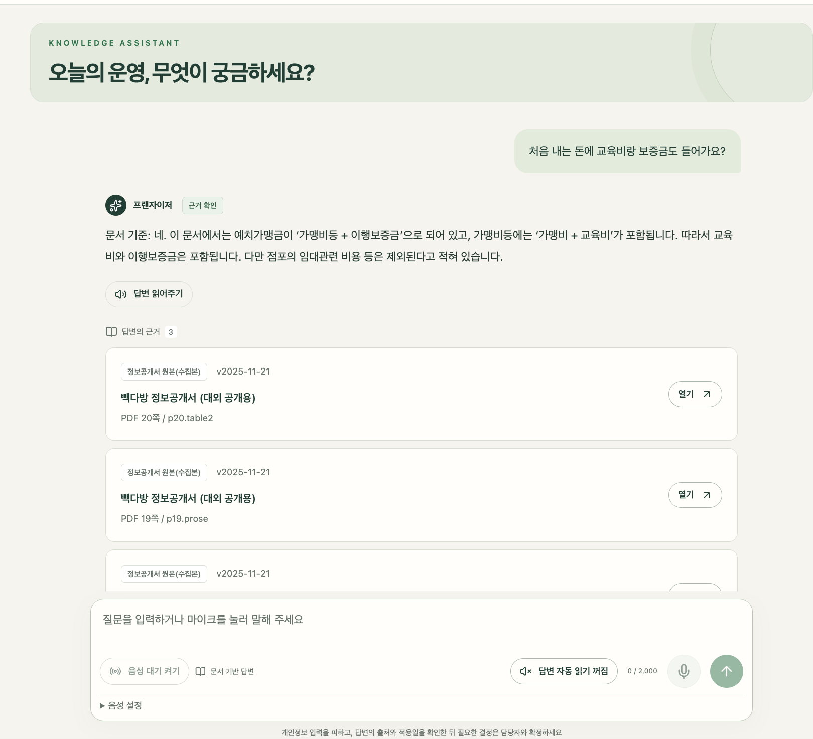

*그림 1. 정보공개서에 기재된 가맹비등·이행보증금의 구성 관계와 임대 관련 비용 제외 설명을 제공하고, 사용한 문서의 쪽수·판본을 표시한다.*

**행동 2:** 정보공개서를 받은 직후 계약금을 납부할 수 있는지 질문한다.

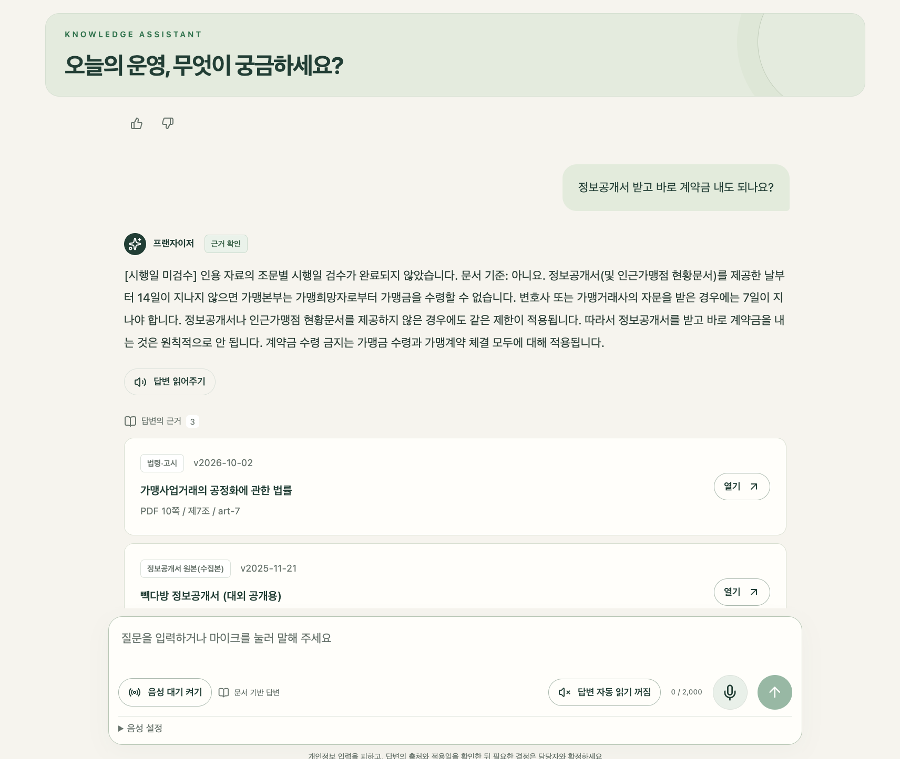

*그림 2. 수집한 법령의 원칙·자문 시 예외를 설명하고 제7조 출처를 연결한다. 화면의 ‘시행일 미검수’ 표시는 조문별 적용 시점 검토가 남아 있음을 뜻한다.*

#### ② 매장 운영 — 전체 레시피 대신 필요한 계량·옵션 확인

**행동 1:** 제조 중 아이스 바닐라라테의 시럽 펌프 수만 질문한다.

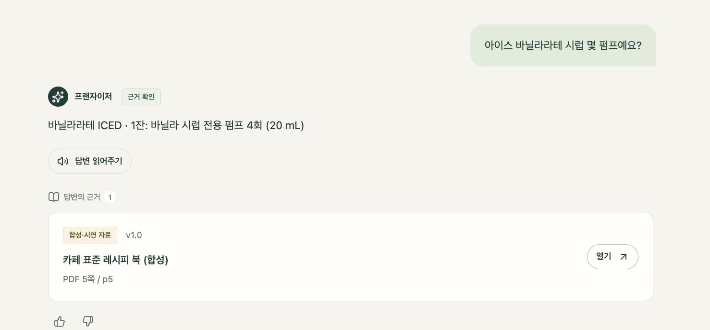

*그림 3. 합성 레시피 v1.0 기준 전용 펌프 4회(20 mL)를 간결하게 반환하고 원문 5쪽을 표시한다. 이 화면은 v1.0 응답 사례이며 이후 모든 시점의 현재 기준을 의미하지 않는다.*

**행동 2:** 딸기라테의 얼음 적게 옵션에서 우유를 추가해야 하는지 질문한다.

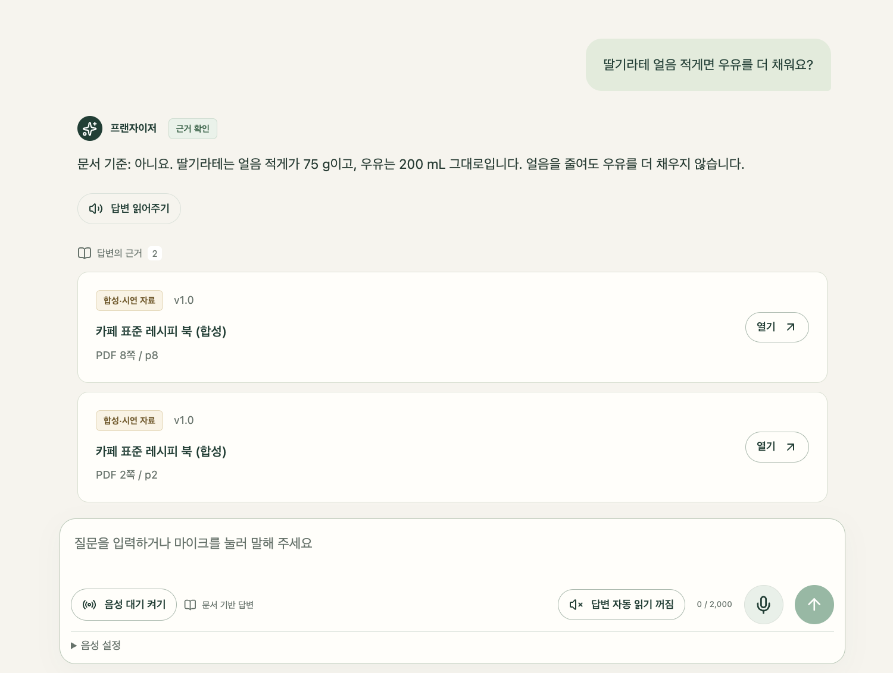

*그림 4. 합성 레시피의 옵션 기준에 따라 얼음 75 g·우유 200 mL를 설명하고, 얼음을 줄여도 우유를 추가하지 않는다는 기준과 출처를 제공한다.*

#### ③ 본사 지원 — 반복 주제와 문의 기록을 함께 확인

**행동 1:** 본사 담당자가 기간·지역 등의 조건을 선택해 문의 현황을 조회한다.

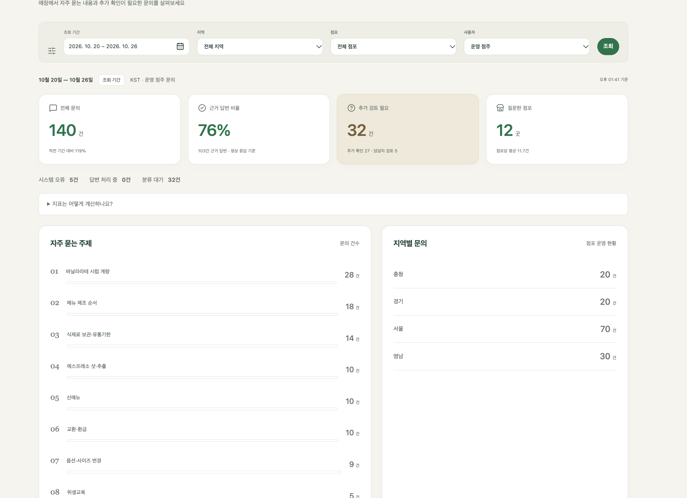

*그림 5. 2026-10-20~10-26 조회 화면에서 전체 문의·추가 검토 필요·반복 주제·지역별 건수를 DB 집계로 확인한다. 합성 시연 기록 등을 포함한 결과이며 실제 운영 성과나 RAG 정답률이 아니다.*

**행동 2:** 문의 목록에서 질문·점포·분류·답변 상태·처리 상태를 확인하고 상세 보기로 이동한다.

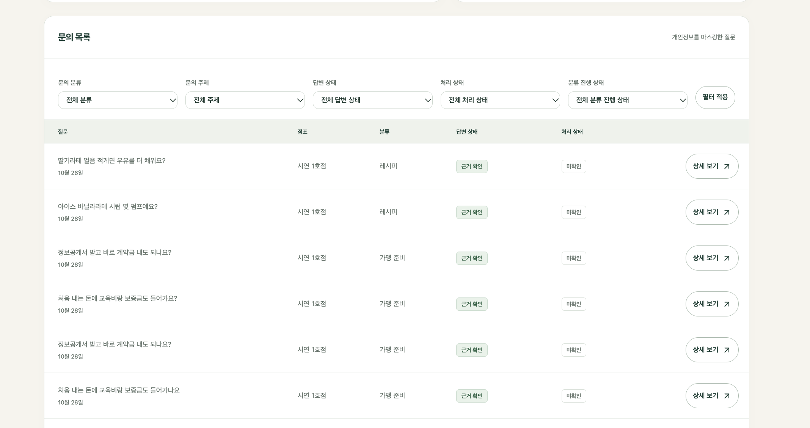

*그림 6. 점주의 질문이 본사 문의 기록으로 연결된 화면이다. 이 캡처는 전체 상태 목록이며 ‘추가 확인 필요’ 필터 적용 결과가 아니다. ‘근거 확인’은 답변 상태, ‘미확인’은 본사 처리 상태로 서로 다른 의미다.*

**확인 범위:** 그림 5~6은 본사 집계와 문의 이력 조회의 사례다. B02의 ‘서울·추가 확인 필요’ 조건 조회는 이 캡처에 포함되지 않아, 해당 필터 결과까지 완료했다고 해석하지 않는다.

#### ④ 변경 전파 — 새 판본 배포와 답변 반영 확인

**행동 1:** 본사가 문서의 판본 이력에서 배포·검색 준비·적용일을 확인한다.

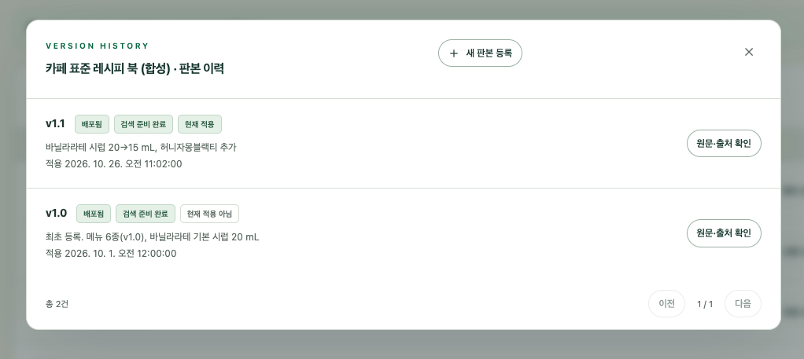

*그림 7. v1.1의 바닐라 시럽 20→15 mL 변경과 신메뉴 추가, 적용일 및 현재 적용 상태를 확인한다. v1.0은 이력으로 유지하면서 현재 적용 판본과 구분한다.*

**행동 2:** 같은 메뉴·온도의 시럽 질문에 대해 판본별 응답을 비교한다.

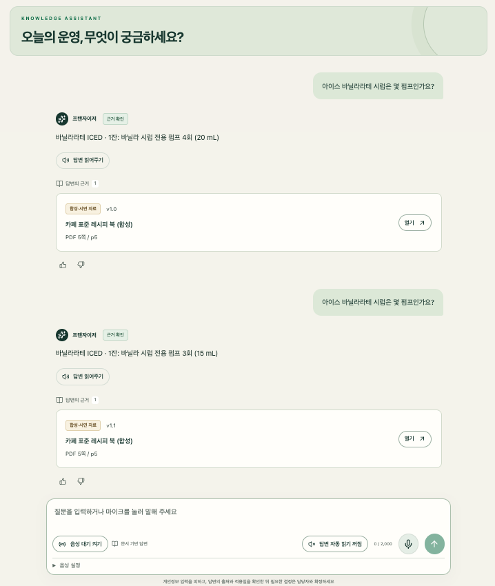

*그림 8. 동일 질문의 v1.0 응답은 4회(20 mL), v1.1 응답은 3회(15 mL)이며 출처 판본도 바뀐다. 캡처에는 각 요청의 기준 날짜가 보이지 않으므로, 이 화면만으로 과거·미래 기준 조회까지 검증했다고 보지는 않는다.*

**행동 3:** 본사가 변경 공지 목록에서 공지 내용·적용 시점을 확인하고 해당 공지의 점포 확인 현황을 연다.

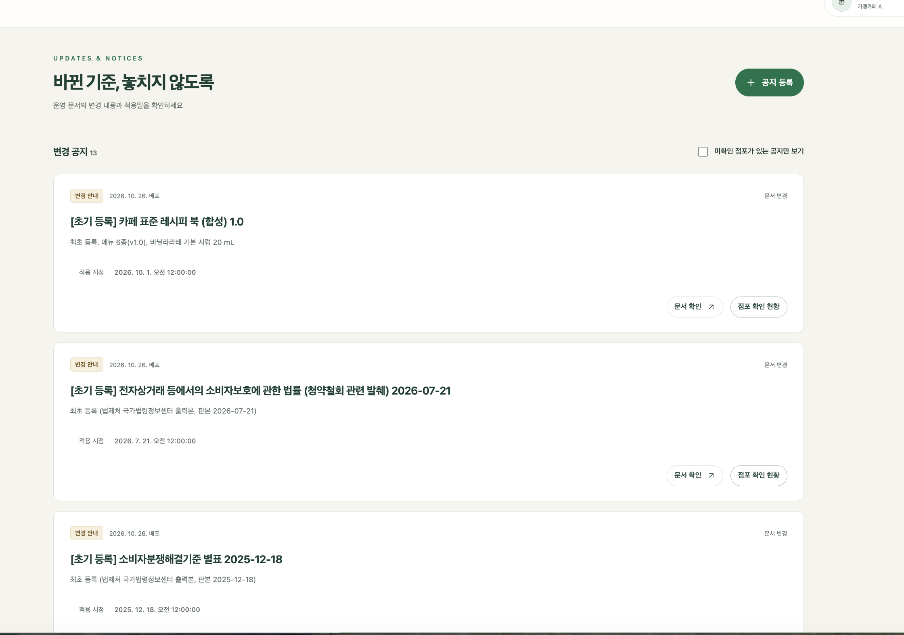

*그림 9. 문서 등록·배포와 연결된 공지 목록에서 내용·적용 시점을 확인하고 ‘점포 확인 현황’으로 이동한다. 캡처에 표시된 레시피 공지는 v1.0 초기 등록 안내다.*

**행동 4:** 해당 공지의 확인 수와 점포별 확인 여부를 조회한다.

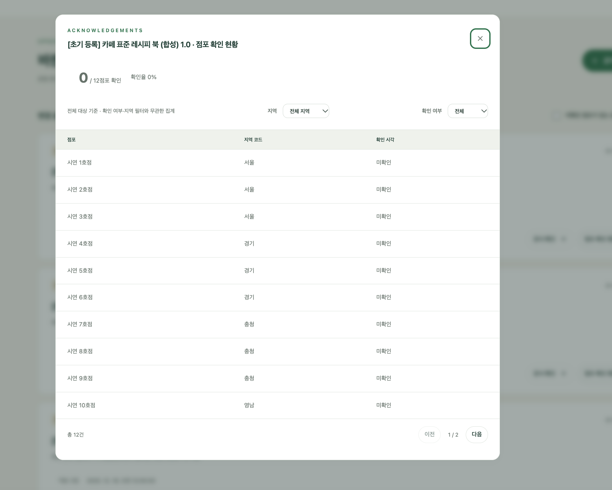

*그림 10. v1.0 초기 등록 공지의 대상 12점포 중 확인 0점포(0%)와 점포별 미확인 상태를 조회한다. 전체 대상 집계와 지역·확인 여부 필터를 구분한다. 공지 확인은 실제 제조 적용 완료를 의미하지 않는다.*

**확인 범위:** 그림 7~8은 v1.1 판본·답변 변경을, 그림 9~10은 v1.0 초기 등록 공지의 조회·미확인 현황을 보여준다. 각 기능의 동작 사례이며, 동일한 v1.1 변경이 점포 확인 완료까지 이어졌다는 연속 검증 결과는 아니다.


## 6. 교재 기반 3계층 아키텍처·인증 흐름

### 6.1 교재 구조를 3계층에 대응

교재 **19페이지의 전체 상용 서비스 아키텍처, 20페이지의 요청 흐름, 27페이지의 JWT 검증, 31페이지의 RAG 응답 계약**을 참고한다. 교재의 구성요소를 다음과 같이 3계층으로 묶는다. 계층 수와 컨테이너 수는 다르며, Java와 FastAPI는 같은 애플리케이션 계층 안에서 역할을 나눈다.

| 3계층                                       | 교재의 구성요소                               | 본 서비스의 책임                                                         |
| ------------------------------------------- | --------------------------------------------- | ------------------------------------------------------------------------ |
| **Tier 1. Presentation — 화면 계층**        | Vue.js 프론트엔드                             | 로그인, 질문·출처, 문서 관리, 공지·확인·집계, FAQ, 음성 입력             |
| **Tier 2. Application — 애플리케이션 계층** | Java 인증·게이트웨이, FastAPI RAG·음성 서비스 | JWT 발급·검증, 업무 권한, 근거 검색·답변, 문서 승인·색인·배포, 로그·집계 |
| **Tier 3. Data — 데이터 계층**              | 회원 DB, 문서·FAISS                           | 계정·권한, 업무 상태, 원문·가공 이력·판본, 검색 인덱스 보존              |

외부 LLM·임베딩 API는 애플리케이션이 호출하는 외부 연동이다. 모델의 추론 연산을 데이터 저장 계층과 혼동하지 않도록 별도로 표시한다.

### 6.2 3계층 Mermaid 아키텍처

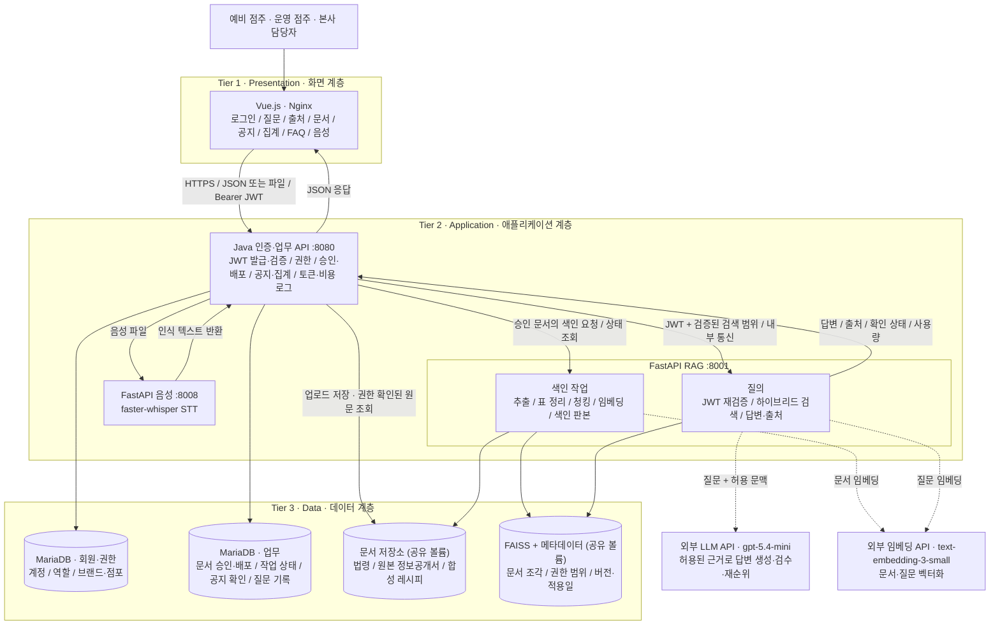

질문과 문서에 동일한 임베딩 모델·설정을 사용한다. 교재의 External RAG처럼 외부 API를 쓰며, 모델은 `.env`의 `LLM_MODEL=gpt-5.4-mini`, `EMBEDDING_MODEL=text-embedding-3-small`(1536차원)로 설정한다. 임베딩 모델을 바꾸면 질의·문서 임베딩을 함께 전환하고 전체를 다시 색인한다.

색인 작업은 RAG 서비스 안에서 백그라운드 작업으로 실행한다. 별도 작업 서버·메시지 브로커는 두지 않았다. 같은 `job_id` 재요청은 기존 작업을 돌려주고, 재시작 시 끊긴 작업은 실패(`INTERRUPTED`)로 기록한다. 회원·업무 정보는 같은 MariaDB에 두며, AI 서비스는 DB에 직접 접근하지 않고 Java가 계산한 허용 판본 목록만 받는다. 업로드 문서와 FAISS 색인은 backend·rag가 함께 쓰는 볼륨(`/var/lib/frangizer`)에 저장한다.

### 6.3 로그인부터 근거 답변까지

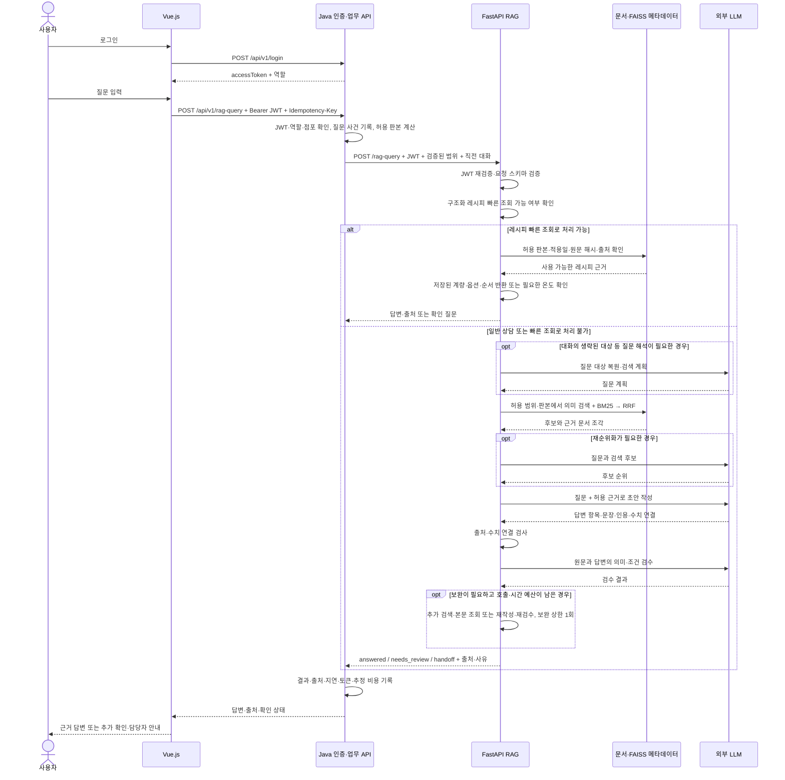

질문 접수 시에도 서버가 사건 ID·점포·지역·접수 시각을 기록하고, 위 응답 단계에서 결과를 갱신한다. 분류·집계는 업무 DB를 읽는 별도 처리이며, 기존 질문 기록은 자동으로 답변용 지식베이스에 넣지 않는다.

### 6.4 인증·접근 제어와 배포

- **공개 진입점:** Vue.js에서 호출하는 `/api/v1/*`는 Nginx를 통해 Java API로 전달한다. Java는 인증·업무 API를 처리하고 RAG·STT 요청을 해당 내부 서비스로 라우팅한다. 교재의 FastAPI `/rag-query` 경로는 내부 경로로 유지한다.
- **토큰:** Java가 JWT(HS256, `iss=frangizer`, `aud=frangizer-api`)를 발급하고 Java·FastAPI가 서명·만료·발급자·대상 값을 검증한다. 서비스 간 호출에는 `X-Internal-Token`을 함께 쓴다. 역할·브랜드·점포 범위는 서버가 확인한다. Java를 통하지 않은 외부 요청이 내부의 신뢰된 검색 범위를 임의로 주입할 수 없게 네트워크와 서비스 인증을 제한한다.
- **문서 권한:** `prospect`는 공개 가맹 자료, `owner`는 소속 브랜드·점포에 허용된 운영 자료, `hq`는 허용된 본사 업무 자료를 조회한다. 관리 동작에는 `document:approve`, `document:publish` 등의 별도 권한을 확인한다.
- **검색·원문:** 검색 전에 허용된 문서 집합·판본을 정한다. 답변 이후 출처·원문 조회에도 같은 권한을 적용한다. 다른 사용자의 대화 ID와 점포 ID를 입력해도 자료 범위가 넓어지지 않는다.
- **오류:** 인증 실패·만료는 `401`, 인증 후 권한 부족은 `403`이다. Vue는 로그인 복귀와 접근 제한을 구분해 안내한다.
- **배포:** Docker Compose로 web(Nginx)·backend·rag·voice·db 5개 서비스를 기동한다. DB·문서·FAISS·음성 모델 캐시는 영속 볼륨에 저장한다. 외부 공개는 웹 진입점(80)으로 제한하며 DB·RAG·음성 포트는 내부 통신에만 쓴다. 개발용 Compose(`docker-compose.dev.yml`)는 내부 포트를 `127.0.0.1`에만 열어 운영 배포와 구분한다.
- **키·로그:** JWT 서명키·모델 API 키는 서버 환경변수(`.env`, 커밋 금지)로 관리한다. 브라우저 번들·응답·일반 로그에 포함하지 않는다.

RAG·임베딩·색인은 필수다. 답변용 Open Weight 모델 직접 서빙은 후속 선택이다. 이번 3계층 도식은 계층 분리를 보여주는 설계이며, Compose 단일 환경이 고가용성·상용 운영 수준까지 보장한다는 뜻은 아니다.

### 6.5 기술 스택

| 계층      | 기술                                                                                        |
| --------- | ------------------------------------------------------------------------------------------- |
| Frontend  | Vue 3.5, Vite 7, Pinia, Vue Router, axios, Vitest, Nginx                                    |
| Backend   | Java 25, Spring Boot 4.1 (WebMVC·JDBC·Validation), Gradle, Flyway, jjwt, PDFBox, Swagger UI |
| DB        | MariaDB 11                                                                                  |
| RAG       | Python 3.11, FastAPI, Pydantic 2, LangChain·LangGraph(단일 상담 에이전트), OpenAI API       |
| 검색      | FAISS(정규화 벡터 내적 = 코사인), kiwipiepy 형태소 BM25, RRF 순위 결합, LLM 재순위          |
| 문서 처리 | PyMuPDF(본문·표 좌표), Camelot·pdfplumber(표 후보)                                          |
| Voice     | FastAPI, faster-whisper                                                                     |
| Infra     | Docker Compose, 공유 볼륨                                                                   |
| 계약      | OpenAPI 3.1 (공개 API·내부 RAG API)                                                         |

## 7. API 명세 — v1

공개 API 25개를 구현했다. 상세 규칙·스키마·담당별 구현 가이드는 [API 명세서](https://github.com/kimhynsoo/frangizer/blob/main/docs/api/API_%EB%AA%85%EC%84%B8%EC%84%9C.md)와 OpenAPI(`docs/api/public.openapi.yaml`, `docs/api/internal-rag.openapi.yaml`)를 기준으로 하며, 이 장은 요약이다. 외부 공개 경로는 `/api/v1`, 내부 RAG 경로는 `/rag-query`로 구분한다. 교재의 예제 `/login`은 게이트웨이에서 `/api/v1/login`으로 매핑한다.

### 7.1 공통 규칙

| 항목        | 명세                                                                                                                                     |
| ----------- | ---------------------------------------------------------------------------------------------------------------------------------------- |
| 전송        | HTTPS, 기본 `application/json`; 파일 등록·음성은 `multipart/form-data`                                                                   |
| 인증        | 로그인·공개 상태 확인을 제외하고 `Authorization: Bearer <accessToken>`                                                                   |
| 식별자·시간 | ID는 문자열. 시각은 시간대가 포함된 RFC 3339, 예: `2026-10-22T09:00:00+09:00`                                                            |
| 권한        | `prospect`, `owner`, `hq`와 서버의 브랜드·점포 범위. 본사 관리 권한은 별도 검증                                                          |
| 성공 응답   | 업무 응답은 `data`와 `request_id`로 감싼다. 로그인은 교재 호환 필드 `accessToken` 사용. 공개 `/health`는 최소 상태만 반환                |
| 목록        | `page=1`, `page_size=20`, 최대 100. 응답에 `meta.page`, `meta.page_size`, `meta.total`, `meta.total_pages` 제공                          |
| 질문 기록   | 다른 사용자의 대화 접근 금지. 원문 대신 마스킹본·유형·상태·사용량을 저장                                                                 |
| 중복 방지   | 질문·등록·승인·배포 요청에는 `Idempotency-Key` 필수. 같은 사용자·경로·키·내용은 기존 결과 반환, 같은 키의 다른 내용은 `409`. 24시간 보존 |
| 크기 제한   | 문서 10MB, 음성 10MB·60초. 초과 시 `413`. 계정별 요청 수 제한(`429`)은 계약에만 있고 아직 구현하지 않았다                                |

### 7.2 엔드포인트 목록

아래 표의 경로에는 모두 `/api/v1`이 앞에 붙는다. `doc_id`는 문서 계열, `ver_id`는 변경할 수 없는 개별 판본 ID다.

| 메서드·경로                                          | 목적                            | 권한                        | 정상 코드        |
| ---------------------------------------------------- | ------------------------------- | --------------------------- | ---------------- |
| `POST /login`                                        | 계정 인증·JWT 발급              | 비로그인                    | `200`            |
| `GET /me`                                            | 본인 역할·브랜드·점포·권한 확인 | 인증 사용자                 | `200`            |
| `POST /rag-query`                                    | 근거 답변·확인 필요 상태 반환   | 인증 사용자, 문서 범위 제한 | `200`            |
| `GET /conversations/{conversation_id}`               | 본인 대화의 마스킹 기록         | 본인                        | `200`            |
| `PUT /questions/{question_id}/feedback`              | 답변 도움 여부 기록             | 본인                        | `200`            |
| `GET /documents`                                     | 허용된 문서·대표 판본 목록      | 인증 사용자                 | `200`            |
| `POST /documents`                                    | 문서 또는 새 판본 등록          | 본사 문서 등록 권한         | `201`            |
| `GET /documents/{doc_id}/versions`                   | 허용된 판본 이력                | 판본 열람 권한              | `200`            |
| `GET /documents/{doc_id}/versions/{ver_id}`          | 해당 판본의 출처·본문 조각      | 판본 열람 권한              | `200`            |
| `GET /documents/{doc_id}/versions/{ver_id}/file`     | 원본 파일 다운로드              | 판본 열람 권한              | `200`            |
| `POST /documents/{doc_id}/versions/{ver_id}/approve` | 승인·비동기 색인 시작           | 본사 승인 권한              | `202`            |
| `GET /index-jobs/{job_id}`                           | 색인 작업 상태 조회             | 본사 문서 등록 권한         | `200`            |
| `POST /documents/{doc_id}/versions/{ver_id}/publish` | 준비된 판본 배포·공지 생성      | 본사 배포 권한              | `200`            |
| `GET /notices`                                       | 본인 대상 변경 공지 목록        | `owner`, `hq`               | `200`            |
| `PUT /notices/{notice_id}/ack`                       | 본인 소속 점포의 공지 확인 기록 | 공지 대상 점포의 `owner`    | `200`            |
| `GET /notices/{notice_id}/acknowledgements`          | 대상 점포의 확인·미확인 현황    | 본사 분석 권한              | `200`            |
| `GET /regions` · `GET /stores` · `GET /topics`       | 대시보드 필터 목록              | 본사 분석 권한              | `200`            |
| `GET /analytics/questions`                           | 주간·지역·유형별 질문 집계      | `hq`, 소속 브랜드 범위      | `200`            |
| `GET /analytics/question-events`                     | 마스킹된 질문 목록              | `hq`, 소속 브랜드 범위      | `200`            |
| `GET /analytics/question-events/{question_id}`       | 질문 한 건 상세                 | `hq`, 소속 브랜드 범위      | `200`            |
| `PATCH /analytics/question-events/{question_id}`     | 분류·실제 처리 상태 수정        | `hq`, 분석 수정 권한        | `200`            |
| `POST /stt`                                          | 음성을 질문 텍스트로 변환       | 인증 사용자                 | `200`            |
| `GET /health`                                        | 최소 서비스 준비 상태           | 공개, 내부 상세는 비공개    | `200` 또는 `503` |

계정은 시연용으로 미리 준비한다(본사 1, 운영 점주 12, 예비 점주 1). 회원가입·비밀번호 복구·토큰 갱신은 범위에 넣지 않았으며, 토큰 만료 시 다시 로그인한다.

### 7.3 로그인·본인 정보

`POST /api/v1/login` 요청:

```json
{
  "username": "demo-owner-a001",
  "password": "<DEMO_PASSWORD>"
}
```

성공 응답 — 토큰 값은 형식 설명용이다.

```json
{
  "accessToken": "<JWT>",
  "token_type": "Bearer",
  "expires_in": 3600,
  "user": {
    "id": "user-demo-01",
    "username": "demo-owner-a001",
    "role": "owner",
    "brand_id": "brand-demo-a",
    "store_id": "demo-store-01",
    "region_code": "SEOUL",
    "permissions": ["rag:ask"]
  },
  "request_id": "req-login-001"
}
```

`GET /api/v1/me`는 위 `user` 구조를 `data`에 담아 반환한다. 시연 계정 비밀번호는 저장소에 두지 않고 `.env`의 `DEMO_PASSWORD`로 설정한다. 로그인 오류는 계정 존재 여부를 구분하지 않고 `401 AUTH_FAILED`로 안내한다.

### 7.4 RAG 질의 요청·응답

`POST /api/v1/rag-query` 요청:

```json
{
  "question": "아이스 바닐라라테 제조 순서 알려주세요.",
  "conversation_id": null,
  "as_of": "2026-10-23T10:00:00+09:00"
}
```

| 요청 필드         | 필수 | 검증·처리                                                                                          |
| ----------------- | ---- | -------------------------------------------------------------------------------------------------- |
| `question`        | 필수 | 공백 제거 후 1~2,000자. 음성 질문도 사용자가 확인한 텍스트로 전송                                  |
| `conversation_id` | 선택 | 신규는 생략·`null`. 기존 ID는 소유자 확인, 무단 접근은 `403`. 같은 대화의 직전 6턴까지 RAG에 전달  |
| `as_of`           | 선택 | 생략하면 서버의 현재 시각. 공개·배포된 판본 중 해당 시점의 기준 검색. 과거·미래 기준은 답변에 명시 |

서버가 판정하는 `role`, `brand_id`, `store_id`, 승인 상태는 질의 본문에서 받지 않는다(받으면 `422`). 미래 적용일로 배포된 문서는 현재 질문의 근거에서 제외하고, 사용자가 해당 미래 시점을 명시한 경우에만 예정 기준임을 표시한다.

성공 응답 예시 — 제조 내용은 문서 구조 설명용 합성 예시다.

```json
{
  "data": {
    "question_id": "q-demo-0001",
    "conversation_id": "conv-demo-01",
    "answer": "등록된 합성 카페 표준 레시피 v1.0을 기준으로 안내합니다. 실제 브랜드 제조법이 아닌 시연 기준입니다.",
    "steps": [
      "바닐라 시럽 20 mL와 에스프레소 60 mL를 별도 용기에서 섞습니다.",
      "컵에 우유 170 mL와 얼음 180 g을 넣은 뒤 혼합액을 붓습니다."
    ],
    "status": "answered",
    "needs_review": false,
    "handoff": false,
    "sources": [
      {
        "chunk_id": "chk-recipe-10-p5-01",
        "document_id": "demo-cafe-recipes",
        "version_id": "demo-cafe-recipes-1.0",
        "title": "합성 카페 표준 레시피",
        "version": "1.0",
        "location": "PDF 5쪽 / 바닐라라테 ICED / 제조 순서",
        "page": 5,
        "effective_from": "2026-10-19T00:00:00+09:00",
        "effective_until": "2026-10-26T00:00:00+09:00",
        "material_type": "synthetic",
        "is_demo": true,
        "excerpt": "바닐라 시럽 20 mL와 에스프레소 60 mL를 별도 용기에서 섞는다.",
        "detail_url": "/api/v1/documents/demo-cafe-recipes/versions/demo-cafe-recipes-1.0",
        "file_url": "/api/v1/documents/demo-cafe-recipes/versions/demo-cafe-recipes-1.0/file"
      }
    ],
    "follow_up_questions": [],
    "handoff_reason": null,
    "category": "recipe",
    "as_of": "2026-10-23T10:00:00+09:00",
    "basis": "current",
    "latency_ms": 2100
  },
  "request_id": "req-rag-001"
}
```

| 응답 항목                               | 계약                                                                                                                    |
| --------------------------------------- | ----------------------------------------------------------------------------------------------------------------------- |
| `answer`, `steps`                       | 핵심 설명과 확인·처리 순서. 숫자·단위는 문서에 근거해 제공                                                              |
| `sources`                               | 실제 검색에 사용한 허용 문서만 포함. 문서·판본 ID, 위치, 근거 발췌, 자료 유형, 적용일, 권한 검증되는 상세·파일 URL 제공 |
| `status`                                | `answered`, `needs_review`, `handoff` 중 하나                                                                           |
| `needs_review`, `handoff`               | 교재 응답 계약과 호환하기 위한 불리언. 아래 규칙대로 서버에서 일관되게 산출                                             |
| `follow_up_questions`, `handoff_reason` | 부족한 정보와 검토 사유. 확인 상태에서는 사유 또는 추가 질문을 필수 제공                                                |
| `category`                              | `franchise`, `recipe`, `hygiene`, `consumer`, `other` 중 하나                                                           |
| `basis`                                 | `past`, `current`, `future`. 현재가 아니면 해당 시점 기준임을 표시                                                      |
| `latency_ms`                            | 질의 처리 지연시간. 토큰·비용은 응답에 넣지 않고 질문 기록·운영 로그에서 관리                                           |

상태 조합은 `answered → false/false`, `needs_review → true/false`, `handoff → true/true`로 고정한다. 근거가 부족한 응답도 정상 업무 응답이므로 HTTP `200`이다. 근거가 전혀 없으면 `sources=[]`, 확인된 일부 근거만 있으면 해당 자료만 제공한다. 모델 장애를 근거 부족 상태로 숨기지 않는다.

### 7.5 문서 등록·승인·색인·배포

**① 등록 — `POST /api/v1/documents`**

`multipart/form-data`로 `file`과 `metadata`(JSON 문자열) 두 파트를 보낸다. 허용 파일은 PDF·TXT·Markdown, 파일당 최대 10MB이며 서버가 실제 형식·쪽수를 검사한다.

| `metadata` 필드            | 필수 | 의미                                                                                    |
| -------------------------- | ---- | --------------------------------------------------------------------------------------- |
| `title`, `version`         | 필수 | 표시 제목, 판본 이름                                                                    |
| `category`                 | 필수 | `franchise`, `recipe`, `hygiene`, `consumer`, `other` 중 문서의 대표 유형               |
| `document_id`              | 선택 | 기존 문서에 새 판본을 추가할 때 지정. 생략하면 새 문서 생성                             |
| `material_type`, `is_demo` | 필수 | `official`, `public_disclosure`, `synthetic`과 내용의 합성 여부                         |
| `visibility`               | 필수 | `prospect`, `owner`, `hq` 중 하나를 최소 허용 역할로 지정. 브랜드·점포 범위는 별도 검증 |
| `effective_from`           | 필수 | 문서 내용이 적용될 시각. 법령은 원문 시행 정보를 검수                                   |
| `original_source`          | 필수 | 원문 제목·URL·판본·발행처·수집일·비고. 합성 자료는 팀 작성 출처 기록                    |
| `change_summary`           | 필수 | 최초 등록 또는 이번 변경의 요약                                                         |
| `indexing_policy`          | 필수 | 포함·제외할 쪽(표지·목차 제외 등)과 법령 시점 검토 여부                                 |

기존 문서와 같은 판본 이름은 `409 VERSION_CONFLICT`다. 새 파일은 새 판본으로 보존하고 배포된 판본의 내용을 덮어쓰지 않는다. 공개 가맹 참고서는 `prospect`, 레시피는 `owner`로 등록한다. 허용 역할은 `prospect → prospect/owner/hq`, `owner → owner/hq`, `hq → hq`로 매핑하고 브랜드·점포·관리 권한을 추가로 검증한다. 등록 성공 시 생성된 판본의 상세 경로를 `Location` 헤더로 반환한다.

응답 `201`:

```json
{
  "data": {
    "document_id": "demo-cafe-recipes",
    "version_id": "demo-cafe-recipes-1.1",
    "version": "1.1",
    "lifecycle": "draft",
    "index_status": "not_started"
  },
  "request_id": "req-upload-001"
}
```

**② 승인 — `POST /api/v1/documents/{doc_id}/versions/{ver_id}/approve`**

헤더 `Idempotency-Key`와 요청 `{"review_note":"계량·적용일·출처 검수 완료"}`를 보낸다. 서버는 승인 상태를 기록하고 RAG에 색인 작업을 요청한다. 응답 `202`의 `data`는 `version_id`, `lifecycle="approved"`, `index_status="queued"`, `job_id`를 포함한다.

**③ 작업 조회 — `GET /api/v1/index-jobs/{job_id}`**

응답 `200`의 `data`에 `job_id`, `version_id`, `status`, `chunk_count`, `index_revision`, `error_code`를 제공한다. 상태는 `queued`, `running`, `succeeded`, `failed`다. 실패 코드는 `CHECKSUM_MISMATCH`, `PAGE_POLICY_INVALID`, `EXTRACTION_FAILED`, `EMBEDDING_FAILED`, `EMBEDDING_NOT_CONFIGURED`, `INTERRUPTED` 등으로 구분한다. 내부 파일 경로와 비밀키는 노출하지 않는다. 작업 실패는 기존 배포 판본의 답변에 영향을 주지 않는다.

**④ 배포 — `POST /api/v1/documents/{doc_id}/versions/{ver_id}/publish`**

헤더 `Idempotency-Key`와 요청 `{"notice_title":"합성 레시피 v1.1 적용 안내"}`를 보낸다. 승인됐고 색인이 준비된 판본만 배포할 수 있으며, 그 외는 `409 INDEX_NOT_READY` 또는 `409 INVALID_STATE`다. 대상 점포·역할은 문서 접근 범위에서 서버가 산출해 배포 시점에 고정한다.

응답 `200`:

```json
{
  "data": {
    "document_id": "demo-cafe-recipes",
    "version_id": "demo-cafe-recipes-1.1",
    "lifecycle": "published",
    "index_status": "ready",
    "effective_from": "2026-10-26T00:00:00+09:00",
    "published_at": "2026-10-23T11:00:00+09:00",
    "notice_id": "notice-demo-002"
  },
  "request_id": "req-publish-001"
}
```

문서 상태는 `draft → approved → published`, 색인 상태는 `not_started → queued → running → ready/failed`로 별도 관리한다. 승인 후 내용·권한·적용일 변경은 새 판본으로 등록한다. 검색은 `published + ready + 허용 범위 + 질의 적용일`을 모두 만족하는 판본만 사용한다.

새 판본을 배포해도 이전 판본과 적용 이력은 보존한다. 판본 배포·직전 판본 적용 종료일 설정·공지 생성·대상 점포 고정은 한 트랜잭션으로 처리하고, 적용 시각이 겹치면 `409 EFFECTIVE_DATE_CONFLICT`로 막는다. 미래 판본의 배포는 현재 기준을 즉시 대체하지 않는다.

### 7.6 문서 목록·공지·본사 집계

| API                                         | 입력                                                                                             | 응답 `data`의 핵심 항목                                                                                                                                                |
| ------------------------------------------- | ------------------------------------------------------------------------------------------------ | ---------------------------------------------------------------------------------------------------------------------------------------------------------------------- |
| `GET /documents`                            | `category`, `as_of`, `management`, `page`, `page_size` 선택                                      | 허용된 문서의 `document_id`, `title`, `selected_version_id`, `lifecycle`, `index_status`, `effective_from`, `material_type` 목록                                       |
| `GET /documents/{doc_id}/versions/{ver_id}` | 경로 ID                                                                                          | 판본 메타데이터, `sections`, `original_source`, `indexing_policy`. 초안·승인 판본은 본사 관리 권한만 열람                                                              |
| `GET /notices`                              | `unread`, `page`, `page_size` 선택                                                               | `notice_id`, `title`, `version_id`, `change_summary`, `effective_from`, `acknowledged_at` 목록                                                                         |
| `PUT /notices/{notice_id}/ack`              | 본문 `{}`                                                                                        | `notice_id`, `store_id`, `acknowledged_by`, `acknowledged_at`. 점포는 인증 범위에서 결정                                                                               |
| `GET /notices/{notice_id}/acknowledgements` | `acknowledged`, `region_code`, `page`, `page_size` 선택                                          | 배포 시 대상 점포 기준의 `target_count`, `acknowledged_count`, 점포별 확인 시각                                                                                        |
| `GET /analytics/questions`                  | `week_start` 또는 `from/to`, `region_code`, `store_id`, `category`, `topic_id`, `user_role` 선택 | 기간·필터, `total`, `answered_count`, `review_required_count`, `system_error_count`, `active_store_count`, `by_region`, `by_category`, `top_topics`, `previous_period` |
| `GET /analytics/question-events`            | 같은 기간·범위 필터, `answer_status`, `resolution_status`, `classification_status`, 페이지       | 마스킹 질문·접수 시각·당시 지역·응답 상태·담당자 처리 상태·관련 출처                                                                                                   |

공지 확인은 같은 공지·점포에 대한 재요청 시 기존 확인 기록을 반환한다. 다른 점포 대신 확인할 수 없고, 확인 시각은 서버가 기록한다. 목록 API에는 공통 `meta` 페이지 정보를 제공한다.

본사 집계의 조회 기간은 최대 31일이다. 화면은 오늘 포함 최근 7일·owner로 조회하고, API에서 기간을 생략하면 지난 완료 주·owner를 기본으로 사용한다. 브랜드 범위는 인증에서 결정한다. `review_required_count`는 needs_review와 handoff의 합계이고, 실제 처리중·종결 상태와 구분한다. 근거 답변 비율은 answered / (answered + needs_review + handoff)이며 시스템 오류를 따로 표시한다. 질문 상세는 권한 있는 담당자에게 마스킹 후 제공한다. 공지 대상 점포 수와 확인 수는 동일한 배포 대상 집합을 기준으로 계산한다. 기간·지역·분모가 없는 비율은 N/A로 표시한다.

### 7.7 음성·상태 확인·오류

- **`POST /api/v1/stt`:** `audio` 파일을 전송한다. WebM·WAV, 10MB 이하·60초 이하다. Java가 내부 음성 서비스로 전달하고 응답은 `data.text`, `data.duration_ms`다. 인식 텍스트를 화면에서 확인·수정한 뒤 별도 `/rag-query`로 전송하며, 음성 원본은 저장하지 않는다. 음성 모델이 준비되기 전이나 서비스가 없으면 `503`이고 화면은 텍스트 질문으로 안내한다.
- **`GET /api/v1/health`:** `{"status":"ready"}` 또는 `{"status":"not_ready"}`만 반환한다. 서버 주소·키·문서 수 등 상세 상태는 내부 운영에서 확인한다.
- **오류 형식:** HTTP 상태와 기계 판독 코드, 사용자 안내, 추적 ID, 재시도 가능 여부를 분리한다.

```json
{
  "error": {
    "code": "INDEX_NOT_READY",
    "message": "문서 검색 준비가 끝난 뒤 배포할 수 있습니다.",
    "details": [],
    "question_id": null,
    "retryable": false
  },
  "request_id": "req-error-001"
}
```

| HTTP                | 코드 예시                                                                                                 | 의미·화면 동작                                         |
| ------------------- | --------------------------------------------------------------------------------------------------------- | ------------------------------------------------------ |
| `400`               | `MALFORMED_REQUEST`                                                                                       | JSON·요청 형식 오류                                    |
| `401`               | `AUTH_FAILED`, `AUTH_REQUIRED`, `TOKEN_EXPIRED`                                                           | 로그인 실패 또는 로그인 안내, 입력 내용 보존           |
| `403`               | `FORBIDDEN`                                                                                               | 역할·브랜드·점포·문서 접근 제한                        |
| `404`               | `RESOURCE_NOT_FOUND`                                                                                      | 대상 문서·판본·공지·작업 없음                          |
| `409`               | `INVALID_STATE`, `VERSION_CONFLICT`, `INDEX_NOT_READY`, `EFFECTIVE_DATE_CONFLICT`, `IDEMPOTENCY_CONFLICT` | 상태·판본·중복 요청 충돌                               |
| `413`, `415`        | `FILE_TOO_LARGE`, `UNSUPPORTED_MEDIA_TYPE`                                                                | 파일 크기·형식 안내                                    |
| `422`               | `VALIDATION_ERROR`                                                                                        | 필수 항목·길이·날짜 검증 실패, `details`에 필드명 제공 |
| `429`               | `RATE_LIMITED`                                                                                            | 사용량 제한(계약만 정의, 미구현)                       |
| `502`, `503`, `504` | `UPSTREAM_ERROR`, `SERVICE_UNAVAILABLE`, `UPSTREAM_TIMEOUT`                                               | 외부 모델·서비스 장애와 지연 안내                      |
| `500`               | `INTERNAL_ERROR`                                                                                          | 추적 ID와 일반 오류 안내, 내부 상세는 서버에만 기록    |

## 8. 품질·위험 관리

| 주요 오류                                 | 대응 설계                                                                                                          | 검증 방법                                                        |
| ----------------------------------------- | ------------------------------------------------------------------------------------------------------------------ | ---------------------------------------------------------------- |
| 없는 비용·규정·레시피를 생성              | 검색 근거 범위 내 답변, 문장별 근거 검수, 근거 부족 상태 반환                                                      | 문서에 없는 질문과 허위 전제 질문                                |
| 법령·정보공개서·합성 자료 혼동            | 자료 유형과 적용 범위를 답변·출처에 표시                                                                           | 서로 다른 자료를 함께 요구하는 질문                              |
| 오래된 문서를 최신 기준으로 안내          | 시행·적용일·배포 상태로 판본 선택, 시행 예정 조문의 적용 기간 분리                                                 | 동일 질문을 변경 전후·미래 적용일로 비교                         |
| 계량·표의 단위 누락, 표의 옆 칸 숫자 인용 | 레시피 구조화 JSON, 원문 대조·합계 검산을 거친 표 데이터에서만 표 수치 사용. 검증되지 않은 표 근거는 답변에서 차단 | 숫자·단위·주석을 원문과 대조, 표 질문(교육비·보증금·인테리어 등) |
| 특정 요구를 위법으로 단정                 | 확인된 근거와 필요한 계약·사실관계 분리                                                                            | 추가 장비·비용·분쟁 질문                                         |
| 다른 역할의 자료 노출                     | 검색·답변·출처·원문에 권한 적용                                                                                    | 예비 점주와 점주 계정으로 같은 질문 비교                         |
| 개인정보 과잉 마스킹·누락                 | 이름 신호가 분명한 꼴만 마스킹, 질문 원문을 로그에 남기지 않음                                                     | 고객명 포함·미포함 문장 테스트                                   |
| 음성의 메뉴명·수량 오인식                 | 인식 문장 확인·수정 후 질의                                                                                        | 유사 메뉴명·계량 표현의 STT 시연                                 |

소비자분쟁해결기준은 분쟁 해결을 위한 합의·권고의 기준이며 적용 조건을 확인해야 한다. 단순히 해당 문서를 찾았다는 이유로 개별 환불·배상 결론을 자동 확정하지 않는다. [근거: 법제처 생활법령정보](https://www.easylaw.go.kr/CSP/CnpClsMainBtr.laf?ccfNo=3&cciNo=2&cnpClsNo=1&csmSeq=669&popMenu=ov)

## 9. 수익 구조와 비용 관리

### 9.1 수익 모델 가설

브랜드별 기본 구독료에 사용 점포 수 또는 이용량을 반영하는 B2B 구독형 모델을 검토한다. 고객이 비용을 지불하는 이유는 반복 문의 대응, 자료 탐색, 변경사항 재안내에 쓰는 시간을 줄일 수 있기 때문이다.

가격과 절감액은 본사 담당자 인터뷰와 사용량 측정 이후 산정한다. 예비 점주에게 질문별로 과금하는 방식보다 본사 도입을 우선 가설로 둔다.

### 9.2 주요 비용과 절감 방법

- 비용 항목: 문서 정제·검수, 임베딩, LLM 입력·출력, STT, 서버·저장소 운영.
- 같은 입력(파일 해시·쪽 정책·분할 방식·모델)의 색인은 다시 만들지 않고 재사용하며, 변경된 판본만 새로 임베딩한다. 검색 문맥과 답변 길이를 제한한다.
- 레시피 질문은 구조화 데이터로 답해 LLM 호출을 줄인다. 같은 멱등키 재전송은 RAG를 다시 부르지 않는다.
- STT는 외부 API 대신 자체 서버의 faster-whisper로 처리해 호출 비용이 없다.
- 질문마다 지연시간, 입력·출력·임베딩 토큰과 추정 비용(USD)을 요청 로그와 질문 기록에 남긴다. 단가는 환경변수(`LLM_PRICE_INPUT_PER_1M`, `LLM_PRICE_OUTPUT_PER_1M`, `EMBEDDING_PRICE_PER_1M`)로 설정한다.

## 10. 5인 역할분담

| 담당 파트         | 주요 작업                                                                                                        | 산출물                                                                                               | 담당자 |
| ----------------- | ---------------------------------------------------------------------------------------------------------------- | ---------------------------------------------------------------------------------------------------- | ------ |
| 데이터 파이프라인 | 원본 자료·합성 레시피 정리, 조문·표 추출, 시행 예정 조문 분리, 페이지·적용일 보존, 색인 작업 모듈, 시드 스크립트 | 자료 목록(manifest), 레시피 구조화 JSON, 표 데이터, 색인 모듈(FAISS 색인 판본), 시드·재색인 스크립트 | 김세령 |
| RAG·LLM           | 하이브리드 검색·재순위, 답변·출처 구성, 근거 검수, 근거 부족·담당자 확인, 되묻기, 질문 분류                      | RAG 코드, 상담 에이전트, 프롬프트, 응답 형식, 질문별 점검 결과                                       | 박인우 |
| 인증·API          | JWT·권한, 질문 사건·점포·지역 DB, 문서 승인·배포, 공지·확인, 주간·지역별 집계, 마스킹, 토큰·비용 로그            | API 명세·Swagger, 업무 DB, 인증·업무 처리 코드                                                       | 김현수 |
| Vue.js 프론트엔드 | 역할별 질문·출처 화면, 이어지는 대화·되묻기, 본사 문서 관리, 알림·확인·집계, FAQ, STT·핸즈프리 음성              | Vue 화면·컴포넌트, API 연결, 시연 화면                                                               | 박세웅 |
| 통합·배포·평가    | 실행 환경·Compose, 통합 검증, 평가 실행과 결과 집계, 발표 시연 준비                                              | Compose, README, 스모크 테스트, QA 결과표, 시연 영상                                                 | 성재원 |

33개 준비 사례를 분담 검토하고 각자 실제 사용자 표현의 변형 질문을 추가한다. 성재원이 평가 실행을 총괄하고, 발견된 오류는 해당 기능 담당자가 수정한다. 각자는 커밋·결과물과 함께 자신의 구현 부분을 설명한다.

## 11. 개발 일정·검증 계획

### 11.1 3일 개발 순서

| 일정  | 목표                                                         | 확인할 결과                                                                      |
| ----- | ------------------------------------------------------------ | -------------------------------------------------------------------------------- |
| Day 1 | 데이터 판본·권한·응답 형식 확정, 최소 RAG 연결               | 로그인 → 질문 → 근거 답변까지 성공                                               |
| Day 2 | Vue 통합, 질문 기록·분류, 주간·지역별 집계, 레시피 변경·공지 | 본사에서 반복 주제·지역별 문의 확인, 신규 판본 배포 이후 적용일별 답변·공지 변경 |
| Day 3 | 평가·수정, 배포·발표 준비                                    | 평가 결과표, 동일 환경 재실행, 전체 시연 완료                                    |

### 11.2 평가셋

정상 RAG 20개와 경계·변경·권한·본사 업무 13개를 구분한 33개 사례를 준비했다. 이를 바탕으로 25문항 QA표(`eval/results/2026-10-23/QA_결과.md`)를 만들어 1차 실행했다.

| 유형                | 문항 수 | 확인할 내용                                                   |
| ------------------- | ------- | ------------------------------------------------------------- |
| 정상·합성 레시피    | 12      | 계량·단위·제조 순서·옵션                                      |
| 정상·가맹 준비·위생 | 8       | 원본 항목·조건, 관련 법령의 검색·출처                         |
| 문서 변경·신규 등록 | 4       | 변경 전후·미래 판본·미배포 메뉴                               |
| 근거 부족·판단 경계 | 3       | 없는 레시피·환불 정책·사건 종결 판단                          |
| 접근 권한           | 2       | 제한 자료의 본문·출처 노출 방지                               |
| 본사 업무 기능      | 4       | 주간·지역 집계, 목록, 공지 확인, 문서 배포. RAG 정답률과 분리 |
| **합계**            | **33**  |                                                               |

**1차 QA 결과(2026-10-23) 및 후속 처리:** 당시 발견한 4개 문제와 10/26 운영 점검·화면에서 확인한 처리 상태를 구분한다. 후속 기록은 [운영 점검](https://github.com/kimhynsoo/frangizer/blob/main/eval/results/2026-10-26/%EC%9A%B4%EC%98%81_%EC%A0%90%EA%B2%80.md)을 참고한다.

| ID    | 현상                                                       | 처리                                                                        |
| ----- | ---------------------------------------------------------- | --------------------------------------------------------------------------- |
| QA-01 | 음성 질문 후 답변이 매번 읽히고 중지 버튼이 화면 밖에 있음 | 기본 자동 읽기 끄기·중지 동작 개선 반영. 첨부 화면에서 자동 읽기 꺼짐 확인. 실제 마이크·전체 중지 동작의 최종 확인과 구분 |
| QA-02 | 근거가 없는 질문(최저시급)에 상식 문장을 덧붙임 | 10/26 운영 점검에서 해결 기록. 출처가 없으면 정해진 근거 부족 안내 반환 |
| QA-03 | 표가 있는 쪽을 인용하면 "표 검수 필요" 문구만 나옴 | 검수된 구조화 표를 반영하고 10/26 운영 점검에서 해당 경고 문제 해결 기록. 모든 표 질문의 정확도가 입증된 것은 아님 |
| QA-04 | 범위 밖 질문(파이썬 정렬)에 서버 오류 | 10/26 운영 점검에서 해결 기록. 시스템 오류 대신 `needs_review`와 범위 안내 반환 |

### 11.3 측정 지표와 완료 기준

- 답변의 핵심 내용·수치가 기대 답변과 일치하는지 확인한다.
- 답변의 주요 주장과 인용 문서·페이지·조항이 실제로 연결되는지 확인한다.
- 정상 20개는 사실 정확도 18/20 이상·근거 연결 20/20을 데모 목표로 두고, 계량·단위 오류는 개별 수정 후 재검증한다. 목표는 현재 성적이 아니다.
- 근거 부족 3문항에서는 모두 확인 필요·인계 처리를 기대하고, 없는 내용을 생성하면 실패로 기록한다.
- 변경·권한 시나리오는 각각 전부 통과해야 완료로 본다. 구버전 오안내나 제한 자료 노출은 수정 후 재검증한다.
- 질의 응답 지연시간과 요청당 비용은 질문 기록에 쌓이는 값으로 측정한다. 동일 질문을 PDF 검색과 서비스로 해결하는 시간 비교는 후속 과제다.
- 같은 평가셋으로 개선 전후를 기록한다. 본사 통계는 합성 질문 기록 220건으로 숫자·지역·기간·중복 처리가 일치하는지 확인한다.
- 자동 테스트는 실행 범위·시점과 함께 기록한다. 2026-10-26 PR #43에서 수치 검증·초안 보완·표 조회·질문 분기의 관련 회귀 검사 116개가 통과했다. 이는 RAG·색인 전체 검사 수나 정상 20문항의 정답률이 아니다. 백엔드·프론트 검사와 배포 후 스모크 테스트(`scripts/smoke.sh`) 결과는 각 실행 기록으로 확인한다.
- 반복 문의 감소·교육 개선·사용자 신뢰 향상은 후속 사용자 조사로 확인한다. 데모 결과만으로 실무 효과가 입증됐다고 쓰지 않는다.

## 12. 발표 시연 흐름

1. **운영 점주:** '아이스 바닐라라테 시럽 몇 펌프예요?', '얼음 적게면 우유를 더 채워요?'를 묻고 레시피 쪽수·합성 여부를 확인한다. 핸즈프리 음성으로도 같은 질문을 해 본다.
2. **본사 · 문의 대시보드:** 기간과 지역을 선택해 반복 문의·추가 확인 필요 목록을 확인한다. 이번 주 조회 시 진행 중인 기간임을 구분한다. 수치는 DB 집계이며 상담 채팅의 문서 검색 결과가 아님을 설명한다.
3. **본사:** 레시피 v1.1을 등록·승인(색인)·배포하고 시럽 변경·신메뉴와 적용일을 확인한다.
4. **운영 점주 · 상담 및 변경 공지:** 메뉴·온도를 지정한 같은 레시피 질문을 적용일(2026-10-26) 전후 기준으로 비교해, 승인·배포된 해당 시점의 판본과 시럽량을 확인한다. 변경 공지는 별도 화면에서 읽고 확인을 기록한다.
5. **본사 · 변경 공지 확인 현황:** 해당 공지의 확인·미확인 점포를 확인한다. 문의 대시보드의 반복·미해결 문의를 함께 살펴 다음 문서 개선 후보를 정한다. 공지 확인은 실제 제조 적용 완료와 구분한다.
6. **보조 시나리오:** 예비 점주가 임대보증금 포함 여부를 원본 정보공개서에서 확인하고, 없는 메뉴·환불 정책에는 확인 필요 안내를 받는다.

## 13. 기대효과

**직접 효과:** 가맹·운영 정보 탐색 시간 감소, 근거와 판본을 확인한 안내, 본사의 반복 문의 대응과 문서 개선 지원, 변경 전달의 누락 파악.

**장기 파급효과:** 본사·가맹점 사이의 신뢰와 투명성, 점포 간 안내·운영 기준의 일관성, 브랜드 신뢰 향상. 이는 직접 효과가 지속적으로 확인될 때 기대할 수 있으며 기업 가치 상승이나 분쟁 감소를 자동으로 보장하지 않는다.

## 14. 공식 출처와 데이터 확정 체크

- [식품위생법 — 국가법령정보센터](https://www.law.go.kr/법령/식품위생법)
- [가맹사업거래의 공정화에 관한 법률 — 국가법령정보센터](https://www.law.go.kr/법령/가맹사업거래의공정화에관한법률)
- [소비자분쟁해결기준 — 국가법령정보센터](https://www.law.go.kr/행정규칙/소비자분쟁해결기준)
- [식품위생법 시행규칙 — 국가법령정보센터](https://law.go.kr/lsInfoP.do?ancYnChk=0&lsId=007634)
- [정보공개서 열람 — 공정거래위원회 가맹사업거래 누리집](https://franchise.ftc.go.kr/mnu/00013/program/userRqst/list.do)
- [소비자분쟁해결기준의 적용 설명 — 법제처 생활법령정보](https://www.easylaw.go.kr/CSP/CnpClsMainBtr.laf?ccfNo=3&cciNo=2&cnpClsNo=1&csmSeq=669&popMenu=ov)

자료 15건의 본문·쪽 구성을 확인했다. 기본 시드 대상 13건, 선택 합성 가맹계약서 1건, 수동 등록 시연용 레시피 v1.1 1건으로 구성되며, 실제 검색 가능 여부는 판본별 색인·배포 상태와 적용일에 따른다. 정보공개서는 최종 등록일 2025-11-21인 59쪽 공개본이다. 법령·고시는 수집본의 조문·시행 정보를 기록하며 최신 현행본이라는 의미로 안내하지 않는다. 원본을 가상 기업 자료로 가공하지 않는다.

**아키텍처 참고:** 제공된 『AI서비스개발 Mini-project 교재 v3.1』 19쪽(전체 상용 구조), 20쪽(요청 흐름), 27쪽(JWT 발급·검증), 31쪽(RAG 계약). 이번 기획서는 이를 바탕으로 3계층과 게이트웨이 경로를 구체화한 조별 설계안이다.

**확정한 항목:**

| 항목                       | 결정                                                                                                    |
| -------------------------- | ------------------------------------------------------------------------------------------------------- |
| 조문별 적용 시점           | 출력본의 시행일 꼬리표로 시행 예정 조문을 분리. 조문별 법적 검토는 하지 않고 `[시행일 미검수]` 표시     |
| 시행규칙·별표 범위         | 식품위생법 시행령·시행규칙, 가맹사업법 시행령·별표 2, 소비자분쟁해결기준 별표, 전자상거래법 발췌를 추가 |
| 복수 문서·페이지 보존 적재 | 문서·판본·쪽·조문·적용 기간을 조각마다 보존하고, 판본마다 새 색인 판본을 만든다                         |
| 점포·지역 매핑             | 가상 1브랜드·4권역·12점포. 질문 접수 당시 지역을 스냅샷으로 저장                                        |
| 대시보드 시연 데이터       | 합성 질문 기록 220건(214건 주제 분류 완료, 6건 미분류). backend 기동 시 반복 마이그레이션으로 투입      |
| 질문 분류 기준             | 대분류 5개(`category`)는 답변 시 자동, 세부 주제(`topic_id`)는 본사가 지정                              |
| 외부 모델·STT 이용 범위    | LLM·임베딩은 OpenAI API, STT는 자체 서버의 faster-whisper                                               |
| 자율 분석 에이전트         | 이번 범위에서 제외                                                                                      |

**이번 준비물:** [자료 목록](https://github.com/kimhynsoo/frangizer/blob/main/data/manifest.json), [QA 결과](https://github.com/kimhynsoo/frangizer/blob/main/eval/results/2026-10-23/QA_%EA%B2%B0%EA%B3%BC.md), [API 명세서](https://github.com/kimhynsoo/frangizer/blob/main/docs/api/API_%EB%AA%85%EC%84%B8%EC%84%9C.md), [데이터 파이프라인 현황](https://github.com/kimhynsoo/frangizer/blob/main/docs/planning/%EB%8D%B0%EC%9D%B4%ED%84%B0_%ED%8C%8C%EC%9D%B4%ED%94%84%EB%9D%BC%EC%9D%B8_%ED%98%84%ED%99%A9.md), [README](https://github.com/kimhynsoo/frangizer/blob/main/README.md).

---

## 변경 이력

| 날짜       | 내용                                                                                                                                                                                                                                                                                                                                                                              |
| ---------- | --------------------------------------------------------------------------------------------------------------------------------------------------------------------------------------------------------------------------------------------------------------------------------------------------------------------------------------------------------------------------------- |
| 2026-10-23 | 개정안. 기능·API는 구현 계획 단계                                                                                                                                                                                                                                                                                                                                                 |
| 2026-10-26 | 구현 결과 반영: 문서 상태, 자료 15건 표, 전처리·검색 실제 방식(표 데이터·레시피 JSON·시행 예정 조문·하이브리드 검색), 기능 상태 열 추가(이어지는 대화·되묻기·피드백·FAQ·핸즈프리 음성), 아키텍처(색인을 RAG 안으로, 음성 기본 포함, 모델명), 기술 스택 절 추가, API 표 25개로 갱신, 요청 수 제한 미구현 표시, 비용 로그, 역할 산출물, 1차 QA 결과, 확정 항목, 깨진 문서 경로 수정 |
| 2026-10-26 | 대시보드 시연용 합성 질문 기록 220건 반영(PR #36)                                                                                                                                                                                                                                                                                                                                 |
| 2026-10-26 | 상담·문의 대시보드·변경 공지의 시연 위치 명시. 단일 상담 에이전트와 후속 본사 자율 분석의 범위 구분, 답변 구성·발표 동선 보완 |
| 2026-10-26 | 페인포인트별 동작 스냅샷 8장과 사용자 행동·결과 캡션 추가. 추가 촬영할 문의 필터·공지 확인 현황 구분 |
| 2026-10-26 | 변경 공지 목록·점포 확인 현황 스냅샷 2장 추가. v1.0 초기 등록 공지와 v1.1 변경 사례 구분 |
| 2026-10-26 | 제출 정리: 실제 레시피 우선 분기, 화면·API 조회 기간, 자료 준비·배포 구분, Q19 쪽수·후속 QA·회귀 검사 범위 및 공유 링크 정합성 보완 |
