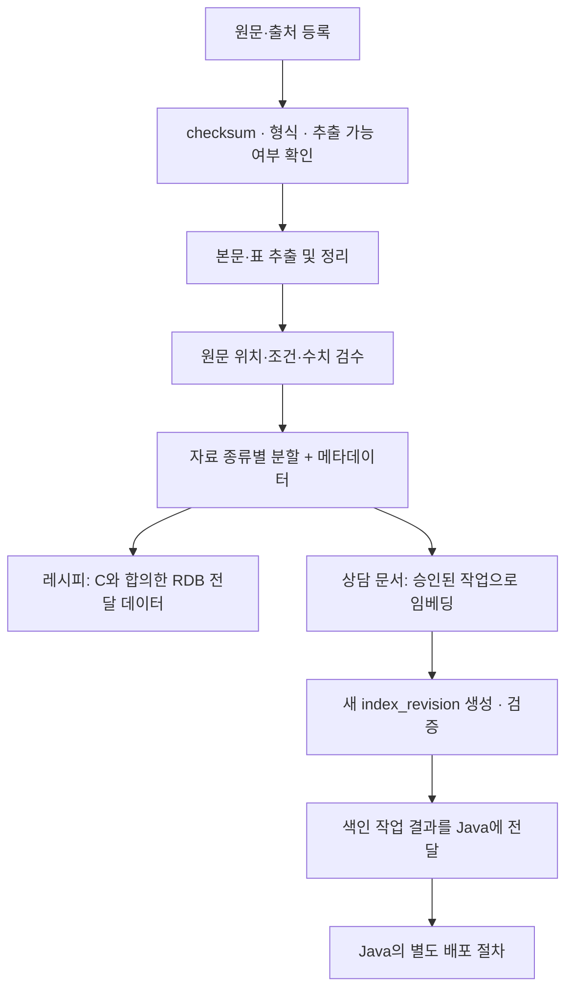

# 데이터 파이프라인 담당자 인계서

> 2026-10-23 후속 결정: 사용자가 C 회신의 **MVP는 기존 `/rag-query` + 구조화 JSON 빠른 경로, RDB는 E2E 이후 확장**을 선택했습니다. 아래 본문의 레시피 RDB 이관·신규 API 요구는 과거 제안 기록이며 현재 MVP 요구가 아닙니다. 최신 회신은 [데이터 파이프라인 합의 회신안](데이터_파이프라인_합의_회신안.md), 현재 구현 방향은 [RAG 시스템 설계](RAG_시스템_설계.md)를 따릅니다. 정확한 계량·순서·옵션·판본·출처 보존 원칙은 유지합니다.

작성일: 2026-10-23 (Asia/Seoul)  
대상: A 데이터 담당 / 협업: B RAG·LLM, C 인증·업무 API, E 통합·평가  
용도: 데이터 확보·정리·색인 모듈을 구현하기 위한 작업 기준과 협의 항목

## 0. 먼저 확인할 내용

이번 서비스는 두 흐름으로 구분합니다.

| 기능 | 최근 결정 | 데이터 담당자의 준비 방향 |
|---|---|---|
| 핵심 업무 빠른 처리 | 카페 예시는 **레시피만**, 정확한 값·순서를 **RDB로 조회** | 메뉴·별칭·HOT/ICE·재료·계량·순서·판본을 구조화하여 전달 |
| 창업·운영 상담 | 사용자 상황에 적용되는 문서를 검색하고 근거와 확인 사항 안내 | 운영 지침·가맹 참고 자료 등의 원문·메타데이터·검색 조각 준비 |

**중요: 최근 레시피 RDB 결정과 저장소의 현행 API 계약이 아직 일치하지 않습니다.**

- 현행 계약은 레시피도 `/rag-query`의 문서 검색·출처 형식으로 다룹니다.
- 레시피 RDB 경로와 원문·판본·공지 연결 방식은 B·C·D가 API 계약에 먼저 반영해야 합니다.
- A는 레시피 원본 검수·구조화 데이터 준비를 진행할 수 있습니다. 최종 RDB 스키마·적재 API는 C와 확정하고, 레시피 임베딩을 신규 빠른 조회의 필수 작업으로 만들지 않습니다.
- 이 인계서는 API를 변경하지 않습니다. 아래에서 **현행 계약**과 **제안·협의 필요**를 구분합니다.

### 우선 요청드리는 작업

1. 자료 목록과 현재 확보 상태를 정리합니다. 파일 존재와 검수·승인 여부는 별개로 기록합니다.
2. 레시피는 기존 합성 데이터의 판본·계량·단위를 검수하고 RDB 전달용 구조를 준비합니다.
3. 상담 문서는 대표 자료 소수부터 원문 → 추출 → 분할 → 출처 복원을 확인합니다.
4. 승인된 문서의 색인 작업이 새 `index_revision`을 만들도록 구성합니다.
5. 입력·산출물 형식, 검수 결과, 알려진 누락 사항과 재현 방법을 B·C·E에게 전달합니다.

## 1. 읽을 문서와 기준의 우선순위

저장소 루트 기준 경로입니다.

| 순서 | 문서 | 확인할 부분 |
|---|---|---|
| 1 | `폴더규칙.md` | 담당 범위, 원본 보존, 적재 경계, API 계약 우선 규칙 |
| 2 | `docs/api/API_명세서.md` | 5장 문서 등록·승인·배포, 8장 내부 RAG, 11.3 색인 구현 규칙 |
| 3 | `docs/api/internal-rag.openapi.yaml` | `IndexJobRequest`, `IndexedChunkMetadata`, `IndexingPolicy`, `OriginalSource`, `IndexJob` |
| 4 | `docs/api/public.openapi.yaml` | `UploadMetadata`, 문서 원문·조각의 공개 응답 형식 |
| 5 | `docs/api/examples/upload-metadata.json` | 현행 업로드 메타데이터 예시 |
| 6 | `docs/api/examples/contract-cases.json` | 내부 질의·업무 응답 예시. 실제 원문 확보·정확성 검증 완료 자료는 아님 |

명세서와 OpenAPI가 다르면 현행 명세서의 규칙을 우선하고 C에게 불일치를 전달해 둘을 함께 수정합니다. 이 인계서의 제안 필드를 API에 임의로 추가하지 않습니다.

## 2. 현재 자료와 미확정 사항

### 2.1 현재 저장소

인계서 작성 시점 `frangizer`에는 폴더 규칙과 API 계약이 있습니다. `data/`, `rag/`, `backend/`, 실행 코드와 적재 스크립트는 아직 없습니다. 명세의 실행 순서는 구현 목표이지 현재 실행할 수 있는 명령이 아닙니다.

### 2.2 이전 데모의 참고 데이터

같은 개발 환경의 형제 경로 `../data/synthetic-recipes/`에 아래 자료가 있습니다. **frangizer에 복사하거나 등록한 상태는 아닙니다.** 다른 팀원은 전달 또는 저장소 반입 후 사용할 수 있습니다.

| 자료 | 현황 | 활용 |
|---|---|---|
| `recipes.json` | 메뉴 50종, v1 온도별 77건 + v2 변경 판본 5건 = 82개 판본 | 구조화·RDB 이관 후보 |
| `documents/` | 판본별 Markdown 82개 | 계량·제조 순서·출처를 대조할 원문 표현 |
| `catalog.md` | 메뉴·별칭·등록 온도 | 메뉴 식별·별칭 매핑 참고 |
| `recipe.schema.json` | 기존 레시피 JSON Schema | 기존 자료 형식 참고. 새 DB/API 계약을 대신하지 않음 |
| `evaluation-cases.json` | 기대 동작 30개 | 평가 후보. 30개 전체의 실제 통과 기록이 아님 |
| `evaluation-scenario.json` | 승인·배포를 가정한 시연 fixture | 실제 승인 상태와 분리 |

이 자료는 모두 **합성·검수 전 초안**입니다. 원본 상태는 `draft/unreviewed`이며 실제 브랜드 레시피가 아닙니다. 기존 생성·실행 검증 기록은 해당 데모 범위의 결과로, 상담 문서의 정확성을 검증한 결과가 아닙니다. 파일을 변경한 뒤에는 과거 검증 보고서나 hash를 그대로 재사용하지 않습니다.

### 2.3 서로 다른 시연 시나리오를 섞지 말아야 함

| 항목 | 이전 합성 데이터 | frangizer 현행 예시 |
|---|---|---|
| 바닐라 시럽 변경 | 20 → 25ml | 20 → 15mL |
| 변경 시각 | 2026-10-30 09:00 KST | 2026-10-26 00:00 KST |
| 판본·ID 체계 | 메뉴·온도별 v1/v2, 예: `recipe-003-ice-v1` | 묶음 문서 v1.0/v1.1, 예: `demo-cafe-recipes-1.1` |
| 펌프 기준 | 펌프당 용량 근거 없음 | 계약 예시에 1회 5mL·4회 표현 있음 |

어느 쪽도 실제 브랜드 기준이 아닙니다. B·C·E와 사용할 합성 시나리오·원문·평가 정답을 통일하고 변경 이력을 남깁니다. 펌프 기준을 사용할 경우 그 값이 명시된 원문을 준비해야 하며, 기존 자료에 있는 사실로 간주하지 않습니다.

## 3. 담당 경계

| 담당 | 책임 |
|---|---|
| A 데이터 | 원문 확보·목록·출처 관리, 추출·정리·분할, 조각 메타데이터, `rag/app/indexing/`의 색인 작업, 데이터 품질 보고 |
| B RAG·LLM | 검색과 문맥 복원, 허용 범위 적용, 모델 응답·출처 조립, 내부 API 라우터·스키마와 색인 모듈 연결 |
| C 인증·업무 API | 사용자 권한, 문서·판본 ID와 DB, 승인·배포, 색인 작업 요청·상태 반영, 레시피 RDB 스키마·조회 API |
| D 화면 | 답변·출처·추가 확인·작업 상태 표시와 API 연동 |
| E 통합·평가 | 파일·볼륨 설정, 실행 환경, 평가셋·계약 테스트·시연 결과 관리 |

DB 스키마 변경은 C의 Flyway migration으로 관리합니다. A가 임의 테이블을 만들거나 회원 DB를 읽는 방식으로 처리하지 않습니다. A가 준비한 레시피 데이터는 C가 확정한 입력 형식으로 전달하고, 적재 후 원본과 다시 대조합니다.

색인 성공을 실제 배포로 바꾸는 권한은 A/B의 색인 모듈에 두지 않습니다. 승인·배포·공지 생성은 Java 업무 API의 책임입니다.

## 4. 자료 준비 목록

### 4.1 레시피 RDB 전달 자료

| 묶음 | 반드시 보존할 내용 |
|---|---|
| 메뉴 | 기존 메뉴 식별자, 표시 이름, 별칭, 브랜드 |
| 레시피 판본 | 메뉴·HOT/ICE, 판본 식별자, 서빙 기준, 적용 시각, 이전 판본 연결 |
| 재료 | 재료명, 숫자 계량, 단위, 표시 순서 |
| 제조 단계 | 순번과 원문 지시문 |
| 관리·출처 | 합성 여부, 검수 상태, 원본 위치, 변경 내용 |

단위와 값을 분리하고, 부동소수점 반올림이나 단위·용량 환산으로 원본을 바꾸지 않습니다. ml/g·잔·펌프를 같은 것으로 취급하지 않습니다. HOT/ICE, 서로 다른 판본, 컵 크기를 근거 없이 합치지 않습니다.

RDB 전달용 JSON/CSV의 최종 컬럼·파일명과 재료 명칭 표준화 범위는 C와 합의합니다. 현재 `recipes.json`을 그대로 새 API가 받는다고 가정하지 않습니다.

### 4.2 상담용 문서 후보

| 자료 | 준비할 내용 | 현재 주의점 |
|---|---|---|
| 운영 지침 | 오픈·마감·장비 관리·교육·인계 등의 적용 조건과 절차 | 실제 내부 지침 미확보. 작성한 시연안은 합성임을 표시 |
| 고객 응대 정책 | 적용 주문·상황·예외·결정 권한·문의 경로 | 일반 분쟁 기준으로 특정 브랜드 내부 정책을 만들어 채우지 않음 |
| 가맹 준비 안내 | 필요한 자료·절차·조건과 원천 문서 위치 | 첫 상담 범위·원천 자료 확정 필요 |
| 법령·고시 | 정확한 시행 판본·조문·별표·적용 범위 | 수집일과 시행일 구분. 조문별 시점 검수 필요 |
| 정보공개서 | 원본 판본·기준연도·비용표·주석·페이지 | 현행 계약은 원본 `public_disclosure` 사용. 가상 기업으로 바꾼 가공본과 구분 |

모든 자료를 한꺼번에 수집하기보다, B와 정한 대표 상담 질문에 필요한 소수의 원문으로 추출·검색·출처 복원부터 검증합니다. 현재 첫 상담 시나리오와 공식 원문 파일은 확정·확보 전입니다.

## 5. 권장 파이프라인

원문 정리·검수는 레시피와 상담 문서가 공유할 수 있습니다. 최종 산출 경로는 RDB 적재와 문서 검색 인덱스로 구분합니다.

### 5.1 원문 확보·등록

- 출처 제목·URL·판본·발행 주체·수집일을 기록합니다.
- 공식 자료, 정보공개서 원본, 합성 자료를 구분합니다.
- 원본 파일의 SHA-256을 기록하고 파일·판본을 연결합니다.
- 원본 파일을 덮어쓰거나 기존 `data/source/` 원본 PDF의 이름을 바꾸지 않습니다. 새 판본은 새 파일로 추가합니다.
- 사용할 문서·판본 ID의 발급·등록 방식은 C와 맞춥니다. 로컬 파일명과 서버 판본 ID를 동일한 것으로 가정하지 않습니다.

### 5.2 추출·정리

- PDF는 글과 표를 추출하고 원문과 대조합니다. 현재 초기 기술 후보는 pypdf이며 실제 표 추출 품질을 먼저 확인합니다.
- Markdown/TXT는 제목·목록·표 구조를 보존합니다. 레시피 JSON은 구조화 데이터를 직접 읽습니다.
- 스캔 PDF가 있으면 식별해 OCR 필요 여부를 보고합니다. 추출 실패·깨진 표를 정상 본문으로 넘기지 않습니다.
- 의미가 없는 반복 머리말·꼬리말은 제거할 수 있지만 조건·예외·주석·수치·부정 표현은 보존합니다.
- `page`는 PDF 파일의 1부터 시작하는 페이지 번호를 사용합니다. 표지를 제외해도 후속 페이지를 다시 1부터 세지 않습니다. 인쇄된 쪽번호와 다르면 출처 설명에 구분합니다.
- Markdown/TXT의 PDF 페이지는 만들지 않습니다. `page=null`과 실제 제목·섹션 위치를 사용합니다.

### 5.3 자료 종류별 분할

| 자료 | 기본 단위 | 함께 유지할 내용 |
|---|---|---|
| 레시피 | 메뉴·온도·판본 한 건 | 재료·단위·전체 순서. 신규 빠른 조회에서는 RDB 전달 대상 |
| 작업 지침 | 작업 또는 하위 작업 | 대상 모델·준비물·전제 조건·주의사항·순서 |
| 체크리스트 | 작업 묶음 | 항목·순서·완료 기준. 전체 요청은 원문 전체 복원 가능해야 함 |
| 응대 정책 | 상황·규정 항목 | 적용 조건·예외·판단 권한·문의 경로 |
| 법령 | 조·항·호와 관련 별표 | 정의·예외·시행 시점·연결 조문 |
| 정보공개서 | 설명 항목 또는 표의 의미 있는 행 묶음 | 열 제목·단위·주석·기준연도 |

모든 문서를 같은 글자 수로만 자르지 않습니다. 긴 지침을 나눌 때에는 상위 조건과 주의사항을 다시 가져올 수 있도록 `section_key`와 원문 위치를 유지하고, 복원 방식은 B와 합의합니다.

## 6. 현행 내부 계약에 맞출 메타데이터

### 6.1 색인 작업 입력: `IndexJobRequest`

호출은 Java → `POST /internal/v1/index-jobs`입니다. 서비스 토큰이 필요하고 사용자 JWT는 이 작업의 필수 인증이 아닙니다. 승인 여부는 Java가 확인합니다.

| 묶음 | 필드 |
|---|---|
| 작업·대상 | `job_id`, `brand_id`, `document_id`, `version_id` |
| 문서 설명 | `title`, `version`, `category`, `material_type`, `is_demo`, `visibility` |
| 적용 기준 | `effective_from` |
| 출처·정책 | `original_source`, `indexing_policy` |
| 파일 | `source.storage_key`, `source.sha256`, `source.media_type` |

현행 열거형:

- `category`: franchise / recipe / hygiene / consumer / other
- `material_type`: official / public_disclosure / synthetic
- `visibility`: prospect / owner / hq
- `source.media_type`: application/pdf / text/plain / text/markdown

`adapted_reference`나 `operations` 같은 값을 임의로 API에 추가하지 않습니다. 새 자료 유형·분류가 필요하면 C와 계약을 수정합니다. 특히 합성 운영 지침의 등록 의미·분류는 현재 예시가 레시피 중심이므로 B·C와 확인합니다.

### 6.2 출처: `OriginalSource`

필수 필드는 `title`, `url`(없으면 null), `edition`, `publisher`, `acquired_on`, `note`입니다. `acquired_on`은 수집일이며 법적 시행일·업무 적용일을 대체하지 않습니다.

### 6.3 페이지·시점: `IndexingPolicy`

- `include_pages`: 선택 항목. 지정 시 처리할 실제 PDF 페이지 목록.
- `exclude_pages`: 필수 배열. 제외가 없으면 빈 배열.
- `legal_temporal_reviewed`: 필수 불리언. 실제 법령 시점 검수 여부를 기록하며 형식 검사를 통과시키려고 true로 채우지 않습니다.
- 범위를 벗어난 페이지, 포함·제외 충돌, 제외 후 본문이 없는 경우를 검출합니다. 검증 오류를 어떻게 반환할지는 B와 맞춥니다.
- 법령의 시점 검수가 끝나지 않은 자료를 검색 대상으로 허용할지와 조문별 적용일 저장 방식은 B·C와 확정합니다.

### 6.4 조각 메타데이터: `IndexedChunkMetadata`

| 목적 | 현행 필수 필드 |
|---|---|
| 조각·원문 연결 | `chunk_id`, `document_id`, `version_id`, `index_revision` |
| 브랜드·열람 범위 | `brand_id`, `visibility` |
| 표시 정보 | `title`, `version`, `material_type`, `is_demo` |
| 원문 위치 | `page`, `article`, `section_key` |
| 조각 적용 기간 | `effective_from`, `effective_until` |
| 출처 | `original_source` |
| 모델·정합성 | `embedding_model`, `content_sha256` |

`page`, `article`, `effective_until`은 필드 자체는 필수이며 값에 null을 허용합니다. `effective_until=null`의 의미는 종료 시점 미지정입니다. 날짜에는 시간대가 필요합니다.

현재 스키마는 `additionalProperties=false`입니다. 본문 `text`, 승인 상태, 로컬 처리 상태, 토큰 수를 이 객체에 임의로 넣지 않습니다. 본문과 메타데이터를 묶는 내부 파일 형식과 추가 처리 정보는 별도의 산출물 형식으로 B와 맞춥니다.

`chunk_id`는 원문·판본·구간에 연결하고 같은 입력·분할 설정의 재실행에서 재현 가능하게 설계합니다. 입력이나 분할 규칙이 달라졌는데 같은 ID의 본문을 덮어쓰지 않습니다. 구체적인 ID 생성식과 `section_key` 형식은 B와 합의합니다.

## 7. 입력 경계와 승인·배포

### 7.1 입력 범위

- 저장소 규칙상 RAG 적재 입력은 `data/source/`와 승인된 업로드입니다.
- `docs/`, `eval/`, `data/staged/`를 적재하지 않습니다. `data/` 전체를 재귀 스캔하지 않습니다.
- `data/source/`에 파일이 있다는 사실만으로 운영 배포를 완료한 것으로 간주하지 않습니다. 서비스 검색 허용 여부는 서버의 승인·색인·배포 상태와 적용일로 결정합니다.
- `data/staged/` 파일은 자동 적재 대상이 아닙니다. 미배포 파일을 수동 이름 변경으로 승인된 입력처럼 만들지 않습니다. 후보 파일을 승인된 업무 저장 자산으로 등록하는 구체적인 흐름은 C·E와 맞춥니다.
- `source.storage_key`는 저장소의 승인된 파일 저장 루트에 상대적인 업무 저장 키입니다. 저장소의 `data/source/` 경로와 같은 문자열이라고 가정하지 않습니다.
- `documents/...` 형태 검증에 더해 경로 정규화 후 실제 파일이 허용 루트 안에 있는지 검증합니다. `..`로 루트를 벗어나거나 임의 URL에서 읽는 동작을 허용하지 않습니다.

### 7.2 서로 다른 상태

| 단계 | 의미 | 담당 |
|---|---|---|
| draft | 등록됐지만 미승인 | C |
| approved | 내용·범위를 승인하여 색인 요청 가능 | C |
| index ready | 색인 작업이 성공함 | A·B가 결과 제공, C가 상태 반영 |
| published | 서비스 배포 대상으로 등록 | C |
| 적용 시각 도래 | 질의 시점과 판본·조문 적용 기간이 일치 | C 허용 범위 계산 + B 검색 검증 |

**색인 성공과 배포는 다릅니다.** 미래 적용 판본을 미리 색인할 수 있어도 현재 질문의 근거가 되는 것은 아닙니다. 질의 시에는 `(document_id, version_id, index_revision)`이 `allowed_versions`에 있고 질의 시점이 적용 기간 안에 있어야 합니다.

## 8. 색인 실행과 산출물

### 8.1 처리 순서

1. 입력 스키마·저장 키·허용 형식을 확인합니다.
2. 원본 파일 SHA-256을 요청의 `source.sha256`과 대조합니다. 불일치 시 `CHECKSUM_MISMATCH`로 실패시킵니다.
3. 페이지 정책에 따라 추출·정리·분할하고 출처·조건·수치를 검수합니다.
4. B·E와 합의한 `EMBEDDING_MODEL`과 설정으로 임베딩합니다.
5. 새 `index_revision`의 별도 경로에 인덱스·조각·연결 정보를 작성합니다.
6. 벡터 수·조각 수·차원·유한값·ID 유일성·판본 연결·원문 위치를 검증합니다.
7. 모두 성공한 경우 `succeeded`와 `index_revision`, `chunk_count`를 반환합니다. 실패 시 원인과 `failed`를 기록하고 부분 산출물을 검색 대상으로 삼지 않습니다.

같은 `job_id`·같은 입력은 기존 작업/결과를 반환하고, 같은 `job_id`·다른 입력은 409로 처리합니다. 프로세스 재시작·동시 요청에서의 작업 기록 보존 방식은 B·C·E와 정합니다.

### 8.2 산출물 제안

아래 파일명·내부 형식은 **A·B·E가 합의할 제안**이며 OpenAPI의 새 필드가 아닙니다. 공개 응답으로 파일 시스템 경로를 노출하지 않습니다.

| 산출물 | 담을 내용 | 전달·보관 |
|---|---|---|
| 원본 목록/manifest | 파일·hash·출처·판본·적용일·페이지 정책·등록 상태 | `data/manifest.json` 형식 합의 후 관리 |
| 추출 결과 | 원문 순서와 위치를 유지한 본문·표 | 작업 볼륨. B가 재현할 수 있도록 형식 공유 |
| `chunks.jsonl` | 본문과 계약에 맞는 조각 메타데이터 | 인덱스와 같은 revision의 볼륨 |
| `index.faiss` | 실제 임베딩 벡터 인덱스 | `FAISS_DIR` 아래 revision별 볼륨 |
| `build-manifest.json` | 입력 hash·판본, 모델·차원, 분할 규칙 버전, 벡터-조각 연결, 건수 | 인덱스와 같은 revision의 볼륨 |
| `quality-report.json` | 추출·표·단위·페이지·판본 검사 결과, 누락·검수 필요 항목 | 원본 포함 여부를 확인하고 작업 볼륨 또는 검수용 전달 |
| 작업 결과 | 현행 `IndexJob` 응답과 실패 원인 | Java 작업 상태와 연결 |
| 레시피 구조화 자료 | C와 합의한 메뉴·판본·재료·단계 입력 | RDB 적재 후 대조 결과와 함께 전달 |

인덱스와 조각 파일은 **같은 revision의 묶음**으로 검증합니다. 원본·분할 설정·모델이 바뀌면 새 revision을 생성합니다. 문서와 질문 임베딩의 모델·설정은 B와 동일하게 맞추고 모델 변경 시 재색인합니다.

FAISS는 원본·권한의 기준 저장소가 아닙니다. 조회 시 B가 허용 판본만 검색하고 인용하도록 필요한 식별자를 제공해야 합니다. 원본 파일과 검색용 인덱스는 역할이 다릅니다.

### 8.3 Git과 볼륨

FAISS 인덱스·사용자 업로드·키·가상환경은 저장소에 커밋하지 않습니다. `FAISS_DIR`, `DOCUMENT_STORE_DIR`는 E와 맞춥니다. 현재 저장소에는 `.gitignore`도 아직 없으므로 생성 산출물을 만들기 전에 제외 규칙·볼륨 위치를 마련해야 합니다.

원본 파일 중 저장소에서 관리하기로 합의한 자료와 런타임 업로드를 구분합니다. 승인되지 않은 개인정보·비공개 자료를 검수 보고서나 추출 파일에 넣어 저장소에 올리지 않습니다.

## 9. MVP 구현 순서 제안

1. **합의 목록 작성:** 대표 상담 질문, 사용할 원문, 레시피 기준 판본, 시연 수치를 B·C·E와 맞춥니다.
2. **로컬 검수:** 원문 소수로 파일 읽기 → 추출 → 페이지·표·출처 대조 → 조각 생성까지 확인합니다. 외부 임베딩 전 검사 가능한 항목부터 끝냅니다.
3. **구조 전달:** 레시피 구조화 자료는 C, 조각·메타데이터·원문 복원 형식은 B에게 전달합니다.
4. **색인 모듈 연결:** `rag/app/indexing/`에서 승인된 작업 입력으로 새 revision을 생성합니다. 라우터·인증은 B와 연결합니다.
5. **상태 통합:** Java approve → index job → ready까지 연결하고, publish 전에는 서비스 근거로 노출되지 않는지 확인합니다.
6. **평가·전달:** 대표 질문·기대 출처는 E의 평가 영역에서 관리하고 다른 판본·역할·적용일에 대한 제외 동작도 확인합니다.

초기는 전체 자료를 한꺼번에 자동 수집·색인하는 구성보다 적은 자료의 재현 가능한 작업으로 시작합니다. 현재 없는 CLI·API를 이미 실행 가능하다고 안내하지 않습니다. 실제 구현 후 담당자가 실행 명령·필요 환경변수·재실행 방법을 기록합니다.

## 10. 완료 기준과 검수 체크리스트

### A가 준비·검증할 항목

- [ ] 원본 목록과 실제 파일이 일치하고 SHA-256이 기록됨
- [ ] 출처·판본·자료 유형·합성 여부가 확인됨
- [ ] 승인 상태가 불명확한 자료를 승인 완료로 표시하지 않음
- [ ] 레시피 계량·단위·HOT/ICE·단계·판본 관계가 원본과 일치함
- [ ] 펌프·잔·사이즈 환산은 원문 근거가 있는 경우에만 포함함
- [ ] PDF 페이지·조항·표 주석과 Markdown 섹션이 실제 원문에 대응함
- [ ] 적용 조건·예외·주의사항을 분할로 잃지 않음
- [ ] `IndexedChunkMetadata`의 필수 필드·null·열거형·ID 형식을 만족함
- [ ] `docs/`, `eval/`, `data/staged/`가 입력에 포함되지 않음
- [ ] 같은 입력의 재실행과 변경 입력의 새 revision 생성이 구분됨
- [ ] 인덱스·조각·매핑의 건수와 식별자·모델·차원이 일치함
- [ ] 실패한 작업이 기존 인덱스를 덮어쓰지 않음
- [ ] 형식 검증과 실제 추출·임베딩·검색 실행 결과를 구분해 보고함

### B·C·E와 함께 확인할 항목

- [ ] 검색·인용이 `allowed_versions` 밖으로 나가지 않음
- [ ] 미래·이전 판본과 조문 적용일 경계가 기대대로 처리됨
- [ ] approve 후 ready여도 publish 전에는 일반 사용자 답변 근거로 사용되지 않음
- [ ] publish해도 미래 적용 판본이 현재 답변을 대체하지 않음
- [ ] 사용된 조각 ID로 실제 출처·원문을 열 수 있고 같은 권한을 검증함
- [ ] RDB 레시피 값·판본과 연결된 원문이 서로 다르지 않음
- [ ] 모델·색인 장애와 업무상 근거 부족을 구분함

평가셋의 기대 답변·출처는 검색 인덱스에 넣지 않습니다. 테스트 중인 질문이 정답 파일을 검색해 통과하지 않도록 입력 경계를 분리합니다.

## 11. 구현 전 협의할 항목

| 우선순위 | 항목 | 확인할 담당·결과 |
|---|---|---|
| 먼저 | 레시피 RDB 전환과 현행 RAG 계약의 차이 | B·C·D: API·응답·원문·판본/공지 연결 방식 |
| 먼저 | 합성 레시피의 기준 시나리오 | A·B·C·E: 25ml/15mL, 변경일, ID·판본·펌프 기준 통일 |
| 먼저 | 첫 상담 질문과 사용 문서 | A·B: 필요한 원문·누락 조건·출처 확정 |
| 먼저 | 합성 운영 지침·가공 참고서의 등록 의미 | B·C: 현행 material_type·category·API 계약으로 표현 가능한지 |
| 먼저 | `data/manifest.json` 형식 | A·C·E: 로컬 원본 키와 서버 발급 ID의 연결, 상태·페이지 정책 |
| 연결 전 | staged 후보의 등록·승인 자산 경로 | C·E: 적재 경계 우회 없이 승인된 저장 키 제공 |
| 연결 전 | 법령 시점 검수와 조각 적용 기간 | A·B·C: 미검토 자료 처리, 조문별 시행일·경과 규정 검수 |
| 연결 전 | 모델·분할·hash·revision·조각 파일 형식 | A·B·E: 재현 가능한 입출력과 저장 위치 |
| 연결 전 | 작업 기록·재실행·중복 요청 | B·C·E: 작업 상태 보존·재시작·멱등성 |

협의 중에도 원본 목록 작성, 출처 조사, 합성 표시, 추출·수치·페이지 검수는 진행할 수 있습니다. 계약을 바꾸는 구현만 별도 계약 변경과 팀 확인 후 진행합니다.

## 12. 최종 전달물

데이터 담당자는 다음을 한 묶음으로 전달합니다.

1. 자료 목록과 확보·검수·미확정 상태
2. 원본과 출처·판본·페이지·적용일 메타데이터
3. 레시피 구조화 자료와 C가 적재 후 대조할 기준
4. 상담 문서 추출 결과·조각·원문 위치와 B가 읽을 파일 형식
5. 재현 가능한 색인 모듈, 사용 설정, revision별 산출 위치
6. 검수·실행 보고서: 통과·실패·미실행 항목을 구분
7. 대표 질문·기대 출처·누락/충돌 사례를 E에게 전달하되 색인에서는 제외
8. 알려진 제한과 B·C·E에게 남긴 협의 항목

## 변경 범위

이 인계서는 `폴더규칙.md`의 `docs/planning/`에 작성한 참고 문서입니다. API 계약·데이터 원본·색인·DB·서비스 코드를 수정하지 않았으며, 외부 자료를 수집하거나 임베딩을 호출하지 않았습니다.
