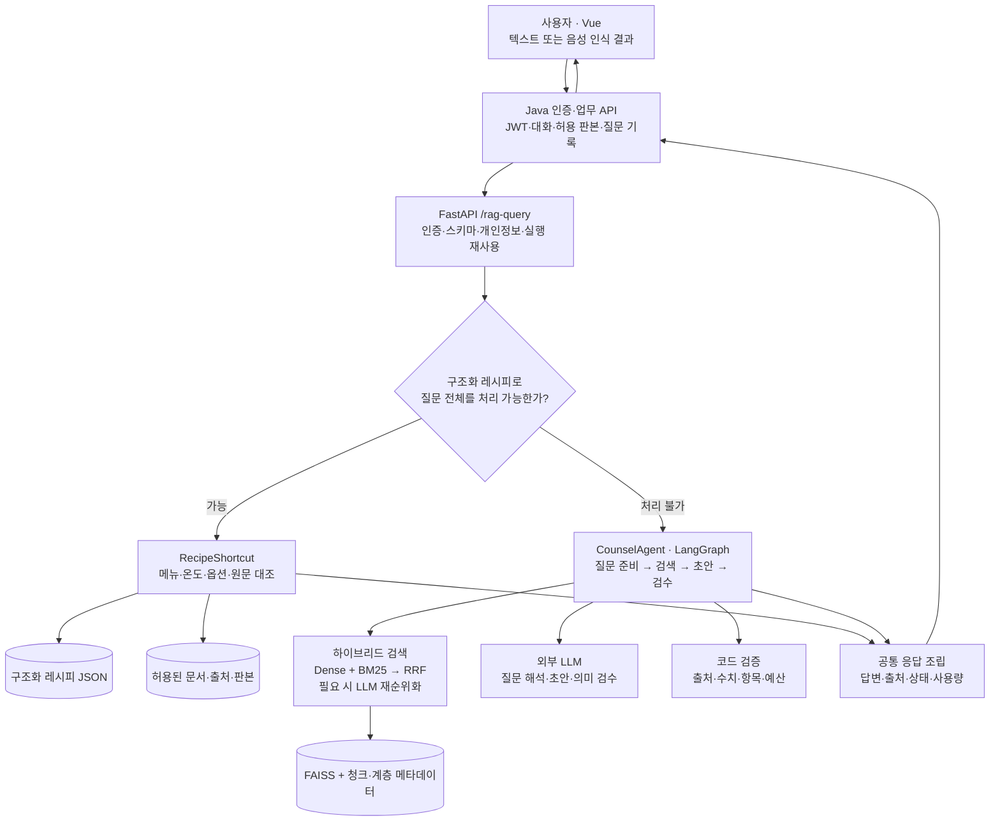
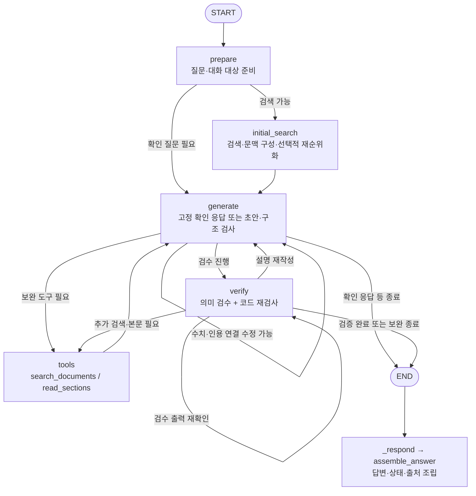

# frangizer RAG — 아키텍처와 동작 설명

> **근거를 찾아 답하고, 불확실하면 멈추며, 제한적으로 보완하는 상담 시스템.**
>
> 레시피의 값·순서는 코드가 조회하고, 문서의 의미·조건은 AI가 해석한다. 권한·판본·출처·실행 한계는 코드가 통제한다.

**기준:** 2026-10-26, PR #43이 반영된 구현. 모델명·호출 한도 등은 설정과 코드가 바뀌면 달라질 수 있다. 이 문서는 구조 설명이며 전체 질문의 정확도를 보장하는 평가 결과가 아니다.

## 읽는 순서

- **전체 흐름:** [1. 서비스 아키텍처](#1-서비스-아키텍처) → [2. 실행 단계 요약](#2-실행-단계-요약)
- **분기와 노드:** [3. 레시피 빠른 조회](#3-레시피-빠른-조회) → [4. 상담-graph](#4-상담-graph) → [5. 노드별 동작](#5-노드별-동작)
- **설계 이유:** [6. AI와 코드의 역할 분담](#6-ai와-코드의-역할-분담) → [7. 상태와 실행 한계](#7-상태와-실행-한계)
- **데이터·유지보수:** [8. 색인 파이프라인](#8-색인-파이프라인) → [9. 질문별 실행 예시](#9-질문별-실행-예시) → [10. 문제를 찾는 위치](#10-문제를-찾는-위치) → [11. 변경 영향과 한계](#11-변경-영향과-한계)

## 1. 서비스 아키텍처

**중요한 구분:** 질문을 받는 API는 하나지만, 모든 질문이 LLM과 벡터 검색을 거치는 것은 아니다.

| 구성 요소 | 기술·역할 | 관련 파일 |
| --- | --- | --- |
| Java 게이트웨이 | JWT, 대화 이력, 업무 DB, 검색 가능한 판본 계산, 결과·사용량 기록 | [RagService.java](../../backend/src/main/java/com/frangizer/rag/RagService.java) |
| FastAPI 진입점 | 내부 토큰과 사용자 JWT 검증, 요청 형식·권한 일치 확인 | [query.py](../../rag/app/api/query.py), [auth.py](../../rag/app/auth.py) |
| 런타임 구성 | 검색기·모델·레시피 실행기·상담 에이전트 연결 | [bootstrap.py](../../rag/app/bootstrap.py) |
| 레시피 실행기 | 구조화 데이터와 원문을 대조한 뒤 값·순서 반환 | [recipe.py](../../rag/app/generation/recipe.py) |
| 상담 에이전트 | LangGraph로 검색·생성·검수·한정된 보완 수행 | [agent.py](../../rag/app/generation/agent.py) |
| 검색 계층 | FAISS 의미 검색, Kiwi 기반 BM25, RRF, 계층 문맥 확장 | [faiss_store.py](../../rag/app/retrieval/faiss_store.py), [hybrid.py](../../rag/app/retrieval/hybrid.py) |

본사 문의 통계·공지 확인은 Java의 업무 API와 DB 조회다. **현재 상담 Agent가 문의 DB를 자연어로 조회하는 도구는 없다.** 음성은 질문을 텍스트로 만드는 입력 수단이며, 별도의 답변 근거가 아니다.

## 2. 실행 단계 요약

아래의 ‘단계’와 실제 LangGraph의 ‘노드’는 다르다. 인증·레시피 분기·최종 응답은 Graph 바깥에 있고, 재순위화·표 복원·수치 검사는 노드 내부 함수다.

| 순서 | 단계 | AI 역할 | 코드 역할 | 그렇게 나눈 이유 |
| --- | --- | --- | --- | --- |
| ① | 요청 접수 | 없음 | 인증·요청 검증·개인정보 처리·동일 실행 재사용 | 모델에게 권한이나 요청 동일성 판단을 맡기지 않음 |
| ② | 레시피 빠른 조회 | 없음 | 지원 질문 해석, JSON·원문·판본 확인, 저장값 반환 | 단순 계량에 생성 오류와 지연을 추가하지 않음 |
| ③ | `prepare` | 필요할 때만 대화의 지시 대상 복원·검색 계획 | 기본 분류, 선택 대상·질문 계획 검증 | 독립 질문마다 계획 모델을 호출하지 않음 |
| ④ | `initial_search` | 필요한 경우 후보 재순위화 | 허용 범위 검색, Dense·BM25 결합, 문맥 확장·상한 | 의미 유사성과 정확한 용어를 함께 활용 |
| ⑤ | `generate` | 질문별 답변 항목·문장·인용 제안 | 표 셀 복원·수치 연결·구조 검사 | AI의 설명과 원문 숫자 복사를 구분 |
| ⑥ | `verify` | 주장과 원문의 대상·조건·예외·질문 충족 여부 검수 | 인용·수치 재검사, 실패 분류, 검증된 항목 보존 | 출처가 존재한다는 사실만으로 정확성을 인정하지 않음 |
| ⑦ | 보완 분기·`tools` | 부족한 근거·수정 방향 제안 | 허용 도구·횟수·시간을 검사하고 실행 | 필요한 부분만 보완하고 무한 반복을 막음 |
| ⑧ | 최종 응답 | 새 사실을 생성하지 않음 | 상태·출처·표시 문구·사용량 조립 | 응답 계약과 실패 의미를 일관되게 유지 |

## 3. 레시피 빠른 조회

### 처리 순서

**`RagRuntime.run()` → `RecipeShortcut.try_answer()` → `execute()` → 공통 응답 조립**

1. 메뉴·온도·재료·동작·옵션을 지원하는 표현인지 파싱한다. 알 수 없는 조건을 지워서 억지로 단순 질문으로 만들지 않는다.
2. 사용자 권한, `allowed_versions`, 적용일을 통과한 문서에서 사용할 수 있는 레시피를 찾는다.
3. JSON의 원본 파일 해시·판본·쪽과 실제 문서의 메뉴·온도·계량·순서를 대조한다.
4. 저장된 값·펌프·제조 순서를 반환한다. 온도가 빠져 답이 달라지면 확인 질문을 반환한다.
5. 질문 전체를 처리할 수 없으면 `None`을 반환해 기존 상담 경로로 넘긴다.

| 구분 | 동작 |
| --- | --- |
| 지원 예 | 특정 재료의 양·펌프 수, 재료표, 제조 순서·다음 단계, 지원 옵션, 조회 가능한 메뉴 목록 |
| AI 호출 | 순수 빠른 조회는 생성 LLM·질문 임베딩 호출 없이 처리 |
| 온도 확인 | HOT·ICED 값이 달라지면 선택 요청. 단순 조회에서 공통값을 확인할 수 있으면 공통값 사용 |
| 후속 ‘핫·아이스’ | 직전의 온도 미지정 레시피 질문에 연결하고 현재 허용 원문을 다시 확인. 과거 답변의 숫자는 재사용하지 않음 |
| 넘겨야 하는 질문 | 미인식 조건, 대체·허용 판단, 여러 기준의 해석·비교 등 지원하는 조회만으로 해결할 수 없는 질문 |
| 상담 내 재사용 | 상담의 독립된 레시피 계량 항목도 `resolve_item()`을 통해 같은 실행기 사용. 관련 인용이 허용된 경우에만 대체 |

**이유:** 제조 중 필요한 계량은 저장값 조회가 적합하다. ‘두유로 바꿔도 되는가’처럼 허용 근거가 필요한 질문까지 계량 조회로 처리하면 안 된다.

**관련 파일:** [recipe.py](../../rag/app/generation/recipe.py) · [demo_cafe_recipes.json](../../data/structured/demo_cafe_recipes.json) · [test_recipe.py](../../rag/tests/test_recipe.py)

## 4. 상담 Graph

아래가 실제 등록된 **5개 노드**와 제어 흐름이다. `START`·`END`는 시작·종료 표시이고, `_respond()`는 Graph 실행 뒤의 응답 조립 함수다.

**루프 화살표는 무제한 반복을 의미하지 않는다.** 구조 오류 수정·추가 검색·재작성·재검수는 하나의 보완 예산을 공유한다.

## 5. 노드별 동작

### 5.1 `prepare` — 무엇을 묻는지 확정

| 구분 | 내용 |
| --- | --- |
| 입력 → 출력 | 현재 질문·최대 6턴 이력 → `QuestionPlan` 또는 구체적인 확인 질문 |
| 기술 | Python 규칙, Kiwi 대상 후보 추출, 선택적 LLM, Pydantic |
| 코드 | 독립 질문에 기본 계획 적용. 후속 대상 후보를 만들고 모델이 고른 대상이 실제 대화에 있는지 확인 |
| AI | ‘그 금액’, ‘교육비까지 포함?’ 같은 생략을 복원하거나 비교 질문의 검색어를 최대 2개로 구성 |
| 이유 | 모든 질문을 재작성하면 지연·의미 변경이 늘어남. 사용자에게 없는 상황을 만들거나 과거 AI 답변을 사실 근거로 쓰지 않기 위함 |

지시 대상을 확정할 수 없을 때만 확인 질문으로 간다. **문서가 부족한 문제를 사용자 상황이 부족한 문제로 바꾸지 않는다.** 이력은 Java DB에서 전달하며 Graph가 장기 대화를 자체 기억하는 구조가 아니다.

**관련 파일:** [agent.py](../../rag/app/generation/agent.py)의 `_prepare()`·`_context()` · [question.py](../../rag/app/generation/question.py) · [test_question_routing.py](../../rag/tests/test_question_routing.py)

### 5.2 `initial_search` — 답의 근거를 먼저 확보

**허용 문서 필터 → Dense + BM25 → RRF → 상위 문맥 확장 → 필요한 경우 재순위화**

| 단계 | 기술·코드 | 목적 |
| --- | --- | --- |
| 검색 전 필터 | 역할·브랜드·허용 문서/판본/revision·적용 기간 | 권한 밖 자료를 검색 후보로 넣지 않음 |
| 의미 검색 | 질문 임베딩, L2 정규화, FAISS `IndexFlatIP` | 표현이 달라도 의미가 가까운 문서 탐색 |
| 키워드 검색 | Kiwi 형태소, BM25 | 조문 번호·비용 항목·고유 용어 등 정확한 표현 보완 |
| 순위 결합 | RRF, 기본 `k=60` | 서로 다른 점수 크기 대신 순위를 결합. 단순 점수 합산이나 α 가중 합산이 아님 |
| 문맥 확장 | 상위 문맥의 원문 조각·동일 부모 섹션 | 잘린 단위·조건·표 주변 설명 보완 |
| 재순위화 | LLM이 기존 후보 번호 중 최대 5개 선택 | 제목이 비슷한 문서에서 실제 질문의 근거를 앞에 배치 |

검색기는 기본 후보 30개에서 우선 5개를 선택하고 문맥을 보충한다. 이후 Agent에 전달하는 원문은 최대 20개·합계 12,000자다. 추가 검색으로 요청 상태에 누적된 후보 수는 30개를 넘을 수 있다.

재순위화는 설정·시간·호출 예산에 따라 생략 가능하다. 정확한 단일 표 조회는 재순위화를 생략할 수 있지만, 포함·비교·복수 대상 질문은 표 하나의 일치만으로 완료하지 않는다. 재순위화가 실패하면 기존 검색 결과로 돌아간다.

**AI:** 후보의 의미적 관련성 판단. **코드:** 후보 범위, ID 유효성, 결과 수·본문 크기, 타임아웃을 강제한다.

**관련 파일:** [faiss_store.py](../../rag/app/retrieval/faiss_store.py) · [hybrid.py](../../rag/app/retrieval/hybrid.py) · [reranker.py](../../rag/app/retrieval/reranker.py) · [base.py](../../rag/app/retrieval/base.py) · [agent.py](../../rag/app/generation/agent.py)의 `_initial_search()`·`_comparison_context()`

### 5.3 `generate` — 설명은 AI, 값·인용 연결은 코드

| 구분 | 내용 |
| --- | --- |
| 입력 → 출력 | 질문 계획·원문 구간·표 선택지 → 항목·문장·수치 연결이 있는 초안 |
| 기술 | LangChain `ChatOpenAI`, JSON Schema 구조화 출력, Pydantic |
| AI | 질문에 필요한 항목을 정하고, 원문으로 설명·조건을 작성하며 해당 문장의 인용 구간을 선택 |
| 코드 | ID 복원, 표 셀 복사, 수치 연결 정리, 출처·단위·항목 검사, 항목별 근거 도출 |
| 이유 | 유연한 설명은 필요하지만 모델이 금액·출처·응답 상태를 임의로 만들게 두면 안 됨 |

초안은 다음처럼 역할이 나뉜다.

| 단위 | 뜻 |
| --- | --- |
| `items` | 질문이 요구한 의미 단위. 예: 교육비·보증금 포함 관계 |
| `blocks` | 실제 출력할 설명·단계 문장. 각 문장은 하나의 `item_id`에 속함 |
| `evidence_refs` | 문장이 실제 사용한 청크와 원문 구간. 항목 출처는 이 연결에서 수집 |
| `quantities` | 출력 숫자의 항목·값·단위·원문 연결. 사용자에게 그대로 노출하는 데이터가 아님 |
| 표 선택지 | 검수된 원문과 대조된 셀의 서버 소유 ID. 모델은 선택하고 코드는 원래 값 복원 |

단순 표 조회는 `_exact_coverage()`로 기존 표를 사용한 초안을 만들고, 일반 상담은 `ProposedAnswer`로 항목과 설명을 함께 제안한다. **단순 표 조회도 최종 의미 검수는 생략하지 않는다.** 포함·비교 해석은 일반 상담에서 다룬다.

본문에 없는 수치 메타데이터는 제거한다. 본문에 실제 쓴 수치는 여전히 검증한다. 빠진 수치 연결을 자동 보충할 때도 이미 인용한 원문에 값·단위가 유일하게 확인되는 경우만 허용한다. 다른 출처 탐색·단위 환산·새 계산으로 숫자를 맞추지 않는다.

**관련 파일:** [model.py](../../rag/app/generation/model.py) · [table_evidence.py](../../rag/app/generation/table_evidence.py) · [evidence_policy.py](../../rag/app/generation/evidence_policy.py) · [counsel.md](../../rag/prompts/counsel.md) · [agent.py](../../rag/app/generation/agent.py)의 `_generate()`

### 5.4 `verify` — 인용의 존재와 의미의 정확성을 구분

| 검사 | 담당 | 예시 |
| --- | --- | --- |
| 인용·수치의 구조 | 코드 | 없는 청크 ID, 다른 표의 단위, 교육비에 보증금 숫자를 연결한 경우 |
| 대상·조건·예외 | LLM | 다른 업종 규정을 적용하거나 제한 조건을 빼고 ‘전액 반환’으로 설명한 경우 |
| 질문의 충족 여부 | LLM + 코드 | 교육비와 보증금을 물었는데 교육비만 설명한 경우 |
| 검수 결과 형식 | 코드 | 빠진 문장 ID, 허용하지 않은 인용 번호, 항목별 검사 누락 |

AI는 문장을 `supported`, `condition_missing`, `subject_mismatch`, `unsupported`, `uncertain`으로 판단한다. 코드는 이 출력을 검증하고 실제 수치·인용 검사를 다시 적용한다.

- 설명 오류는 `rewrite`, 근거 부족은 `research`, 이미 찾은 후보의 본문·연결 조건 부족은 `read_sections`로 보완한다.
- 검수 형식이 틀리면 답변을 고치는 대신 검수 출력을 한정해서 다시 확인할 수 있다.
- 실패한 항목과 독립적으로 검증된 항목은 구분해 가능한 부분을 보존한다.
- 같은 의미 항목 안에서 한 문장이 잘못되면 항목 전체가 제외될 수 있다. 서로 의존하는 내용의 잘못된 부분 답변을 막기 위한 선택이지만 과도한 보류의 원인도 될 수 있다.

**이유:** 인용 ID가 유효하거나 숫자가 원문에 존재하는 것만으로 질문에 맞는 답변이라고 판단할 수 없다. 반대로 부연 하나의 오류 때문에 독립된 정상 항목까지 버리는 것도 줄여야 한다.

**관련 파일:** [review.py](../../rag/app/generation/review.py) · [evidence_policy.py](../../rag/app/generation/evidence_policy.py) · [answer.py](../../rag/app/generation/answer.py)의 `retain_verified()`·`preserve_verified()` · [agent.py](../../rag/app/generation/agent.py)의 `_verify()`

### 5.5 `tools` — 필요한 근거만 한정해서 보완

| 도구 | 무엇을 하는가 | 코드가 강제하는 경계 |
| --- | --- | --- |
| `search_documents` | 보완 검색어로 하이브리드 검색 | 검색어 형식·길이, 권한·판본, 횟수·시간 |
| `read_sections` | 이미 찾은 후보의 원문·같은 섹션·명시된 연결 문맥 조회 | 후보에 있는 ID만, 한 호출 최대 5개 앵커, 관련 문맥만 확장 |

AI는 보완의 필요성과 검색어·조회 위치를 제안한다. 코드는 `_schedule_recovery()`에서 실제 실행 가능 여부를 판정한다. **모델이 도구를 요청했다고 자동으로 실행되는 것은 아니다.**

첫 검색도 내부적으로 `_tools()` 함수를 사용하지만, Graph의 `tools` 노드는 보완 분기에서 실행된다. 같은 함수 재사용과 Graph 노드 실행을 구분한다.

**이유:** 임의 파일·DB·외부 웹을 읽게 하지 않고 이미 허용된 검색 범위에서 보완한다. 문서가 없으면 끝없이 검색하지 않는다.

**관련 파일:** [agent.py](../../rag/app/generation/agent.py)의 `_tools()`·`_schedule_recovery()` · [faiss_store.py](../../rag/app/retrieval/faiss_store.py)의 `read_sections()` · [base.py](../../rag/app/retrieval/base.py)의 `context_related()`

### 5.6 최종 응답 — 공개 계약과 상태를 코드로 조립

`_respond()`와 `assemble_answer()`는 Graph 노드가 아닌 후처리다. 새 사실을 LLM으로 생성하지 않는다.

| 상태·상황 | 응답 원칙 |
| --- | --- |
| `answered` | 사용할 수 있는 출처와 질문에 대한 답변 제공. 현장 업무 해결 완료를 뜻하지 않음 |
| 사용자 조건 부족 | `needs_review`와 구체적인 확인 질문. 예: 필요한 HOT·ICED 선택 |
| 문서 근거 부족 | `needs_review`와 자료 범위 안내. 상식으로 대신 답하지 않음 |
| 관련 자료는 있지만 검증 실패 | 문서가 없다고 하지 않고 근거·답변 적합성 미확인으로 안내 |
| 담당자 최종 판단 필요 | `handoff`와 사유·문의 요약. 실제 외부 상담 접수는 하지 않음 |
| 모델 장애·시간 초과 | 오류 코드 반환. 단, 이미 검증한 부분 결과가 있으면 제한적으로 `needs_review` 반환 가능 |

코드는 실제 채택한 원문에서 출처 위치·발췌·자료 성격·판본을 만들고, 법령의 시행일 미검수와 합성 자료 표시를 붙인다. Java는 출처가 허용 판본 안에 있는지 확인하고 문서 DB의 제목·URL 등으로 정리한다.

**관련 파일:** [answer.py](../../rag/app/generation/answer.py) · [schemas.py](../../rag/app/schemas.py) · [errors.py](../../rag/app/errors.py) · [RagService.java](../../backend/src/main/java/com/frangizer/rag/RagService.java)

## 6. AI와 코드의 역할 분담

| 결정 | AI에 맡기는 범위 | 코드가 최종 통제하는 범위 | 이유 |
| --- | --- | --- | --- |
| 무엇을 묻는가 | 필요한 경우 생략 복원·의미 비교 | 실제 질문·대화의 대상 후보 검증 | 없는 상황을 만들어 검색하지 않기 위해 |
| 무엇을 읽는가 | 후보의 관련성·보완 위치 제안 | 인증·브랜드·역할·판본·적용일·허용 도구 | 의미 판단이 권한 변경으로 이어지면 안 됨 |
| 어떤 값을 쓰는가 | 표 셀 또는 근거 구간 선택 | 레시피·표 원문 값 복원, 수치·단위 검사 | 임의 계산·옆 칸 숫자 혼동을 줄이기 위해 |
| 어떻게 설명하는가 | 핵심 결론·조건·예외를 자연어로 설명 | 출력 형식·길이·출처 연결 | 설명의 유연성과 계약의 일관성이 모두 필요 |
| 맞는 답인가 | 원문의 의미·대상·예외와 질문 충족 여부 검수 | 검수 형식·수치·출처 재검사 | LLM Judge도 틀릴 수 있으므로 역할을 나눔 |
| 계속할 것인가 | 보완 방향 제안 | 보완 횟수·호출 수·시간·후보 범위 | 무한 루프·비용 증가·자의적 도구 실행 방지 |

현재 구조는 **하이브리드 검색을 사용하는 Advanced RAG에 제한적인 Agentic 보완을 결합한 형태**로 설명할 수 있다. 여러 에이전트가 협업하거나 임의 도구를 생성하는 시스템은 아니다. 실행 단계와 종료 조건은 개발자가 정하고, 그 안의 해석·근거 선택에 AI를 사용한다.

## 7. 상태와 실행 한계

### 요청 단위 상태

| 상태 | 역할 |
| --- | --- |
| `context`·`plan` | 사용자·판본·기준 시점과 해석한 질문 |
| `candidates`·`evidence` | 찾은 후보 전체와 현재 작성·검수에 제공할 원문 |
| `assessment`·`draft` | 항목별 근거 상태와 답변 문장 |
| `fallback_draft`·`verified_partial` | 보완 중에도 보존할 검증된 부분 |
| 호출 카운터·`end_at`·`stage_ms` | 횟수·마감 시각·단계별 소요 시간 |

Graph의 State는 요청마다 새로 만든다. `graph.compile()`에 영속 체크포인터를 붙이지 않았다. **대화 이력은 Java DB, 실행 결과 재사용은 SQLite, Graph State는 현재 요청 메모리**로 역할이 나뉜다.

### 기본 실행 예산

| 항목 | 현재 값·의미 |
| --- | --- |
| LLM 호출 | 최대 6회. 질문 계획·재순위화·생성·검수를 합산. 질문 임베딩 호출과는 별도 |
| 도구 호출 / 검색 | 각각 최대 3회 / 3회. 최초 검색도 포함 |
| 보완 | 최대 1회 공유. 수치 연결 수정에서 사용하면 뒤의 보완 기회가 줄어듦 |
| 질문 계획 검색어 | 최대 2개 |
| 재순위화 | 초기 검색에서 선택적으로 1회, Agent의 대기 상한 3초 |
| 원문 문맥 | 한 묶음 최대 20청크·12,000자. 토큰 수와 동일하지 않음 |
| 요청 시간 | Java가 기본 20,000ms 전달. API 스키마는 1,000~30,000ms 허용 |
| Graph 재귀 상한 | 30단계. 보완 허용 횟수와는 별도의 안전 한계 |

`ReplayStore`는 **같은 사용자·question_id·attempt_id와 동일 요청 내용**의 실행 결과·서비스 오류를 SQLite에 24시간 보관한다. 같은 실행 키로 다른 내용을 보내면 409다. 표현이 같은 새 질문을 자동 재사용하는 의미 기반 캐시는 아니다. 동시 동일 실행 합치기는 단일 프로세스 범위다.

**관련 파일:** [agent.py](../../rag/app/generation/agent.py)의 `AgentState`·`run()`·`_can_recover()` · [replay.py](../../rag/app/replay.py) · [RagClient.java](../../backend/src/main/java/com/frangizer/rag/RagClient.java)

## 8. 색인 파이프라인

질문 처리와 문서 적재는 다른 흐름이다. **파일이 저장소에 있다는 것만으로 질문의 근거가 되지 않는다.**

| 단계 | 기술·로직 | 설계 이유·관련 파일 |
| --- | --- | --- |
| 요청·작업 관리 | FastAPI, Pydantic, 작업 ID 멱등성, 단일 프로세스 스케줄러 | 같은 작업 중복 실행 방지. [index_jobs.py](../../rag/app/api/index_jobs.py), [service.py](../../rag/app/indexing/service.py) |
| 원본 검증 | 저장 루트·SHA-256·포함/제외 쪽 검사 | 요청과 다른 파일·잘못된 쪽 정책 차단. [job.py](../../rag/app/indexing/job.py) |
| 본문·표 추출 | PDF 추출, 파일 해시로 연결한 검수된 구조화 표, 표 품질 표시 | 벡터 모델이 깨진 행·열을 복원해 주지는 않음. [extract.py](../../rag/app/indexing/extract.py), [table_transcription.py](../../rag/app/indexing/table_transcription.py), [tables.py](../../rag/app/indexing/tables.py) |
| 청킹·계층 문맥 | 법령 조문/긴 조의 항, 일반 쪽·표 단위, 상위 제목·원문 연결 | 고정 길이로만 자르지 않고 대상·조건을 보존. [chunking.py](../../rag/app/indexing/chunking.py), [structure.py](../../rag/app/structure.py) |
| 임베딩 | OpenAI 호환 임베딩 어댑터, 정규화 벡터, FAISS | 질문과 문서의 모델·차원 일치. [embedding.py](../../rag/app/indexing/embedding.py) |
| revision 검증·확정 | `chunks.jsonl`·벡터·메타데이터 검증 후 임시 경로 확정 | 실패해도 기존 revision을 덮어쓰지 않음. [job.py](../../rag/app/indexing/job.py) |

검색용 `search_text`에는 상위 제목 등 문맥을 붙이고, 인용용 `text`는 원문으로 따로 보존한다. 두 텍스트의 해시도 구분한다. 검색을 쉽게 만들기 위한 가공 문장이 원문 인용으로 바뀌지 않게 하는 설계다.

법령은 출력본의 시행 예정 꼬리표를 기준으로 적용 기간을 분리하지만 법적 검토 완료를 의미하지 않는다. 미검수 표시가 남은 법령은 답변에도 그 상태를 표시한다. 검수되지 않은 표 수치는 정상 답변 근거로 사용하지 않는다.

임베딩은 모델 추론이지만 색인 순서·경로·해시·표 연결·revision 확정은 코드가 통제한다. 현재 기본 색인 경로가 모든 PDF를 실시간 비전 LLM으로 읽는 구조는 아니다.

## 9. 질문별 실행 예시

| 질문 | 주요 경로 | 무엇을 보여주는가 |
| --- | --- | --- |
| 아이스 바닐라라테 시럽 몇 펌프예요? | 레시피 빠른 조회 → 판본·원문 확인 → 저장값 반환 | 단순 조회에서 LLM을 호출하지 않는 역할 분리 |
| 바닐라라테 우유 얼마? → 아이스 | 온도 확인 → 같은 대화의 질문에 연결 → 원문 재조회 | 모호함을 추측으로 메우지 않고 필요한 조건 확인 |
| 처음 내는 돈에 교육비랑 보증금도 들어가요? | 일반 상담 검색 → 포함 관계 설명 → 수치·의미 검수 | 한 표의 교육비만 찾아 복합 질문을 완료하지 않음 |
| 정보공개서 받고 바로 계약금 내도 되나요? | 법령 검색 → 원칙·예외 설명 → 검수·시행일 표시 | 숫자 존재뿐 아니라 조건·예외 연결 확인 |
| 우유를 두유로 바꿔 팔아도 돼? | 단순 계량으로 처리하지 않고 상담에서 허용 근거 확인 | 대체 비율을 임의 계산하거나 판매 허용을 생성하지 않음 |
| 이번 주 반복 문의를 보여줘 | 현재 채팅의 문서 도구로는 조회 불가 | 본사 문의 대시보드에서 업무 DB 집계를 확인해야 함 |

예시는 현재 설계의 경로를 설명한다. 실제 답변은 해당 환경의 배포 판본·권한·근거와 모델 실행 결과에 따라 달라지므로 문항별 평가는 별도로 기록한다.

## 10. 문제를 찾는 위치

| 증상 | 우선 확인할 위치·기록 |
| --- | --- |
| 레시피가 느리거나 상담으로 넘어감 | `parse_request()`·`try_answer()`의 인식 범위, 적용 가능한 JSON·문서 판본 |
| 출처가 엉뚱함 | 검색 후보·계층 확장 → 재순위화 → 문장별 실제 인용 순서 |
| 복수 항목 중 한쪽만 답함 | `lookup_sources()`·`_exact_coverage()`와 검수의 질문 충족 여부 |
| 숫자 때문에 보류됨 | `QUANTITY_SOURCE_MISMATCH`, `QUANTITY_LABEL_VALUE_MISMATCH`, `MISSING_QUANTITY_BINDING`와 실제 출력 문장 |
| 자료가 있는데 출처 없이 보류됨 | 구조 검사·의미 검수 실패, 같은 항목 전체 제외, 보완 예산 소진 |
| 수정했는데 이전 결과가 반복됨 | 동일 실행 키의 Replay 결과인지 확인. 새 실행과 같은 내용의 재전송을 구분 |
| 401 / 502 / 503 / 504 | 인증·모델/형식 오류·준비 상태·시간 초과를 분리. 일반 근거 부족과 혼동하지 않음 |

`counsel_decision` 로그에는 단계·실패 코드·후보/호출 수·보완 횟수·남은 시간·항목별 근거 ID가 남는다. 원문 질문·초안·모델의 자유로운 검수 사유는 기본 로그에 남기지 않는다. 따라서 실패한 정확한 문장을 확인하려면 제한된 재현 기록이 추가로 필요할 수 있다.

**회귀 검사 위치:** [test_recipe.py](../../rag/tests/test_recipe.py), [test_question_routing.py](../../rag/tests/test_question_routing.py), [test_hybrid.py](../../rag/tests/test_hybrid.py), [test_table_evidence.py](../../rag/tests/test_table_evidence.py), [test_grounding.py](../../rag/tests/test_grounding.py), [test_draft_flow.py](../../rag/tests/test_draft_flow.py), [test_corrective.py](../../rag/tests/test_corrective.py), [test_parent_sections.py](../../rag/tests/test_parent_sections.py)

## 11. 변경 영향과 한계

### 무엇을 바꿀 때 재색인이 필요한가

| 변경 | 필요한 조치 |
| --- | --- |
| 질문 분기·생성/검수 지침·출력 표시·미사용 수치 정리 | 일반적으로 재색인 불필요. RAG 코드·이미지 갱신 후 관련 회귀 확인 |
| 검색에 사용할 원문·청킹·검색 문맥·구조화 표·관련 메타데이터 | 변경된 자료의 새 색인 revision 생성 및 적용 상태 확인 |
| 임베딩 모델·차원 | 문서 재임베딩·새 색인 필요. 질문 임베딩과 동일 설정 유지 |
| 레시피 내용 | JSON만 몰래 덮어쓰지 않고 원문·구조화 데이터·새 판본·적용일을 일치시켜 등록·색인·배포 |

### 현재 구현을 설명할 때 지킬 경계

- **FAISS 사용:** Qdrant·HNSW 전환은 구현하지 않았다. 현재 `IndexFlatIP`는 정규화 벡터의 내적을 사용하는 정확 검색이며 ANN 튜닝 구조가 아니다.
- **LLM 재순위화:** 별도 Cross-encoder 재순위 모델을 도입한 구조가 아니다.
- **계층 문맥 확장:** 상위/동일 섹션과 제한된 참조 문맥을 읽지만, 독립된 부모·자식 이중 인덱스나 지식 그래프를 구축한 Graph RAG는 아니다.
- **제한적인 보완:** 복잡한 다단계 법령 참조를 끝없이 따라가지 않는다. 재귀적 법령 해석·외부 검색·본사 자율 분석은 후속 범위다.
- **검수의 한계:** LLM 검수도 오판할 수 있다. 올바른 근거가 있어도 연결 오류·예산 소진으로 보류될 수 있고, 관련 출처가 있어도 조건 누락이 통과할 수 있다. 검사 통과와 실제 답변 정확도는 별도로 평가한다.
- **운영 규모:** 조회 시 허용 벡터로 검색 인덱스를 구성하고 같은 집합에서 BM25를 계산한다. 현재 시연 자료에 맞춘 구조이며 대규모 문서의 지연·동시성은 별도 측정 대상이다.
- **추가 도구 도입 기준:** 새 도구·프롬프트를 늘리기 전에 추출·질문 분기·근거 선택·수치 연결 중 어느 단계가 실패했는지 확인한다.

---

**관련 문서:** [서비스 기획서·스냅샷](../planning/가맹파트너_AI_서비스기획서.md) · [공개 API 계약](../api/public.openapi.yaml) · [내부 RAG 계약](../api/internal-rag.openapi.yaml) · [데이터 파이프라인 현황](../planning/데이터_파이프라인_현황.md) · [README](../../README.md)
